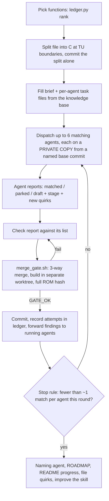

# Methodology: decompiling an N64 game with LLM agents

This decompilation was written almost entirely by LLM coding agents, run and supervised by one person. This document describes how: the setup that makes agent output trustworthy, the procedure the agents follow, what worked, what did not, and how to adapt it to another game. Every file it mentions ships in this repository.

## At a glance

| | |
|---|---|
| Duration | 2026-10-18 (first commit) to 2026-11-08 (last function matched): 22 days |
| Commits | ~2,530; the standing rule is that every commit rebuilds the retail ROM byte-for-byte |
| Result | 4,499 / 4,499 functions matched (1,716,180 bytes of C, 21,500 bytes of registered handwritten assembly) |
| Harness | [omp](https://github.com/can1357/oh-my-pi) (oh-my-pi coding agent): one orchestrator session plus up to 6 subagents |
| Models | Claude Sonnet and Opus, Gemini Flash, GPT (Codex) and others; recorded per attempt in `drafts/attempts.jsonl` |
| Human role | Starts and steers sessions, sets priorities and rules, reviews results and corrects the process |

Progress, from the README table in git history:

| Date | Code bytes matched | Functions |
|---|--:|--:|
| 2026-10-23 | 15.98% | 1,368 / 4,469 |
| 2026-10-25 | 37.50% | 2,615 / 4,503 |
| 2026-10-27 | 55.21% | 3,445 / 4,496 |
| 2026-10-29 | 73.01% | 3,976 / 4,497 |
| 2026-10-31 | 85.90% | 4,238 / 4,499 |
| 2026-11-02 | 93.96% | 4,354 / 4,499 |
| 2026-11-04 | 97.09% | 4,468 / 4,499 |
| 2026-11-06 | 98.38% | 4,487 / 4,499 |
| 2026-11-08 | 100.00% | 4,499 / 4,499 |

(The function total moved by a few dozen as function boundaries were corrected: hidden empty functions, false splits.) Most of the code went fast; the last 6% of bytes, after 2026-11-02, took more than a quarter of the calendar time.

## Why matching decompilation suits agents

A matching decomp has an automatic, unforgiving oracle: the C must compile with the original compiler (IDO 5.3 `-O2` for game code) to exactly the bytes in the ROM. An agent cannot talk its way past a SHA-1. That changes what you need to trust:

- You do not trust the agent's C. You trust the build: `tools/dk make` checks the text and data hash of every segment, then the whole ROM, and must end with `build/dk64.us.z64: OK`. No commit lands without it.
- What the hash cannot check is whether the C is honest: readable, behaviourally right, and free of tricks that only exist to steer the compiler. Most of the human review effort, and most of the process rules below, are about that gap.

## Foundations (before any agent work)

Agents multiply whatever the toolchain gives them, including its flakiness. These came first:

1. **A deterministic, containerised toolchain.** The `Dockerfile` image provides GNU MIPS binutils, IDO 5.3 and 7.1 (static recompilations), splat, asm-processor, m2c, asm-differ, decomp-permuter and GNU gzip 1.2.4, which reproduces the ROM's compressed segments (zlib and gzip 1.12 do not). Every build command runs through `tools/dk`, so host differences never reach a build.
2. **Per-segment hashes.** `*.sha1` covers boot, the decompressed global segment and the text and data of each of the nine overlays, so a failure points at one segment instead of "the ROM differs".
3. **A concurrency-safe build server.** `tools/dkd/` keeps one container per checkout and runs every `tools/dk` call under a reader/writer lock (per-object locks for single-object compiles, exclusive locks for `make split`). Under the earlier per-call `docker run` wrapper, parallel agents raced on shared build outputs.
4. **Per-object compare tools** against a snapshot of the expected objects (`expected/`, from `make expected`). `tools/objdiff.sh` rebuilds one shared object (`build/src/...o`) and compares it: safe in parallel on different files, not on the same file. `tools/fdiff.sh` compiles a private copy into `build/.scratch/` with the original's flags, so several agents can work on the same file at once without touching the shared build.

## The repository is the agents' memory

Agent sessions forget everything. Anything a later agent needs is a file in the repo:

| File | Role |
|---|---|
| `AGENTS.md` | Hard rules (no game data, every commit matches), build commands, the per-function matching method, conventions. Every agent reads it first. |
| `.omp/skills/decomp-unit/` | The orchestrator's procedure for one unit of work, plus the brief template every matching agent reads. Size-capped (≤150 lines per file, brief ≤180). |
| `knowledge/ido/` + `tools/quirks.py` | 588 IDO 5.3 quirks and 26 long-form guides, each tagged by compiler phase (cfe, uopt, ugen, as1, ...) and diff symptom (`regalloc`, `schedule`, `frame-size`, `width`, ...). Agents must query it before writing C, at every stage change, and whenever a diff stops shrinking. |
| `drafts/<segment>/<FUNC>.c` | In-progress C for unmatched functions, with a one-line note of the stage reached and the closest diff. The next agent starts from the draft, not from m2c. |
| `drafts/attempts.jsonl` + `tools/ledger.py` | An append-only log of every attempt on every function (agent, model, outcome, stage). It ranks what to try next and routes models. |
| `ROADMAP.md` | ROM map, per-file status, and the closest diff of anything left. |

The knowledge base matters most. IDO's behaviour is deterministic but poorly documented, and without a shared record each agent has to rediscover the same rules at full cost. Agents are required to look up quirks before experimenting and to report new ones in a fixed format (title, phase, symptom tags, one-paragraph rule naming the function). The orchestrator files each finding once (`quirks.py add`), and later briefs cite the entry IDs that apply to each function.

## One unit of work

The orchestrator (one long agent session following `.omp/skills/decomp-unit/SKILL.md`) runs one unit at a time:

The key mechanics:

- **Private copies, single integrator.** Matching agents never edit `src/`. Each copies its file from a named base commit into `.scratch/<Name>/`, compiles it with `tools/fdiff.sh`, and reports. Only the orchestrator changes `src/`, through `tools/merge_gate.sh`. That script 3-way-merges the copies (`tools/merge_drafts.py`), builds HEAD plus exactly those files in its own worktree and container, and commits only on `GATE_OK`. Several agents can work on one file at once, and a merge never waits on an agent's build.
- **Coverage checks.** `tools/unit_check.py coverage` rejects a dispatch where a function is in two agents' lists or in none.
- **Rolling dispatch.** Each agent is merged as soon as it reports, and its slot is refilled from the new HEAD with a concrete next step per function (the last diff, the knowledge IDs that apply), never a bare "continue".
- **Outcome gates, not time gates.** An agent's budget is its context and request cap. It stops when every assigned function is matched, or is back on its `GLOBAL_ASM` line with a saved draft and no untried idea.
- **The skill improves itself.** Each unit ends by folding what it taught about the procedure into the skill file that owns that phase, within the size caps, and appending a row to `run-log.md`. A manual check repeated across rounds becomes a `tools/` command, and its prose in the skill is replaced by that command.

## Matching a single function

`AGENTS.md` "Decompiling a function" is the method every agent follows. It is the 6-stage order from the OoT IDO guide: (1) behaviourally equivalent C, (2) basic-block order, (3) large reorderings, (4) same callee-saved registers and frame size, (5) small reorderings, (6) register allocation. Agents must report the stage they reached, not just an instruction count. Register-allocation tricks are worthless before stage 4, and agents left to themselves reach for them first.

The tools were built as the remaining functions got harder, each aimed at one compiler phase:

| Problem | Tool |
|---|---|
| Starting C | `tools/m2c.py`; `tools/similar.py` finds matched functions with a similar opcode sequence to copy idioms from |
| Wrong register choices (uopt) | `tools/uopt_trace.sh`: compiles with an IDO build that prints uopt's priority-based colouring trace |
| Right registers, wrong order or delay slots (as1) | `tools/as1probe.py`: keeps the back end's intermediate records and scans every single-record edit for the ones that produce the target |
| Same instructions, different `$tN` names (ugen) | `tools/ringfifo.py`: a model of ugen's scratch-register ring, checked against a corpus of compiled listings |
| Near-misses | `tools/deadsweep.py` (greedy dead-statement insertion against a reduced-TU score); `tools/permute.py` (decomp-permuter wrapper) |
| Behaviour and names | `tools/emu/`: ares emulator + GDB in Docker for coverage, breakpoints, warping and probing real calls |

Permuter and sweep output is treated as a hint, never pasted in. The idea is rewritten as readable C that keeps the asm's behaviour, and it goes through the normal gates.

## Keeping the C honest

The hash proves the bytes; these rules cover what it does not:

- **FAKE tags.** Any construct kept only to steer codegen (a dead `if (G) {}`, a `volatile`, `x ^ 0`) carries `// FAKE: <what it steers>` on its line. `grep -rn "// FAKE" src` is the debt list, and dedicated passes replace FAKEs with natural C (`knowledge/ido/guides/fake-match-removal.md`).
- **Parks.** C that is reviewed as behaviourally equivalent but will not match may be parked under `#ifdef NON_MATCHING` only at stage 4 or later, and still counts as unmatched. Agents park stage-2/3 C despite the brief, so the orchestrator checks the stage of every park.
- **No undefined behaviour.** Dead tests that read an uninitialised local on some path are rejected, even when they produce a match.
- **A park is not proof.** One parked "equivalent" clamp was a `min` where the asm computed a `max`. Fresh-eyes passes check branch sense first.
- **Unpark claims are re-verified.** A ROM gate passing does not prove the C was unparked. The orchestrator confirms the claimed match is in the plain C.
- **Agents never edit `knowledge/`, `tools/`, the Makefile or splat configs.** They report; the orchestrator integrates.

### The cleanup campaign

Once every function matched, the work became making the matched C readable without losing a byte (`.omp/skills/cleanup-unit/`). Every C function gets a recorded review in `drafts/quality/`, not just the tagged sites, because many hacks were never tagged: `tools/clint.py metrics` finds dead `if`s, no-op arithmetic, `volatile` locals, punned casts and gotos by AST. Each site climbs a fixed ladder of methods (automatic sweeps first, then diagnosis, permuter and rewrites); it counts as exhausted only when every method its kind requires has a fresh result, and results go stale when the function's source, its headers or the IDO knowledge about it change. Shared prototype headers generated from the definitions (`tools/protos.py`, `include/proto/`) replace per-file declarations; a declaration that still steers codegen stays visible as a tagged skip. Renames go through `tools/rename.py`, which refuses names that encode addresses and references hidden in macros. The campaign uses whatever model the user names per run, not the router.

## Choosing models

Early units used whatever model the session had. From 2026-10-29 on, every attempt was logged with its model, and `tools/ledger.py plan` picks a model per function by Thompson sampling over past outcomes, weighted by relative cost (`ARMS` in `tools/ledger.py`). It sends functions with 6+ tries, or of 400+ instructions, to stronger models alone, and holds functions that have no new evidence since their last failure. `.omp/extensions/decomp-router.ts` applies the chosen model when the subagent is spawned and logs the spawn to `drafts/spawns.jsonl`.

Logged attempts by model since the ledger started (2026-10-29 onward; most of the game was matched before that, so these numbers describe the harder second half):

| Model | Attempts | Matched |
|---|--:|--:|
| Claude Sonnet 5.5 | 1,066 | 383 (36%) |
| Gemini 3.8 Flash | 465 | 87 (19%) |
| Claude Opus 5.5 | 32 | 14 (44%) |
| GPT-6 Astra (Codex) | 21 | 10 (48%) |
| Claude Fable 5.1 | 11 | 3 (27%) |

Of all logged attempts, 1,073 ended in a parked near-miss and 630 unmatched with a saved draft; the next agent starts from those. Routing sends the hardest leftovers (6+ tries, 400+ instructions) to the strongest models, so their rates are not directly comparable with the others.

## Lessons

From `.omp/skills/decomp-unit/dispatch.md`, `.omp/skills/decomp-unit/run-log.md` and the ledger:

- **Re-dispatch on new evidence, not "try again".** Parks with two zero-yield passes later matched as soon as a new finding arrived. Re-prompts without a concrete next step yielded no matches.
- **Forward a finding at once.** When one agent derives a rule that unblocks a class of diffs, send it to the running siblings immediately, and give that diff class back to the agent that found it (one revisit: 4 matches in an hour this way).
- **Change method when spelling stalls.** In one unit, four typed-C passes in a row matched nothing; switching to near-miss agents that first brought each function to stage 4 (same blocks, frame and saved registers) and then ran a bounded permuter search matched 2–4 functions per pass. Later, revisits of old parks grouped by diff class, with each agent required to derive the responsible compiler rule before editing, produced four matches where blind retries had stalled. The last functions (up to 1,169 instructions) fell to tools that reproduce one compiler phase exactly (scratch-register ring, spill-temp slots, FP ring), not to search.
- **List sizes.** Round 1: ~500–1,000 instructions and ≤10 functions per agent; 14–20-function lists left half untouched. Functions over ~400 instructions get one agent each.
- **Check every report against its list.** Agents silently skipped functions, deleted another function's `GLOBAL_ASM` line, and parked stage-2 C. The merge tooling now refuses the second; the orchestrator's report checks catch the rest.
- **Keep a cheap worker running.** A provider usage-limit outage can stop every strong worker at once; merges, naming and bookkeeping can continue on a fast model.
- **Turn repeated manual checks into tools.** Most of `tools/unit_check.py` started as a paragraph in the skill.

## Limits

- **522 `// FAKE` markers** remain in `src/`: matched C that still contains tagged codegen steering, not yet natural C.
- **Names are agent-assigned** from code behaviour, emulator runs and context, and about 490 distinct `func_XXXXXXXX` symbols remain unnamed. Treat names as best guesses.
- **The ledger before 2026-10-29 is approximate**, back-filled from git history (`"approx": true`).
- **Architecture notes** referenced by the skill (`ok-fine` concepts) live in an external knowledge server and are not part of this repository; the skill's ok-fine steps can be skipped. Everything else the process needs is in the repo.

## Reusing this for another game

The game-specific parts are the splat configs, symbol files, `tools/extract.py` and `tools/compress.py`, `ROADMAP.md`, and the decomp-specific facts inside the skill. The rest transfers:

1. Get a byte-matching build of an all-assembly split first, with per-segment hashes, in a container.
2. Make concurrent builds safe (`tools/dkd/` pattern) and give agents per-file compare tools that work on private copies.
3. Write `AGENTS.md` with the hard rules and the matching method, and a short orchestration skill with a brief template.
4. Start the compiler knowledge base on day one, with symptom tags, and make lookups mandatory.
5. Log every attempt per function, and route work on that evidence.
6. Have every unit end by improving the procedure, under a size cap.

If your game uses IDO 5.3 or 7.1, `knowledge/ido/` applies largely as-is: start with `python3 tools/quirks.py tags` and the guides `decompile-function`, `staged-near-miss-finishing` and `large-functions-and-near-misses`.
