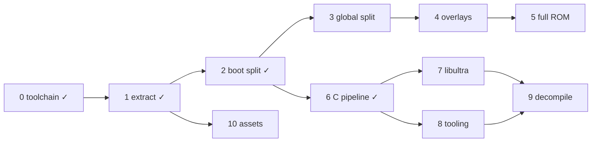

# DK64 Decompilation Roadmap

Target: Donkey Kong 64 (USA), `NDOE`, SHA-1 `cf806ff2603640a748fca5026ded28802f1f4a50`.
Compiler: IDO 5.3, `-O2 -mips2 -G 0`, libultra 2.0L, F3DEX2.

```sh
docker build -t dk64-decomp .   # once
tools/dk make setup             # extract ROM (BASEROM=donkey-kong.n64) + splat split
tools/dk make                   # build build/dk64.us.z64 and check SHA-1
```

## ROM map

Segment table at `0x8000DCC4`, 18 entries of 0x18 bytes:
`romStart, romEnd, vramStart, vramEnd, bssStart, bssEnd`.
ROM fields are written by boot (`0x80000764`); VRAM fields by `func_805FB300`.
Compressed segments are a gzip code member + gzip data member, zero-padded to `romEnd`.

| Table # | Name | ROM | VRAM | Notes |
|---|---|---|---|---|
| — | header / ipl3 | `0x0`–`0x1000` | — | CIC-6105 |
| — | entry | `0x1000`–`0x1050` | `0x80000400` | clears boot bss, jumps to `0x800009D0` |
| 0 | boot | `0x1050`–`0x11320` | `0x80000450` | uncompressed; text→`0x8000DCB0`, data `0xE8B0`, rodata `0x10F60`, bss `0x80010720`–`0x80016630` |
| — | rspboot | `0x11320`–`0x113F0` | — | RSP boot microcode |
| 1 | global | `0x113F0`–`0xCBE70` | `0x805FB300` | text 0x149160, data 0x1CBF0, bss `0x80761050`–`0x807FF100` |
| 2–9 | ovl02–ovl09 | `0xD4B00`–`0x101A40` | `0x80024000` | one overlay loaded at a time |
| 10 | ovl10 | `0xCBE70`–`0xD4B00` | `0x80024000` | |
| 12 | — | `0x101A40`–`0x101C50` | — | raw viewport/display list data |
| 11, 13–17 | assets | `0x101C50`–`0x1FED020` | — | ~8.7k gzip streams |

Full per-segment details (stream offsets, sizes, hashes, gzip header fields): `bin/layout.json` after `make setup`.

## Done

- [x] **0. Toolchain** — `Dockerfile` (IDO 5.3 recomp, binutils, splat 0.50.1, spimdisasm, asm-processor, asm-differ, m2c); `tools/dk` wrapper.
- [x] **1. Extraction** — `tools/extract.py`: any byte order → `baserom.us.z64` (SHA-1 checked); per-stream binaries in `bin/segments/`; `bin/layout.json`. Verifies gzip CRC/size and that `vram + text + data == bssStart` for every segment.
- [x] **2. Boot split** — `dk64.us.yaml` splits entry + boot into 93 files; rest of ROM is one blob. Full ROM rebuilds byte-identical.
- [x] **6. C pipeline** — `src/boot/main.c` compiled with IDO via asm-processor; `dmaCopy` (`0x80000450`) matched in C.

## To do

### 3. Global code split
- [ ] Separate splat config for `bin/segments/global.{text,data}.bin` at `0x805FB300`.
- [ ] Find the data / rodata boundary in `global.data.bin`; apply splat's file-boundary suggestions.
- [ ] Build the segment to its own ELF; compare extracted text/data against the SHA-1s in `bin/layout.json`.
- [ ] Shared symbols with boot (libultra calls such as `dmaCopy`) resolve to the same addresses.
- [ ] Name `func_805FB300` (segment table init) and the overlay loader (`0x806104B4` region).
- **Done when:** `make` checks full ROM SHA-1 *and* global text/data SHA-1s.

### 4. Overlay splits
- [ ] One splat config/linker output per overlay (`ovl02`–`ovl10`), all at `0x80024000`.
- [ ] Overlay-to-global references resolve through global's symbols.
- [ ] Identify each overlay's purpose and rename (`ovl02` → e.g. `menu`).
- **Done when:** every overlay's decompressed text/data matches.

### 5. Byte-identical ROM from decompressed segments
- [ ] `tools/compress.py`: gzip each built stream (header `mtime=0 xfl=2 os=3`) and place it at its original ROM offset with zero padding.
- [ ] Python zlib level 9 reproduces 11 of 20 code/data streams exactly; find settings for the other 9 (mostly data streams: same length, different bytes).
- [ ] Replace the `rom_rest` blob with built segments + assets.
- **Done when:** ROM SHA-1 matches with all code segments rebuilt from source.

### 7. libultra
- [ ] Identify remaining libultra functions in boot (and any in global); add to `symbol_addrs.us.txt`.
- [ ] Bring in libultra 2.0L headers (replace the minimal `include/ultra64.h`).
- [ ] Match libultra C against existing public libultra decomps; check per-file optimisation flags.
- **Done when:** all libultra functions are named, and matched or explicitly marked as handwritten asm.

### 8. Workflow tooling
- [ ] `diff.sh` (asm-differ) for per-function diffing.
- [ ] m2c helper to produce starter C for a given function.
- [ ] Progress report: matched vs total bytes per segment.
- [ ] Hardware register names (`hardware_regs: True` needs a definitions file).
- [ ] Optional CI: build in the container, check hashes.

### 9. Decompilation (ongoing)
Suggested order, one subsystem per unit of work:
- [ ] Boot: DMA, inflate (`func_800004B4`), boot thread, init.
- [ ] Scheduler, threads, message queues.
- [ ] Heap / memory allocator.
- [ ] Controller input.
- [ ] Main loop and map loading.
- [ ] Actors and behaviours.
- [ ] Overlays, smallest first.

### 10. Asset formats (independent)
- [ ] Decode the asset pointer tables (table entries 11, 13–17).
- [ ] Extractors/rebuilders for textures, models, text.
- **Done when:** assets extract to editable files and rebuild to identical bytes.

## Dependencies


