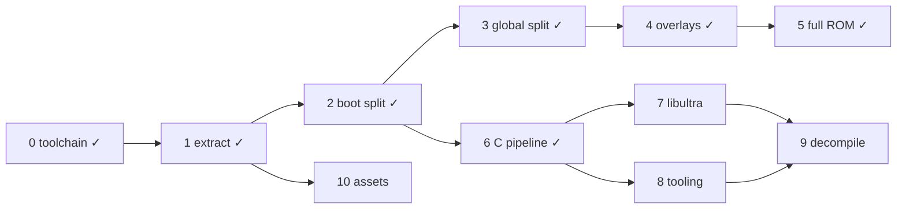

# DK64 Decompilation Roadmap

Target: Donkey Kong 64 (USA), `NDOE`, SHA-1 `cf806ff2603640a748fca5026ded28802f1f4a50`.
Compiler: IDO 5.3, `-O2 -mips2 -G 0`, libultra 2.0L, F3DEX2.

```sh
docker build -t dk64-decomp .   # once
tools/dk make setup             # extract ROM (BASEROM=donkey-kong.n64) + splat split
tools/dk make                   # build build/dk64.us.z64 and check SHA-1
```

## ROM map

Segment table at `0x8000DCC4`, 18 entries of 0x18 bytes:
`romStart, romEnd, vramStart, vramEnd, bssStart, bssEnd`.
ROM fields are written by boot (`0x80000764`); VRAM fields by `func_805FB300`.
Compressed segments are a gzip code member + gzip data member, zero-padded to `romEnd`.

| Table # | Name | ROM | VRAM | Notes |
|---|---|---|---|---|
| — | header / ipl3 | `0x0`–`0x1000` | — | CIC-6105 |
| — | entry | `0x1000`–`0x1050` | `0x80000400` | clears boot bss, jumps to `0x800009D0` |
| 0 | boot | `0x1050`–`0x11320` | `0x80000450` | uncompressed; text→`0x8000DCB0`, data `0xE8B0`, rodata `0x10F60`, bss `0x80010720`–`0x80016630` |
| — | rspboot | `0x11320`–`0x113F0` | — | RSP boot microcode |
| 1 | global | `0x113F0`–`0xCBE70` | `0x805FB300` | text 0x149160, data 0x1CBF0, bss `0x80761050`–`0x807FF100` |
| 2 | multiplayer (`ovl02`) | `0xD4B00`–`0xD6B00` | `0x80024000` | game mode 3 |
| 3 | minecart (`ovl03`) | `0xD6B00`–`0xD9A40` | `0x80024000` | mode 4 |
| 4 | bonus (`ovl04`) | `0xD9A40`–`0xDF600` | `0x80024000` | mode 8: bonus barrels |
| 5 | race (`ovl05`) | `0xDF600`–`0xE6780` | `0x80024000` | mode 5 |
| 6 | critter (`ovl06`) | `0xE6780`–`0xEA0B0` | `0x80024000` | mode 6 |
| 7 | boss (`ovl07`) | `0xEA0B0`–`0xF41A0` | `0x80024000` | mode 7 |
| 8 | arcade (`ovl08`) | `0xF41A0`–`0xFD2F0` | `0x80024000` | mode 9: DK arcade, data holds the arcade assets |
| 9 | jetpac (`ovl09`) | `0xFD2F0`–`0x101A40` | `0x80024000` | mode 10 |
| 10 | menu (`ovl10`) | `0xCBE70`–`0xD4B00` | `0x80024000` | mode 2: main menu / file select |
| 12 | — | `0x101A40`–`0x101C50` | — | raw viewport/display list data |
| 11, 13–17 | assets | `0x101C50`–`0x1FED020` | — | ~8.7k gzip streams |

Full per-segment details (stream offsets, sizes, hashes, gzip header fields): `bin/layout.json` after `make setup`.

## Done

- [x] **0. Toolchain** — `Dockerfile` (IDO 5.3 recomp, binutils, splat 0.50.1, spimdisasm, asm-processor, asm-differ, m2c); `tools/dk` wrapper.
- [x] **1. Extraction** — `tools/extract.py`: any byte order → `baserom.us.z64` (SHA-1 checked); per-stream binaries in `bin/segments/`; `bin/layout.json`. Verifies gzip CRC/size and that `vram + text + data == bssStart` for every segment.
- [x] **2. Boot split** — `dk64.us.yaml` splits entry + boot into 93 files; rest of ROM is one blob. Full ROM rebuilds byte-identical.
- [x] **6. C pipeline** — `src/boot/main.c` compiled with IDO via asm-processor; `dmaCopy` (`0x80000450`) matched in C.
- [x] **3. Global code split** — `dk64.global.us.yaml` splits `bin/segments/global.bin` (text‖data, concatenated by `make split`) into 144 text files + data/rodata (`0x15B390`, VRAM `0x80756690`)/bss; linked to `build/global.elf` with `--just-symbols=build/dk64.us.elf` so boot symbols resolve to the same addresses. `make` checks the ROM and `dk64.global.us.sha1` (text + data). Named `globalInit` (`0x805FB300`: fills segment-table VRAM fields, starts PI manager and the main thread) and `loadOverlay` (`0x80610350`: maps the mode byte at `0x8074450C` to overlay 2–10, lays out the heap after it, clears its bss and loads it via `0x8060B140`).
- [x] **4. Overlay splits** — one splat config per overlay (`dk64.<name>.us.yaml`, segment id `ovlNN` kept for `bin/segments/`), all at `0x80024000`; each links to `build/<name>.elf` with `--just-symbols` of global and boot ELFs, is cut at its text size and checked against `dk64.<name>.us.sha1`. Overlay-local names go in `symbol_addrs.<name>.us.txt` (addresses collide across overlays). `loadOverlay` maps game mode (`0x8074450C`) 2→menu, 3→multiplayer, 4→minecart, 5→race, 6→critter, 7→boss, 8→bonus, 9→arcade, 10→jetpac; modes 0–1 load none. Text files: multiplayer 1, minecart 2, bonus 4, race 7, critter 2, boss 9, arcade 1, jetpac 5, menu 4. Data/rodata split everywhere except boss, whose rodata starts at `0x11CC8` (not 16-aligned; a separate subsegment gets `ALIGN(16)` padding), so it stays one `data` subsegment.

- [x] **5. ROM from rebuilt segments** — `dk64.us.yaml` now ends at `0x113F0` (boot ELF only). `tools/compress.py` gzips each built text/data stream with GNU gzip 1.2.4 `-9 -n` (built in the Dockerfile; reproduces all 20 members, while zlib matched 11 and gzip 1.12 matched 18) and zero-pads to the segment's ROM size. `make` assembles `build/dk64.us.z64` = `build/boot.bin` + global, menu, multiplayer … jetpac (ROM order) + `bin/segments/table12.bin` + `bin/segments/assets.bin` (raw tail from `extract.py`). ROM SHA-1 matches with every code segment rebuilt from source.

## To do

### 7. libultra
- [ ] Identify remaining libultra functions in boot (and any in global); add to `symbol_addrs.us.txt`.
- [ ] Bring in libultra 2.0L headers (replace the minimal `include/ultra64.h`).
- [ ] Match libultra C against existing public libultra decomps; check per-file optimisation flags.
- **Done when:** all libultra functions are named, and matched or explicitly marked as handwritten asm.

### 8. Workflow tooling
- [ ] `diff.sh` (asm-differ) for per-function diffing.
- [ ] m2c helper to produce starter C for a given function.
- [ ] Progress report: matched vs total bytes per segment.
- [ ] Hardware register names (`hardware_regs: True` needs a definitions file).
- [ ] Optional CI: build in the container, check hashes.

### 9. Decompilation (ongoing)
Suggested order, one subsystem per unit of work:
- [ ] Boot: DMA, inflate (`func_800004B4`), boot thread, init.
- [ ] Scheduler, threads, message queues.
- [ ] Heap / memory allocator.
- [ ] Controller input.
- [ ] Main loop and map loading.
- [ ] Actors and behaviours.
- [ ] Overlays, smallest first.

### 10. Asset formats (independent)
- [ ] Decode the asset pointer tables (table entries 11, 13–17).
- [ ] Extractors/rebuilders for textures, models, text.
- **Done when:** assets extract to editable files and rebuild to identical bytes.

## Dependencies


