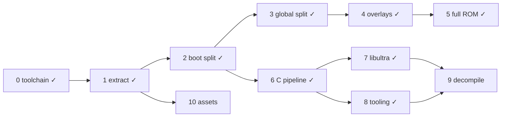

# DK64 Decompilation Roadmap

Target: Donkey Kong 64 (USA), `NDOE`, SHA-1 `cf806ff2603640a748fca5026ded28802f1f4a50`.
Compiler: IDO 5.3, `-O2 -mips2 -G 0`, libultra 2.0J, F3DEX2.

```sh
docker build -t dk64-decomp .   # once
tools/dk make setup             # extract ROM (BASEROM=donkey-kong.n64) + splat split
tools/dk make                   # build build/dk64.us.z64 and check SHA-1
```

## ROM map

Segment table at `0x8000DCC4`, 18 entries of 0x18 bytes:
`romStart, romEnd, vramStart, vramEnd, bssStart, bssEnd`.
ROM fields are written by boot (`0x80000764`); VRAM fields by `func_805FB300`.
Compressed segments are a gzip code member + gzip data member, zero-padded to `romEnd`.

| Table # | Name | ROM | VRAM | Notes |
|---|---|---|---|---|
| — | header / ipl3 | `0x0`–`0x1000` | — | CIC-6105 |
| — | entry | `0x1000`–`0x1050` | `0x80000400` | clears boot bss, jumps to `0x800009D0` |
| 0 | boot | `0x1050`–`0x11320` | `0x80000450` | uncompressed; text→`0x8000DCB0`, data `0xE8B0`, rodata `0x10F60`, bss `0x80010720`–`0x80016630` |
| — | rspboot | `0x11320`–`0x113F0` | — | RSP boot microcode |
| 1 | global | `0x113F0`–`0xCBE70` | `0x805FB300` | text 0x149160, data 0x1CBF0, bss `0x80761050`–`0x807FF100` |
| 2 | multiplayer (`ovl02`) | `0xD4B00`–`0xD6B00` | `0x80024000` | game mode 3 |
| 3 | minecart (`ovl03`) | `0xD6B00`–`0xD9A40` | `0x80024000` | mode 4 |
| 4 | bonus (`ovl04`) | `0xD9A40`–`0xDF600` | `0x80024000` | mode 8: bonus barrels |
| 5 | race (`ovl05`) | `0xDF600`–`0xE6780` | `0x80024000` | mode 5 |
| 6 | critter (`ovl06`) | `0xE6780`–`0xEA0B0` | `0x80024000` | mode 6 |
| 7 | boss (`ovl07`) | `0xEA0B0`–`0xF41A0` | `0x80024000` | mode 7 |
| 8 | arcade (`ovl08`) | `0xF41A0`–`0xFD2F0` | `0x80024000` | mode 9: DK arcade, data holds the arcade assets |
| 9 | jetpac (`ovl09`) | `0xFD2F0`–`0x101A40` | `0x80024000` | mode 10 |
| 10 | menu (`ovl10`) | `0xCBE70`–`0xD4B00` | `0x80024000` | mode 2: main menu / file select |
| 12 | — | `0x101A40`–`0x101C50` | — | raw viewport/display list data |
| 11, 13–17 | assets | `0x101C50`–`0x1FED020` | — | ~8.7k gzip streams |

Full per-segment details (stream offsets, sizes, hashes, gzip header fields): `bin/layout.json` after `make setup`.

## Done

- [x] **0. Toolchain** — `Dockerfile` (IDO 5.3 recomp, binutils, splat 0.50.1, spimdisasm, asm-processor, asm-differ, m2c); `tools/dk` wrapper.
- [x] **1. Extraction** — `tools/extract.py`: any byte order → `baserom.us.z64` (SHA-1 checked); per-stream binaries in `bin/segments/`; `bin/layout.json`. Verifies gzip CRC/size and that `vram + text + data == bssStart` for every segment.
- [x] **2. Boot split** — `dk64.us.yaml` splits entry + boot into 93 files; rest of ROM is one blob. Full ROM rebuilds byte-identical.
- [x] **6. C pipeline** — `src/boot/main.c` compiled with IDO via asm-processor; `dmaCopy` (`0x80000450`) matched in C.
- [x] **3. Global code split** — `dk64.global.us.yaml` splits `bin/segments/global.bin` (text‖data, concatenated by `make split`) into 144 text files + data/rodata (`0x15B390`, VRAM `0x80756690`)/bss; linked to `build/global.elf` with `--just-symbols=build/dk64.us.elf` so boot symbols resolve to the same addresses. `make` checks the ROM and `dk64.global.us.sha1` (text + data). Named `globalInit` (`0x805FB300`: fills segment-table VRAM fields, starts PI manager and the main thread) and `loadOverlay` (`0x80610350`: maps the mode byte at `0x8074450C` to overlay 2–10, lays out the heap after it, clears its bss and loads it via `0x8060B140`).
- [x] **4. Overlay splits** — one splat config per overlay (`dk64.<name>.us.yaml`, segment id `ovlNN` kept for `bin/segments/`), all at `0x80024000`; each links to `build/<name>.elf` with `--just-symbols` of global and boot ELFs, is cut at its text size and checked against `dk64.<name>.us.sha1`. Overlay-local names go in `symbol_addrs.<name>.us.txt` (addresses collide across overlays). `loadOverlay` maps game mode (`0x8074450C`) 2→menu, 3→multiplayer, 4→minecart, 5→race, 6→critter, 7→boss, 8→bonus, 9→arcade, 10→jetpac; modes 0–1 load none. Text files: multiplayer 1, minecart 2, bonus 4, race 7, critter 2, boss 9, arcade 1, jetpac 5, menu 4. Data/rodata split everywhere except boss, whose rodata starts at `0x11CC8` (not 16-aligned; a separate subsegment gets `ALIGN(16)` padding), so it stays one `data` subsegment.

- [x] **5. ROM from rebuilt segments** — `dk64.us.yaml` now ends at `0x113F0` (boot ELF only). `tools/compress.py` gzips each built text/data stream with GNU gzip 1.2.4 `-9 -n` (built in the Dockerfile; reproduces all 20 members, while zlib matched 11 and gzip 1.12 matched 18) and zero-pads to the segment's ROM size. `make` assembles `build/dk64.us.z64` = `build/boot.bin` + global, menu, multiplayer … jetpac (ROM order) + `bin/segments/table12.bin` + `bin/segments/assets.bin` (raw tail from `extract.py`). ROM SHA-1 matches with every code segment rebuilt from source.

- [x] **8. Workflow tooling** — `tools/dk ./diff.sh [-s SEGMENT] FUNC` runs asm-differ per function (`diff_settings.py` maps each segment to its map file, built image and original bytes: boot `build/boot.bin` vs `baserom.us.z64`, global/overlays `build/<name>.bin` vs `bin/segments/<stream>.bin`; `-n` skips the rebuild). `tools/dk python3 tools/m2c.py [-s SEGMENT] FUNC` prints m2c starter C (nonmatchings or whole-file asm, referenced rodata files, context preprocessed from `include/common.h` into `build/m2c_ctx.c`). `tools/dk make progress` (`tools/progress.py`, `--json`) reports matched/total function bytes per segment. `hardware_regs: True` in every splat config; the 131 spimdisasm register names are linker symbols in `undefined_syms.us.txt`. CI dropped: single contributor, the local `make` hash check already gates every commit, and a hash-checking CI job would need the ROM hosted at a private URL.

- [x] **7. libultra** — DK64 links libultra **2.0J** (`BUILD_VERSION=VERSION_J`): J-only features present (pfs inode cache, separate `pfsselectbank.c`, `__osPfsLastChannel`, `__MotorDataBuf`, 2-arg `__osPfsRequestOneChannel`, `__osEPi*` names) and K/L ones absent (`guMtxXFML` still in `mtxcatl.c`, no `__osEepromRead16K`). Headers are decompals/ultralib's (`include/PR`, `include/PRinternal`, `include/libultra`, `include/compiler/ido`). Boot libultra spans ROM `0x5120`–`0xE8B0`; every C-sourced file is `src/boot/libultra/<ultralib dir>/<file>.c` with its own `.data`/`.rodata`/`.bss` subsegments, compiled with ultralib's J flags by path (Makefile; `io/` files that need `-O1` are listed there). The 23 handwritten-asm files stay splat asm under `asm/libultra/` (`os/exceptasm`, `os/interrupt`, cache/TLB/SR/FPCSR/intmask/compare helpers, `libc/bcopy`/`bcmp`/`bzero`, `gu/sqrtf`). The original identification mislabeled several files (gu shift, sinf/cosf, controller/pfsisplug, getthreadpri/id, vimgr, epirawdma, VI modes, PIF RAM buffers); names now follow code behaviour and data contents. Global holds no libultra; it holds the n_audio library (named in `symbol_addrs.us.txt`, not ultralib). Per-object compare for concurrent matching: `tools/objdiff.sh src/....c` against `expected/` snapshots.

## To do

### 9. Decompilation (ongoing)
Suggested order, one subsystem per unit of work:
- [ ] Boot game code (ROM `0x1050`–`0x5120`, `0x6690`): C in `src/boot/{main,1630,1CC0,30E0,3630,3D20,6690}.c`, boot at 79.6% of function bytes. Matched: `dmaCopy`, `bootMain`, boot threads and init (`bootMainThread` fills `gSegmentTable` from per-segment `<seg>_ROM_START/END` linker symbols in `undefined_syms.us.txt`, one name per reference), the "Expansion Pak not installed" screen (`noExpPak*`, `bootDrawString/Glyph`), gzip 1.2.4 inflate (`huft_build` … `inflate`, `gunzip`, `get_method`), Rare libc (`_str*`, `_memset`, `_itoa`, `_sprintf`). Hand-written asm, kept as splat `asm`: `memcpy` (`0x3C00`, `ld`/`sd`) and the LZ bit-stream decoder at `0x3390`–`0x3630`. Remaining: `vsprintf` (best draft is 8 instructions off; IDO caches the non-volatile `%e` `value` in a register in the full function but not in reduced tests).
- [ ] Scheduler, threads, message queues (global): `src/global/0.c` (`0x805FB300`, main-thread init, display-list setup) and `src/global/131B0.c` (`0x8060E4B0`, rumble pak + RCP scheduler) are C units with their own `data` (named asm) and, for 131B0, `.rodata` subsegments. 41 of 55 functions matched (13,596 bytes in global; +22 functions matched this unit including `func_805FD088` [1220 insns], `func_805FC2B0`, `func_805FE7FC`, `schedCreate`, `schedHandleRDP`, `schedTaskDone`, `schedAppendTask`, `rumbleMotorStop`, `func_8060EA28`). Remaining 14 GLOBAL_ASM: `0.c` `globalInit` (store ordering), `func_805FB5C4` (needs TU BSS for D_807655E8), `func_805FB944` (1 insn off), `func_805FBFF4` (epilogue .align 5 padding shift), `func_805FC668` (needs TU data for D_807445C0), `func_805FCA94` (5 insns off); `131B0.c` `func_8060E6E8` (delay slot swap), `schedMain` (`func_8060EE60`, 1 insn off), `func_8060F208` (needs TU BSS for D_807F04D0), `func_8060F254` (dead s2 assignment), `func_8060F54C` (11 insns), `schedStartTask` (`func_8060F960`, needs TU BSS for D_807F0508), `schedYield` (`func_8060FA5C`, needs TU BSS for D_807F04C0), `func_8060FAE4` (2 insns off).
- [ ] Heap / memory allocator.
- [ ] Controller input.
- [ ] Main loop and map loading.
- [ ] Actors and behaviours.
- [ ] n_audio (global `0x80732420`–`0x807412B4`): libnaudio, not in ultralib; needs its own reference source (the n_audio used by other Rare decomps) and has Rare changes.
- [ ] Overlays, smallest first.

### 10. Asset formats (independent)
- [ ] Decode the asset pointer tables (table entries 11, 13–17).
- [ ] Extractors/rebuilders for textures, models, text.
- **Done when:** assets extract to editable files and rebuild to identical bytes.

## Dependencies


