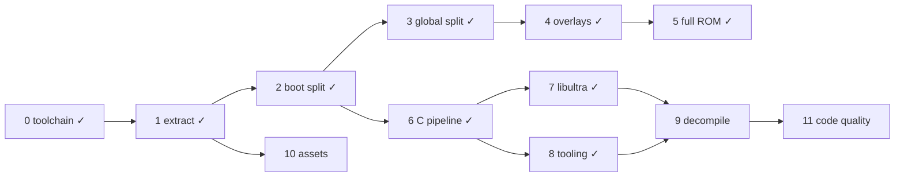

# DK64 Decompilation Roadmap

Target: Donkey Kong 64 (USA), `NDOE`, SHA-1 `cf806ff2603640a748fca5026ded28802f1f4a50`.
Compiler: IDO 5.3, `-O2 -mips2 -G 0`, libultra 2.0J, F3DEX2.

```sh
docker build -t dk64-decomp .   # once
tools/dk make setup             # extract ROM (BASEROM=donkey-kong.n64) + splat split
tools/dk make                   # build build/dk64.us.z64 and check SHA-1
```

## ROM map

Segment table at `0x8000DCC4`, 18 entries of 0x18 bytes:
`romStart, romEnd, vramStart, vramEnd, bssStart, bssEnd`.
ROM fields are written by boot (`0x80000764`); VRAM fields by `globalInit`.
Compressed segments are a gzip code member + gzip data member, zero-padded to `romEnd`.

| Table # | Name | ROM | VRAM | Notes |
|---|---|---|---|---|
| — | header / ipl3 | `0x0`–`0x1000` | — | CIC-6105 |
| — | entry | `0x1000`–`0x1050` | `0x80000400` | clears boot bss, jumps to `0x800009D0` |
| 0 | boot | `0x1050`–`0x11320` | `0x80000450` | uncompressed; text→`0x8000DCB0`, data `0xE8B0`, rodata `0x10F60`, bss `0x80010720`–`0x80016630` |
| — | rspboot | `0x11320`–`0x113F0` | — | RSP boot microcode |
| 1 | global | `0x113F0`–`0xCBE70` | `0x805FB300` | text 0x149160, data 0x1CBF0, bss `0x80761050`–`0x807FF100` |
| 2 | multiplayer (`ovl02`) | `0xD4B00`–`0xD6B00` | `0x80024000` | game mode 3 |
| 3 | minecart (`ovl03`) | `0xD6B00`–`0xD9A40` | `0x80024000` | mode 4 |
| 4 | bonus (`ovl04`) | `0xD9A40`–`0xDF600` | `0x80024000` | mode 8: bonus barrels |
| 5 | race (`ovl05`) | `0xDF600`–`0xE6780` | `0x80024000` | mode 5 |
| 6 | critter (`ovl06`) | `0xE6780`–`0xEA0B0` | `0x80024000` | mode 6 |
| 7 | boss (`ovl07`) | `0xEA0B0`–`0xF41A0` | `0x80024000` | mode 7 |
| 8 | arcade (`ovl08`) | `0xF41A0`–`0xFD2F0` | `0x80024000` | mode 9: DK arcade, data holds the arcade assets |
| 9 | jetpac (`ovl09`) | `0xFD2F0`–`0x101A40` | `0x80024000` | mode 10 |
| 10 | menu (`ovl10`) | `0xCBE70`–`0xD4B00` | `0x80024000` | mode 2: main menu / file select |
| 12 | — | `0x101A40`–`0x101C50` | — | raw viewport/display list data |
| 11, 13–17 | assets | `0x101C50`–`0x1FED020` | — | ~8.7k gzip streams |

Full per-segment details (stream offsets, sizes, hashes, gzip header fields): `bin/layout.json` after `make setup`.

## Done

- [x] **0. Toolchain** — `Dockerfile` (IDO 5.3 recomp, binutils, splat 0.50.1, spimdisasm, asm-processor, asm-differ, m2c); `tools/dk` wrapper.
- [x] **1. Extraction** — `tools/extract.py`: any byte order → `baserom.us.z64` (SHA-1 checked); per-stream binaries in `bin/segments/`; `bin/layout.json`. Verifies gzip CRC/size and that `vram + text + data == bssStart` for every segment.
- [x] **2. Boot split** — `dk64.us.yaml` splits entry + boot into 93 files; rest of ROM is one blob. Full ROM rebuilds byte-identical.
- [x] **6. C pipeline** — `src/boot/main.c` compiled with IDO via asm-processor; `dmaCopy` (`0x80000450`) matched in C.
- [x] **3. Global code split** — `dk64.global.us.yaml` splits `bin/segments/global.bin` (text‖data, concatenated by `make split`) into 144 text files + data/rodata (`0x15B390`, VRAM `0x80756690`)/bss; linked to `build/global.elf` with `--just-symbols=build/dk64.us.elf` so boot symbols resolve to the same addresses. `make` checks the ROM and `dk64.global.us.sha1` (text + data). Named `globalInit` (`0x805FB300`: fills segment-table VRAM fields, starts PI manager and the main thread) and `loadOverlay` (`0x80610350`: maps the overlay index in `$a1` to overlay 2–10, lays out the framebuffers and heap after it (sizes from the video-mode byte `0x8074450C`), clears its bss and loads it via `0x8060B140`).
- [x] **4. Overlay splits** — one splat config per overlay (`dk64.<name>.us.yaml`, segment id `ovlNN` kept for `bin/segments/`), all at `0x80024000`; each links to `build/<name>.elf` with `--just-symbols` of global and boot ELFs, is cut at its text size and checked against `dk64.<name>.us.sha1`. Overlay-local names go in `symbol_addrs.<name>.us.txt` (addresses collide across overlays). `loadOverlay`'s index (`$a1`) maps 2→menu, 3→multiplayer, 4→minecart, 5→race, 6→critter, 7→boss, 8→bonus, 9→arcade, 10→jetpac; 0–1 load none. Its caller `viModeSetup` picks the index from `D_807444EC` (3→arcade, 4→jetpac) or the per-map flags `D_807FBB64` (emulator traces, 2026-10-22: `0x1000` critter, `0x1` boss, `0x40000000` menu); `D_80744470` holds the aligned end of the loaded overlay (`0x80024000` = none). Text files: multiplayer 1, minecart 2, bonus 4, race 7, critter 2, boss 9, arcade 1, jetpac 5, menu 4. Data/rodata split everywhere except boss, whose rodata starts at `0x11CC8` (not 16-aligned; a separate subsegment gets `ALIGN(16)` padding), so it stays one `data` subsegment.

- [x] **5. ROM from rebuilt segments** — `dk64.us.yaml` now ends at `0x113F0` (boot ELF only). `tools/compress.py` gzips each built text/data stream with GNU gzip 1.2.4 `-9 -n` (built in the Dockerfile; reproduces all 20 members, while zlib matched 11 and gzip 1.12 matched 18) and zero-pads to the segment's ROM size. `make` assembles `build/dk64.us.z64` = `build/boot.bin` + global, menu, multiplayer … jetpac (ROM order) + `bin/segments/table12.bin` + `bin/segments/assets.bin` (raw tail from `extract.py`). ROM SHA-1 matches with every code segment rebuilt from source.

- [x] **8. Workflow tooling** — `tools/dk ./diff.sh [-s SEGMENT] FUNC` runs asm-differ per function (`diff_settings.py` maps each segment to its map file, built image and original bytes: boot `build/boot.bin` vs `baserom.us.z64`, global/overlays `build/<name>.bin` vs `bin/segments/<stream>.bin`; `-n` skips the rebuild). `tools/dk python3 tools/m2c.py [-s SEGMENT] FUNC` prints m2c starter C (nonmatchings or whole-file asm, referenced rodata files, context preprocessed from `include/common.h` into `build/m2c_ctx.c`). `tools/dk make progress` (`tools/progress.py`, `--json`) reports matched/total function bytes per segment. `tools/permute.py setup/run/best` wraps decomp-permuter (`/opt/decomp-permuter`) for near-miss search hints with `--stack-diffs` and `--stop-on-zero`. `tools/uopt_trace.sh [-l LEVEL] [-s src/...c] <file.c> [FUNC]` traces IDO 5.3 uopt priority-based register coloring via `/opt/ido5.3-trace` (`tools/ido/ecvt_fcvt.patch`, `-Wo,-zdbug:LEVEL`). Reviewed behaviourally equivalent C near-misses park under `#ifdef NON_MATCHING`; `tools/dk make NON_MATCHING=1` builds into `build_nonmatching/` without hash check (default `make` remains the sole matching gate; `make expected`/`progress` refuse `NON_MATCHING=1`). `hardware_regs: True` in every splat config; the 131 spimdisasm register names are linker symbols in `undefined_syms.us.txt`. CI dropped: single contributor, the local `make` hash check already gates every commit, and a hash-checking CI job would need the ROM hosted at a private URL.

- [x] **7. libultra** — DK64 links libultra **2.0J** (`BUILD_VERSION=VERSION_J`): J-only features present (pfs inode cache, separate `pfsselectbank.c`, `__osPfsLastChannel`, `__MotorDataBuf`, 2-arg `__osPfsRequestOneChannel`, `__osEPi*` names) and K/L ones absent (`guMtxXFML` still in `mtxcatl.c`, no `__osEepromRead16K`). Headers are decompals/ultralib's (`include/PR`, `include/PRinternal`, `include/libultra`, `include/compiler/ido`). Boot libultra spans ROM `0x5120`–`0xE8B0`; every C-sourced file is `src/boot/libultra/<ultralib dir>/<file>.c` with its own `.data`/`.rodata`/`.bss` subsegments, compiled with ultralib's J flags by path (Makefile; `io/` files that need `-O1` are listed there). The 23 handwritten-asm files stay splat asm under `asm/libultra/` (`os/exceptasm`, `os/interrupt`, cache/TLB/SR/FPCSR/intmask/compare helpers, `libc/bcopy`/`bcmp`/`bzero`, `gu/sqrtf`). The original identification mislabeled several files (gu shift, sinf/cosf, controller/pfsisplug, getthreadpri/id, vimgr, epirawdma, VI modes, PIF RAM buffers); names now follow code behaviour and data contents. Global holds no libultra; it holds the n_audio library (named in `symbol_addrs.us.txt`, not ultralib). Per-object compare for concurrent matching: `tools/objdiff.sh src/....c` against `expected/` snapshots.

- [x] **11. Emulator tooling** — Docker sessions running ares-64 with GDB server (port 9123), Xvfb/x11vnc (port 5900, password `dk64`), session CLI (`tools/emu/emu.py`), save-state library (`tools/emu/states.py`), map warping and map sweeps via `func_805FF378` safe-point infcall (`tools/emu/warp.py`), dynamic breakpoint coverage (`tools/emu/coverage.py`), and function tracing and argument inspection (`tools/emu/study.py`). Symbol resolution and overlay detection in `tools/emu/symbols.py`. Session runtime output in `emu/` (gitignored). Skill at `.omp/skills/emulator/`.

- [x] **Handwritten assembly accounting** — `handwritten_asm.json` records the reviewed generated-assembly files and why they are not C targets. Progress counts their ELF function bytes as matched, separately from compiled C: 37 boot functions (6,092 bytes) and 51 global functions (15,392 bytes), including RSP DMA helper `func_80742E9C`. Overall matching completion is 97.60%; boot is 100%, global 97.10%. Assets, embedded data and padding remain excluded. Unlisted assembly and `GLOBAL_ASM` C placeholders remain unmatched, and `tools/similar.py` still searches only compiled C.

## To do

### 9. Decompilation (ongoing)
Near-miss and large-function work now follows the stage order with uopt_trace and the permuter. Suggested order, one subsystem per unit of work:
- [ ] **Codegen-hack removal (ongoing)** — 2026-11-04 focused global pass removed **9 tagged constructs plus one untagged empty guard**, without new hacks or moving matched C back to asm. Natural replacements: direct `cur->next` traversal in `heapFreeToPool` (`15050.c`), useful translation work instead of self-assignment in `mtxLookDirPosF` (`110F00.c`), redundant byte casts in `collisionTestGridMeshHeight` (`6AD90.c`), reuse of the preceding light-bound calculation in `lightCollectVolumesInBounds` (`5E2F0.c`), three redundant guards in `commandApplyToLight` (`126260.c`), standard `gDPSetPrimColor` macros in `func_80713764` / `func_80713B40` (`117190.c`), and an empty guard in `hudPauseMenuSlidePage` (`ACDC0.c`). Forced all 304 C sources through the matching rebuild: all segment hashes and `build/dk64.us.z64: OK`; all seven changed files also compile with `NON_MATCHING`. Inventory at completion: 687 `// FAKE` lines, down from 715; the other 19 disappeared through a concurrent unpark and are not removals credited to this pass. Remaining dead reads / no-op clusters still affect IDO live ranges and scheduling; failed deletion is a local blocker, not proof that natural C cannot match. Shared-type/signature changes need a separate caller audit; parked bodies were not cleanup targets.
  - **2026-11-05 campaign:** natural replacements landed in `126260`, `17B90`, `11BC10`, `89250`, `54150`, `A2F10`, `68AA0`, `6AD90`, `70FD0`, `80150`, `69E60`, and `1292F0`: real byte types, struct members, callee prototypes and named scalar/pointer locals. The false `matrix4Invert` prototype tag was removed separately; `modelAnimEntryBuildKeyMatrix` is now FAKE-free and scheduler/controller parks lost obsolete constraints. Live inventory is 672 `// FAKE` lines versus 688 at the git campaign base (`9b5df902`); this net change also includes new/improved parks and is not the count of verified removals.
- [x] Boot game code (ROM `0x1050`–`0x5120`, `0x6690`): C in `src/boot/{main,1630,1CC0,30E0,3630,3D20,6690}.c`, boot at 88.7% of function bytes (including libultra). Matched: `dmaCopy`, `bootMain`, boot threads and init (`bootMainThread` fills `gSegmentTable` from per-segment `<seg>_ROM_START/END` linker symbols in `undefined_syms.us.txt`, one name per reference), the "Expansion Pak not installed" screen (`noExpPak*`, `bootDrawString/Glyph`), gzip 1.2.4 inflate (`huft_build` … `inflate`, `gunzip`, `get_method`), Rare libc (`_str*`, `_memset`, `_itoa`, `_sprintf`, `vsprintf`). Hand-written asm retained: `memcpy` (`0x3C00`, `ld`/`sd`) and the LZ bit-stream decoder at `0x3390`–`0x3630`. **2026-11-04:** `vsprintf` matched by moving the five numeric-arm `end` initializations to the shared `numout` label; the final `%p` delay-slot mismatch disappears without new codegen hacks. Its three strings are explicit C-owned const arrays preserving `.rodata` order and padding; obsolete draft removed. Full ROM gate OK.
- [x] Scheduler, threads, message queues (global): **55/55 matched**: `0.c` 2/2, `450.c` 23/23, `131B0.c` 14/14, `13980.c` 16/16. Hidden TUs: `450` starts at `seg11DmaRead` (`0x805FB750`, `.rodata` `0x15B290`–`0x15B2E0`); `13980` starts at `0x8060EC80`, after `schedMain`'s `.align 5` tail. C-owned data/bss includes `0.c` data `0x149160` / bss `0x80761050`, rumble bss `0x807F02D0`–`0x807F0570`, and `13980` data `0x14B520`–`0x14B730`. Main-thread, rumble and scheduler dispatch functions are complete, including `schedMain`. `schedDlDebugDump` (323 instructions, frame 0xB8) matched 2026-11-06 (full ROM gate OK, no parks remain): its statics are function-local in original address order (528-byte `.data`), and the last text diff was the `D_80746A20` head load, which the target expands as `lui v0` / `lw s5,%lo(D_80746A20)(v0)`. A second `ilod` of the same address (`cur = *(u32 *)&D_80746A20; if (*(u32 *)&D_80746A20) {}`, FAKE-tagged) makes uopt keep the load in a CSE temp, which as1 then moves into `s5`; the opcode-branch dead read was respelled `if (D_80746A20 && D_80746A20) {}` (FAKE) to keep the `i = 0` / `colorIdx` / `found` initializer order. Five FAKEs remain in the function.
- [x] Heap / memory allocator (global): `src/global/15050.c` (`0x80610350`–`0x80611850`) is a C unit with its own `data` (`0x14B730`, named asm) and `.rodata` (`0x15BF90`, `loadOverlay`'s two jump tables). Types in `include/heap.h`: `HeapBlock` (0x10-byte header: physical prev, size, free-list next/prev; payload[-5] is the tag 0 normal / 1 locked / 2 survives overlay load), `HeapPool` (0x14-byte descriptor in `D_807F0988`, pool 0 = best-fit heap, others fixed-size), `DeferredFree` (queue `D_807F0A58`, 0xA00 entries). All 30 functions matched (`heapFree`, `heapFreeDeferred`, `heapQueueDeferredFree`, `heapCoalesce`, `heapLock/UnlockBlock`, `heapBlockSize`, `heapClearBlock`, `heapFillBlock`, `heapFreeBytes`, `heapAllocFromPool`, `heapSortPools`, `heapRebaseHandles`, `func_80611154/60/6C`, `func_80611724`, `func_80611844`). **2026-10-29 early-units revisit:** 11 more matched (`heapSortSurvivors`, `heapMoveWords`, `heapInitGeneralPool`, `heapBestFitAlloc`, `heapFreeToPool`, `heapRegisterSurvivor`, `heapUnregisterSurvivor`, `heapTickDeferredFrees`, ...). **2026-11-04:** `loadOverlay` matched (423 instructions, 1,692 bytes): share `hp` between survivor loops, `p` between the second survivor loop and final clearing-loop bound, and `q` with the heap-rebuild predecessor. The coordinated lifetimes reproduce `q=v0`, `p=v1`, `hp=a3`; full ROM verified. Details in `knowledge/ido/guides/ido-load-overlay-diagnostics.md`. 2026-10-31 leftovers revisit 3: `heapInitBlockPool` (narrows the `u16` formal in place, a separate `u32` copy for the stores), `heapReleasePool` (real `x`/`y` locals plus three tagged FAKEs) and `heapAlloc` (the first loop header moved onto the function's `{` line: the `.loc` line order steers as1's prologue schedule) matched; named `heapRebaseHandles`, `heapReclaimMatrixCache`, `heapTickDeferredFrees`.
- [x] Controller input (global): `src/global/F600.c` (`0x8060A900`–`0x8060B140`), **10/10 matched**; no own rodata, `.bss` `0x807ECCD0`–`0x807ECE00` is C-owned. Named initialization/read/mask/port/pad helpers are complete. `controllerUpdate` matched in `30847bb7` after the full 17→6 park improvement: separate the initial button-copy web from the timer index, preserve the loaded value, and compute pressed/held stores through the byte offset in the target source order. Allocation, ugen scratch order and store scheduling were separate finishing steps.
- [x] Main loop and map loading (global): **72/72 matched**: `3C10.c` 34/34, `5230.c` 3/3, `5650.c` 6/6, `5A50.c` 29/29. Map/mode transitions and slot arrays live in `3C10` (data `0x1492E0`–`0x149FA0`, rodata starts `0x15B2E0`); the hidden `5230` TU owns frame timing, bss `0x8076AF00`–`0x8076AF20`, rodata from `0x15B390`. `5650` owns `gTimerQueue` (data `0x149FA0`), and `5A50` owns sequence-player wrappers (data `0x149FB0`). No parks remain. The 2026-11-05 naming pass added ten sequence-player channel/time/marker names, including `seqPlayerSetChannelState`, `seqPlayerSetChannelMask`, `seqPlayerAddDeltaTime`, and `seqPlayerSetMarkerLocation`, plus local/parameter names.
- [x] Actors and behaviours (global): all compiler-generated functions in these units are matched. Current ELF counts: `7CA80.c` 79/79, `80150.c` 64/64, `79890.c` 8/8, `7A510.c` 13/13, `7AF60.c` 28/28, `7BA00.c` 1/1, `7BBD0.c` 6/6, `89250.c` 40/40, `8CA50.c` 19/19, `8D3E0.c` 47/47, `8F050.c` 7/7, `8F4B0.c` 15/15, `90D80.c` 17/17, `70FD0.c` 79/79, `936B0.c` 54/54. Shared actor/model/collision types are in `include/actor.h`; data remains shared except the C-owned callback bss `0x807FBFE0`–`0x807FBFF0`. Rodata: `7CA80` `0x15DF60`, `80150` `0x15E090`–`0x15E790`, `79890` `0x15DEA0`, `7A510` `0x15DEC0`, `7AF60` `0x15DEE0`, hidden TU `7BA00` `0x15DF50`, `89250` `0x15E790`–`0x15E8B0`, `8D3E0` `0x15E8B0`, `8F4B0` `0x15EA00`, hidden TU `90D80` `0x15EC30`–`0x15EC70`, `70FD0` `0x15DD50`, `936B0` `0x15EC70`; `7BBD0`, `8CA50`, `8F050` have none. `77B90` stays hand-written asm (64-bit collision code), like `15010`, `16B60`, `61690`. Prior near-miss lists are retired. The 2026-11-05 pass named actor hit predicates and effect spawners (including `collisionSpheresOverlap`, `actorsFacingEachOther`, `effectSpawnBurstParticleCluster`, `effectSpawnBoneSparkAttached`), replaced FAKE byte/cast/prototype constraints in `89250`, `70FD0`, `80150`, and named locals/parameters across the actor units.
- [x] Collision state, triangle tests, collision BST and asset tables (global `0x80663C60`–`0x8066C2D0`): **117/117 matched**: `68960.c` 1/1, `68AA0.c` 3/3, `68EA0.c` 8/8, `699B0.c` 2/2, `69E60.c` 15/15, `6AD90.c` 88/88. Rodata offsets remain `0x15DAF0`, none, `0x15DB10`, `0x15DB20`, `0x15DB30`, `0x15DBC0`; the pads at `0x15DB28` and `0x15DBB8` define the `699B0`/`69E60`/`6AD90` TU boundaries. Named groups cover actor velocity/angles, collision-state accessors, floor/triangle tests, dynamic buffers, ROM asset tables and the collision BST. **2026-11-05:** the final `func_80668E9C` matched (443 instructions / 1,772 bytes); named-local versus repeated-expression storage was the decisive spill-layout lever. No parks remain. Natural real-member/prototype/local replacements also removed FAKEs in `68AA0`, `69E60` and `6AD90`.
- [x] Render segment 6, billboard and matrix caches, effect nodes / water, actor target table and trigger zones (global `0x8065CDA0`–`0x80663C60`): **89/89 matched**: `61AA0.c` 22/22, `63810.c` 3/3, `63EC0.c` 53/53, `67890.c` 5/5, `684C0.c` 6/6. Data is shared; rodata offsets are `0x15DA60`, `0x15DAC0`, `0x15DAD0`, `0x15DAE0`, none. No hidden TUs or remaining parks. Named groups include `gBillboardCache`, `gBillboardQueue`, matrix-cache helpers, `gEffectNodeList`, `gLightQueue`, `gLightKeyframeTable`, `gWaterRippleActive` and the water ripple/render helpers. The 2026-11-05 pass named locals/parameters in `61AA0` and `63EC0`; matching status is unchanged.
- [x] Audio manager, fog, hash table and lights (global `0x80601A10`–`0x8060A7C0`, `0x80659110`–`0x8065C990`): **83/83 matched**: `6710.c` 9/9, `7130.c` 42/42, `5DE10.c` 4/4, `5E020.c` 8/8, `5E2F0.c` 20/20. `6710` owns data `0x149FC0`–`0x14A1F0` and bss `0x8076D4C0`–`0x80770560`; hidden TU `7130` owns rodata `0x15B4B0` and bss `0x80770DF0`–`0x80770F40`; `5E2F0` rodata `0x15D9A0`. Audio, fog, hash-table and light-volume collection helpers are complete. Leftovers revisit 13 matched the last two, both with no FAKEs: `lightSampleColorAtPosition` (`4e550543`: local arrays `f32 d[3]; f32 n[3];`, non-vreg so the post-call reloads sit at the first using block; direct `D_807F7BC8[i]` indexing instead of an entry pointer) and then `lightApplyToActors` (`2a216af9`, 1,159 instructions, after 14 attempts and annealed parks: the same array/global-indexing style, operands of array-element sums and products written in reverse of the target's evaluation order because cfe swaps the top-level pair, and a zero-literal spelling grid) (Q0562).
- [x] Model slots, map chunks and projectile behaviours (global `0x8064F450`–`0x80659110`, `0x80697230`–`0x80699070`): **117/117 matched**: `54150.c` 28/28 (rodata `0x15D8E0`), `55B20.c` 80/80 (`0x15D960`), `9BF30.c` 4/4 (`0x15EEF0`), `9CE20.c` 5/5 (`0x15EF40`). Data remains shared; `55B20` owns bss `0x807F6C20`–`0x807F70B0` for the initializer's count, map lists, clipping buffers and flags. Named groups cover model slots/animation entries and matrix-copy queues, `gMapChunks` / `gMapChunkCount`, collision cells, `gMapGridTrianglePlanes`, frustum/portal rendering, and projectile behaviours. **2026-11-07:** the final `mapChunksInitFromMapData` matched (`3710d41a`, 527 instructions / 2,108 bytes, frame 0xED8): function-local volatile count, explicit BSS first-use ordering, and a combined dead guard preserving the conditional relocation-pointer reload (Q0564–Q0566). Removed its park and draft. Isolated and local full-ROM gates pass; 127 linked-MIPS smoke cases with isolated external callees cover empty maps, relocation sentinels, cell-copy initialization, odd/even grid counts and allocation boundaries. No parks remain in these four units.
- [x] Text markers, round banner, attached/mirrored actors and effect sprites (global `0x80699070`–`0x806A80C0`): six C units, data in the shared asm blob, `.rodata` `0x15EFD0` (`9DD70`), `0x15F110` (`A2F10`; its first labels are the kong-name strings `"DONKEY"`…`"KONG"` used only by the data table `D_807503A4`, kept as rodata `GLOBAL_ASM` lines), `0x15F250` (`A6280`), `0x15F2B0` (`A7710`), `0x15F440` (`A8400`), `0x15F6A0` (`AA960`: hidden TU, `A8400`'s rodata ends with an 8-byte pad at `0x15F6A0` and the 16-aligned data `D_80750400` is used only by `sfxSpawnTableNodes`). Unsymbolised 8-byte empty functions sit inside splat function files (`func_806998E8`, `func_806A1ABC` (symbolised in `symbol_addrs.us.txt`) and `func_806A36F4` now in C; `0x806A1FD0` emitted as `stub_806A1FD0`). 129 of 129 matched, counting those three empty functions (9DD70 38/38, A2F10 25/25, A6280 9/9, A7710 8/8, A8400 13/13, AA960 36/36), 80 named in `symbol_addrs.us.txt`: text markers and digit counters (`textSpawnMarker`, `textMarkerUpdate`/`Render`, `textBuildDigitNode`, `textUpdateThreeDigitCounter`/`TwoDigitCounter`), `mathAngleBetweenPoints3D`, round banner (`actorUpdateBannerFade`, `renderScaledSprite`), attached and mirrored actors (`actorSpawnAttachedTo`, `actorShadowFollowUpdate`, `actorMirrorParentModelY`/`Axis`, `actorFallAndBurstUpdate`, `actorUpdateSpinAndVelocity`), camera-facing models (`actorSeekTargetUpdate`, `actorPlaceModelAtCamera`), sprites/node chains (`renderTextureSprite`, `renderAppendNodeChain`), effect spawners (`sfxSpawnTableNodes`, `effectSpawnAttachedSprite`, `actorUpdateSfxAndGround`). A7710 owns `.bss` `0x807FC7D0`–`0x807FC7E0` (`D_807FC7D0` u64, `D_807FC7D8`). **2026-11-04:** the last function, `textMarkerUpdateMatrix` (formerly `func_8069B908`), now matches all 1,317 instructions / 5,268 bytes: an explicitly homed volatile callback at `sp+0x6C` replaces the misplaced optimizer spill; joining its assignment and the next call on one source line preserves the store in the call delay slot. Both constraints are tagged FAKE/LAYOUT. Whole-file TEXT OK, isolated ROM gate and checkout ROM hashes pass; no unmatched functions remain in these six units.
- [x] HUD text screens and enemy behaviours (global `0x806A80C0`–`0x806B5790`): **79/79 matched**: `ACDC0.c` 21/21, `B1F60.c` 7/7, `B2CE0.c` 13/13, `B5EC0.c` 11/11, `B6C50.c` 2/2, `B7490.c` 25/25. Data is shared; rodata offsets are `0x15F780`, `0x15FA20`, `0x15FB20`, `0x15FFA0`, `0x1600C0`, `0x1600F0`; the unreferenced `"JUNGLE"` strings remain standalone asm rodata. Named groups cover HUD text/menu actors, linked followers and enemy/projectile updates. The final `hudPauseMenuRender` matched on 2026-11-08 (`ab63494e`): 890 instructions, frame 0x1A0. Narrowing the first coordinate's scaled offset to `u16` and its float-converted delta through `(s16)(s64)(s32)` reproduces the scratch-register order without changing the final halfword coordinate (Q0588). The earlier header-hoist explanation was not uniquely determined by the machine code; no loop-header rewrite was needed. The park and draft are removed.
- [x] Enemy behaviours, cursor actor and emitters (global `0x806B5A90`–`0x806BC1E0`): five C units, all functions matched (42/42, +26,404 function bytes incl. the 530–758-insn enemy updates `func_806B5A90`, `func_806B6DB0`, `func_806B91E0`, `func_806BA93C`, `func_806BB874`); data in the shared asm blob, `.rodata` `0x160420` (`BA790`), `0x160460` (`BB300`), `0x160570` (`BC3B0`), `0x1605B0` (`BD820`), `0x1605D0` (`BDEE0`); `rodata_owners.py` pads are all file ends (no hidden TU), no hidden empty functions. Per file: `BA790` 3/3, `BB300` 7/7 (`actorUpdatePulseIntensity`), `BC3B0` 10/10 (cursor actor `actorCursorDrawSprite`/`actorCursorDrawBurst`/`actorCursorFireProjectile`/`actorCursorSteer`; emitters `actorUpdatePeriodicParticleEmitter`, `actorUpdateAimedProjectileEmitter`, `actorUpdateBurstProjectileEmitter`), `BD820` 4/4 (`effectSpawnRandomParticleAtPoint`), `BDEE0` 18/18 (`actorSpawnRandomParticleNearActor`, `actorBuildNodeAlignedMatrix`, `actorSpawnJitteredChild`). Each stub declares `extern Actor *D_807FBB40`/`D_807FBB4C`, `ActorGlobalState D_807FBB70`, `u8 D_807FBD70` once; file-scoped views `BA790Actor`, `BB300Actor`, `BC3B0CursorActor`, …. Next units: `C0EE0` (4 functions, 996 insns), `C1E70` (4, 776), then `C2A90` (30 functions, 6,240 insns; `rodata_owners.py` flags a TU end pad after `D_8075BCB0` at `0x1609C0` inside its rodata run: hidden TU, split it before round 1), `C8C10`, `CB230`, `CBEA0`.
- [x] Enemy behaviours, particle node rings, spotlight and matrix sprites (global `0x806BC1E0`–`0x806C7B00`): **88/88 matched**: `C0EE0.c` 4/4, `C1E70.c` 4/4, `C2A90.c` 7/7, `C4620.c` 23/23, `C8C10.c` 17/17, `CB230.c` 5/5, `CBEA0.c` 28/28 (including its 26 empty functions). Data is shared; rodata offsets are `0x160830`, `0x1608C0`, `0x1608E0`, `0x1609C0`, `0x160F60`, `0x161080`, `0x1610E0`; the pad at `0x1609C0` marks hidden TU `C4620`. Named groups include particle emitters, `actorNodeRingUpdate`, spotlight selection and matrix sprites. `enemyGridStateStep` (878 instructions) matched 2026-11-05 (`893aee2f`); `spriteLinearInterpolateFrame` matched in the preceding focused session.
- [x] Player state machine, angle math, camera viewports and aiming (global `0x806C7B00`–`0x806EB0C0`): four C units, all 474 functions matched, incl. 5 unsymbolised 8-byte empty functions written as C (`func_806D1270`, `playerInputNoop`, `func_806E5E58`, `func_806E5E60`, `func_806EAFEC`, now in `symbol_addrs.us.txt`) (initial unit: +135,304 function bytes, incl. the large `func_806C8984` (412 insns), `func_806CB53C` (581), `playerUpdateHorizontalVelocity` (512), `func_806DBB04` (417), `func_806DC410` (420), `func_806DD24C` (402), `func_806DDAB0` (497), `func_806DE264` (441), `playerFireWeapon` (576)); data in the shared asm blob, `.rodata` `0x161110` (`CC800`), `0x1614B0` (`CEAE0`), `0x1619F0` (`D5E10`), `0x161DE0` (`E4090`). `CC800` is one TU: the `rodata_owners.py` pad flag after `D_8075C430` is its `.rodata`/late_rodata edge (its const tables `D_8075C410`–`D_8075C430` stay standalone rodata `GLOBAL_ASM` lines; the following `0.15f` is compiler-owned, with `D_8075C4B0` retained only as a linker-defined table-end label). Splat's `CEAE0` file is three TUs: the rodata pad after `D_8075CCE0` (`mathAngleFromVector2D`) and CEAE0's own data (`D_80750B54` used by `func_806D10D0`, `D_80750FB0` first used by `func_806D205C`) put `D5E10` at `func_806D1110`; the pad after `D_8075D0D0` (`func_806DF280`) puts `E4090` at the next 16-aligned start `playerHolsterGun` (`playerInputUpdate` owns `D_8075D0E0`). Both boundaries are layout-neutral among the aligned candidates (no padding, no data between them). Per file: `CC800` 33/33, `CEAE0` 91/91, `D5E10` 154/154, `E4090` 196/196. 2026-11-04: the final function, `func_806C850C` (286 instructions, 1,144 bytes), matched by restoring the four-iteration pad-history loop and using `0.15f` literals; removed four FAKE constructs. Full ROM verified. Named (18): `mathAngleStepToward`/`mathAngleStepTowardThreshold`/`mathAngleStepForward` (12-bit angle steppers called by ~40 player state handlers), `mathAngleDistance`, `mathAngleLerp`, `mathApproachF32`, `mathAngleFromVector2D`, `cameraFindViewportEntry`, `cameraSetViewportYRange`, `cameraZoomIn`/`cameraZoomOut`, `aimStickSpeedScale`, `aimUpdateFromStick`, `actorRegisterCurrentActorGlobalCallback`, `actorRegisterSnapToBoneCallback`, `actorGetStateFlags`, `actorAnyActiveHasFlag2000000`, `collectibleCountsClear`. Shared facts: `gPlayerPadState` is the per-player pad array (stride 0x34: `+0x2A` u16 buttons, `+0x2C` u16, `+0x2E`/`+0x2F` s8 stick; `D_807FD63A`/`D_807FD63C`/`D_807FD63E` are its fields of player 0), `gPlayerSlots` the 0x2F0-byte per-player camera/player blocks, `gActivePlayerState` the current player state pointer. Historical parks (all since matched): `func_806C850C` (stage 6: `sel`/`&D_807FBB48` s-register swap, adjsave of the address constant), `playerUpdateCommon` (1063 insns, stage 6, 38 lines: effect pointer a1/s0 split, `D_807FBB48` v0/v1), `playerHeldActorFollowStep` (stage 5: target keeps three uncolored midpoint stores), `func_806CF138` (stage 5–6, post-call float registers), `playerInputUpdate` (539, stage 6, ~21 register lines), `inputRemapButtons` (stage 6, 4 lines: loop mask coloured `a0`), `playerTurnByStickX` (stage 6: `temp_v1`/`temp_a0` swap), `func_806E3E40` (stage 6: `D_807FD6E0` gets an address candidate). Next units: see the player-state callback queue bullet below. 2026-10-30 revisit: E4090 +2 (`playerInputUpdate`, `playerTurnByStickX`); left parked: CEAE0 `playerUpdateCommon` (stage 6, 9 lines), `playerHeldActorFollowStep` (stage 5), `func_806CF138` (stage 6); E4090 `inputRemapButtons` (stage 6, 2 lines), `func_806E3E40` (stage 6). 2026-10-31 leftovers revisit 3: no new matches (CEAE0 88/91, E4090 194/196); `func_806CF138` now 6 lines (stage 6: the sp4C multiply takes `$f14`/`$f0` where the target has `$f2`/`$f14`; a swapped commutative sqrt sum and dead tests on `sp6C`/`sp68` helped, without them 43 lines), `playerHeldActorFollowStep` stage 5 (19 lines: dead tests on `arg0->unk8->unk7C`/`unk80` steer FP colouring; the uninitialised-read tests were dropped), `playerUpdateCommon` stage 6 (9 lines, only `fx` in `a1` vs `s0`), `inputRemapButtons` stage 6 (2 lines: all 7 uopt candidates are unconstrained and coloured in index order, the mask is a sub-expression of the and-result so it is coloured first), `func_806E3E40` stage 6 (12 lines, the `D_807FD6E1` load coloured `v0` where the target has `v1`). Named (CEAE0, 38 more): hit/attacker bookkeeping `actorResolveKillCreditOwner`, `playerSetRecentAttacker`, `playerRecordHitSource`, `playerHitSourceIsStale`, `playerClearStaleHitSource`; angle helpers `mathAngleSignedDistance`, `mathAngleEaseToward`; movement `playerApplyMotion`, `playerApplyGravity`, `playerUpdateHorizontalVelocity`, `playerApproachVelocity`, `playerApplyDeceleration`, `playerSelectMoveTier`, `playerSelectCarryMoveState`, `playerSelectCarryMoveTier`, `playerSetBaseGravity`/`playerSetBaseGravityIfFalling`, `playerEnterFall`, `playerResumeLocomotion`, `playerSetCarryMoveParams`, `playerSetNormalMoveParams`, `playerInitMoveParams`, `playerInitNormalMoveParams`; carrying `playerStartPickupApproach`, `playerRegisterHeldActorFollow`, `playerRegisterHeldActorAlign`, `playerComputePickupHoldPitch`, `playerGetHoldNodeIndices`, `playerThrowHeldActor`, `playerDropHeldActor`, `actorReleaseFromPlayerHold`; ledge `playerCheckLedgeGrab`, `playerProbeLedgeAhead`; size mode `playerSetLargeModeScale`, `playerSetSizeMode`, `playerScaleTransitionStep`, `playerIsSmallerThanAttacker`; `actorChildEffectUpdate` (class 0x139). Named (E4090, 27 more): `mathScaleByAngleDeltaCos`, `playerProjectMoveSpeedOntoAngle`, `playerClearMoveTarget`, `playerUpdateMoveTargetFromStick`, `inputLerpByStickAbsX`/`Y`, `playerClampYawToArc`, `playerPathMoveByStickY`, `playerPathMoveByStickYAndTurn`, `playerSetMoveSpeedFromStickX`, `playerFlipHeading180`, `playerStepPitchAngleToward`, `playerInputNoop` (the 8-byte empty default of the input-handler table `gPlayerInputHandlers`, was `D_80751004`), gun `playerHolsterGun`, `playerDrawGun`, `playerToggleGun`, `playerFireWeapon`, `playerFireWeaponIfOwned`, `playerFireWeaponFirstPerson`, `actorTestNodeSegmentCollision`, input slots `playerInputRequestPause`, `playerInputRecordAPress`, `playerInputRecordBPress`, `playerInputCycleCameraZoom`, `playerInputCamRotateLeft`/`Right`, `cameraZoomStopSound`. Shared globals now named: `gFrameCounter`, `gCurrentMap` (was `D_8076A0A8`), `gPlayerCount`, `gCurrentPlayerIndex`, `gPlayerSlots` (the 0x2F0 blocks), `gActivePlayerState`, `gPlayerCharacterId`, `gPlayerPadState` (was `D_807FD610`), `gPlayerInputHandlers` (107 rows of 17 slot pointers, stride 0x44), `gPausingPlayer`, `gPlayerLargeModeScale`.
- [x] Player-state callback queue, player state handlers, grid node lists (global `0x806EB0C0`–`0x806F7B6C`): **184/184 matched**: `EFDC0.c` 102/102, `F56F0.c` 44/44, `F93B0.c` 1/1, `F9450.c` 37/37. Data is shared; rodata offsets `0x162080`, `0x1622F0`, `0x162550`, `0x162560`; `F93B0` is the hidden single-function TU after the F56F0 pad. Named groups cover per-player callback queues, damage, waypoint walking, grid-node lists and delayed spawn queues. `func_806F03C4`, the last one, matched in leftovers revisit 12 (`f826d6ee`): the natural five-entry switch plus eight dead `D_807FBB48` triple guards after it, which push the default arm's `lui` out of as1's XBB source window (Q0548).
- [ ] Slot queue, effect sprites, text/font renderer, graphics-resource lists, tiled-texture and grid display lists (global `0x806F7FD0`–`0x8070C200`): **151/152 matched**: `FCCD0.c` 46/46, `100180.c` 18/18, `1025E0.c` 12/12, `103AB0.c` 38/39, `109660.c` 15/15, `10D2D0.c` 7/7, `10E1D0.c` 15/15. Data is shared; rodata offsets `0x162760`, `0x162920`, `0x162A40`, `0x162B70`, `0x162C90`, `0x1630F0`, `0x163130`; `103AB0` and `109660` are hidden TUs carved from `1025E0`. Named groups cover HUD slot queues, fonts, graphics resources, view/screen effects, backgrounds, health HUD and transition meshes. **2026-11-06 (leftovers revisit 13):** `textBlitGlyph` matched with no FAKEs (`e6dd0ebe`: nibble mask on the loaded byte plus the `dst = dstRow` position, found by inverting ugen's FIFO ring, Q0554/Q0374) and `textDrawStringVtx` matched (`d8986cf1`: real 3-argument `vtxSetQuadGradientColors` prototype, array-of-struct glyph indexing, a loop-weighted `count` reference; 1 FAKE + 1 LAYOUT, five old FAKEs removed, Q0141/Q0557). Only `gfxDrawTexturedTileGrid` stays parked (stage 5, full 90 → 19, `eeafc8b6`; spill layout now exact from an offline `spilltemps` emulation, see guide `ido-uopt-temp-slots`; 933 instructions, frame 0x1D8; its park keeps an older `if (arg1 && u) {}` that reads `u` uninitialised on the first iteration and must be replaced).
- [x] Matrix helpers, resource-node lists, display-list helpers, actor updaters and menu/selection state (global `0x8070C200`–`0x80714670`): **132/132 complete: 131 compiled-C functions + 1 hand-written asm**: `110F00.c` 25/25, `112080.c` 29/29, `1135F0.c` 3/3, `114270.c` 16/16, `117190.c` 58/58. Data is shared; rodata `0x163170`, `0x163190`, none, `0x1631B0`, `0x1632C0`; the final pad of `114270` defines hidden TU `117190`. Matrix transforms, resource lists, display-list helpers, sprite pools and menu state helpers are complete; no compiler-generated parks remain. `func_8070C200` (`round.w.s` + `mfc1`, four instructions) has its own `asm` subsegment at `0x110F00`, registered in `handwritten_asm.json`; the existing `110F00.c` matrix TU starts at `0x110F10` and the helper is no longer a C target in the attempt ledger. The 2026-11-05 pass named locals/parameters in `110F00` and `114270`.
- [x] Effect grid lists, effect sprite behaviours, command queue and path playback (global `0x80714670`–`0x807248B0`, minus data-in-text `124780`): **153/153 matched**: `119370.c` 36/36, `11BC10.c` 86/86, `126260.c` 9/9, `127B00.c` 20/20, `1292F0.c` 2/2. Data is shared except C-owned `11BC10` data `0x15A350`–`0x15A380` (VRAM `0x80755650`–`0x80755680`); rodata offsets `0x1633A0`, `0x1633D0`, `0x163800`, `0x163840`, `0x163870`. Pads at `0x1633D0` and `0x163870` define the hidden `11BC10` and `1292F0` TUs. `124780` (`0x8071FA80`–`0x80721560`) is data inside text and stays asm. Named groups cover effect grids, sprite callbacks, command queues and path playback; no parks remain. The 2026-11-05 pass replaced FAKEs in `11BC10`, `126260`, `1292F0`, named seven path-playback accessors (speed, looping/mode/limit, active, direction, active query), and named `127B00` locals/parameters.
- [x] Spawn nodes, zones, behaviour-state helpers, volume triggers, proximity paths and flag bitsets (global `0x807248B0`–`0x80731B20`): **133/133 matched**: `1295B0.c` 45/45, `12E800.c` 41/41, `1332B0.c` 8/8, `133A90.c` 20/20, `135D30.c` 19/19. Data is shared; rodata offsets `0x163880` (including standalone spawn table `D_8075EB80`), `0x164880`, none, `0x164C50`, none. `135D30` owns bss `0x807FDCD0`–`0x807FDDA0`. Named groups cover spawn/zone queries, actor movement, volume triggers, proximity paths and flags. The last one, `patrolPathStep` (374 instructions), matched in leftovers revisit 13 (`f115af44`, 1 FAKE): a `u8 idx` read twice in the entry block gets an invisible `ucvt` widening candidate that takes `a3` (Q0549), one dead test moves idx's priority-length divisor (Q0523), and `break` instead of `return moved;` in case 5 keeps `moved` in memory (Q0177). The naming pass added `proxPathSetEndBehavior`, `proxPathSegmentAngleCheck` and locals/parameters in `133A90`.
- [ ] Camera (global `0x8061B4B0`–`0x80627A00`): `src/global/201B0.c` (`[0x201B0, c, 201B0]`, `.rodata` `0x15C1A0`, one TU) also owns its `.data` (`[0x14C3A0, .data, 201B0]`, `0x807476A0`–`0x80747750`, carved from the shared blob) and `.bss` (`0x807F5B10`–`0x807F5D30`, `{type: .bss, name: 201B0}`), all defined in C: `u64` stores to `gCamCueStartTime`/`gCamPathLastTime`-style globals use one `lui` for both halves only when the symbol is defined in the TU. Interior labels the asm still uses (`D_807476CC`, `D_807476D4`, `D_807F5BD4`, `D_807F5CE4`) are in `undefined_syms.us.txt`. Hidden empty `func_8061D058` after `camClearActorRefs`. 101 of 104 functions matched (+35,228 function bytes), 84 named (`cam*`), 44 globals named (`gCam*`, e.g. `gCamActor`, `gCamPathFlags`, `gCamCueTable`): cue timer (`camCueTimerTick`), path playback (`camStartPath`, `camEndPath`, `camPathGetLength`), target/fixed-view setters (`camSetTarget`), floor snap and hit sort (`camFloorSnap`), shake (`camApplyShake`), follow/eye/focus computation (`camComputeFollowPos` 781 insns, `camComputeEyeFocus` 1941, `camUpdate` 954, `camUpdateFollowBlend`), projection (`camProjectToScreen`), path loading (`camInit`, `camLoadPathPoint`). Parked (`NON_MATCHING`): `func_8061F53C` (1102 insns, stage 6: 8 hunks, scheduling of two `sll`/`sra` pairs after `mathAngleDistance`), `camInitZones` (stage 5: 13 insns short, missing `s16` conversions/index copies in the sort loop), `func_806264DC` (460 insns, stage 5: frame matched, count temp `a1` vs `v1`, part-2 `s0`/`s1` swap). The NON_MATCHING build already overflowed the global segment size before this unit. 2026-10-30 oldest-leftovers revisit: `camLoadPathPoint` matched (100 → 101 of 104); left parked: `func_8061F53C`, `camInitZones`, `func_806264DC`. 2026-10-31 oldest-leftovers revisit 2: `camEvaluateZones` (1083 insns) matched (`s16 mathAngleDistance` in this file); left parked `camInitZones`, `func_806264DC`.
- [x] Cutscene script interpreter (global `0x8063D930`–`0x8064F450`): **185/185 matched**: `42630.c` 42/42 and `478F0.c` 143/143, with shared types in `include/cutscene.h`. Data is shared; rodata `0x15D260` / `0x15D630`, whose 8-byte pad marks the hidden `478F0` TU. `42630` owns bss `0x807F61B0`–`0x807F6940` for model IDs, timer queues and command state. Named groups include `csCondEval`, `csCmdExec`, condition/command tables and handlers, spline lights and actor effects. Complete: `csCmdPointHitEffectSpawn` matched on 2026-11-06 (no FAKEs; see the entry below).
- [ ] Fault screen and audio library, first part (global `0x80731B20`–`0x80737C20`): seven C units, 57 of 58 functions matched (+24,352 function bytes), data in the shared asm blob. `136820.c` (`.rodata` `0x164CF0`: fault-message strings reached only through the data table `D_80756360`, kept as standalone rodata `GLOBAL_ASM` lines, plus `faultDrawRegs`'s floats) is IDO 5.3 `-O2` game code: the crash screen (`faultFontInit`, `faultFontSetColorMode`, `faultDrawGlyph`, `faultPrintf`, `faultDrawRegs`, `faultSetMessage`, `faultThreadInit`, `faultThreadMain`) and a MIPS stack unwinder (`faultUnwindStack`, `unwindDecodeLoadRa/AddiuSp/JrRa`, trace table `D_807FEF88`). Everything from `alHeapInit` (`0x80732420`, a TU start inside splat's `136820` file) on is Rare's audio library built with **IDO 7.1 `-g`** (unoptimised; Makefile `GLOBAL_G_FILES` sets `CC := /opt/ido7.1/cc`, `OPT_FLAGS := -g`; the Dockerfile installs IDO 7.1). 5.3 `-g` gets the statement shapes right but never emits 7.1's in-place `sll s0,v0,16; sra s0,s0,16` / `srl a0,a0,1; andi a0,a0,0xff` / in-place multiplies. Files: `137120.c` (`alHeapInit`/`alHeapDBAlloc`, no alignment in `alHeapInit`), `1371D0.c` (`alSeqFileNew`, `alBnkfNew`, `_bnkfPatch*`), `137630.c` (`.rodata` `0x164E90`; Rare oscillators `oscInit`/`oscUpdate`/`oscStop`/`oscSetupConfig`, `oscSinAngle`, `oscVibratoDepthPow`), `137C10.c` (`.rodata` `0x164EA0`; n_csplayer: `n_alCSPlayerNew`, `__n_CSPVoiceHandler`, `__n_CSPHandleNextSeqEvent`, `__n_CSPHandleMIDIMsg`, `__n_CSPHandleMetaMsg`, `__n_CSPRepostEvent`, `__n_CSPPostNextSeqEvent`, `__n_setUsptFromTempo`, `__n_CSPUpdateChanVol/FxPan`, `n_alCSPSetMaxVoices`), `13A750.c` (`alCSPSetBank`), `13A7A0.c` (`.rodata` `0x165150`; n_sndplayer: `n_alSndpNew`, `__n_sndpVoiceHandler`, `__n_handleEvent`, `n_alSndpPlay/Stop/GetState/SetPriority/PostEvent/StopAll/StopChained/StopSustained`, `n_alSndpGet/SetGroupVol` on `D_807FF0E4`, state lists `__n_allocState`/`__n_freeState`/`__n_sndpDestroyState`/`__n_removeEvents`). The early `n_alCSP*`/`n_alSndp*` symbol names were shifted against the code and are corrected; `func_80737B48` was not a function (the dead `jr/nop` tail of `n_alSndpGetGroupVol` at `-g`). Parked `NON_MATCHING`: `faultDrawRegs` (stage 6, temp numbering only: the target burns one temp before the first `D_807563B8` load, ours two at the `&D_807FEF88` induction-pointer init; ~700 source variants and a permuter run tried; draft in `drafts/global/`). The rest of n_audio is the next bullet.
- [x] Audio library, second part: n_audio (global `0x80737C20`–`0x80741310`): 31 C units, all IDO 7.1 `-g` (`GLOBAL_G_FILES`), 117 of 117 functions matched (+38,428 function bytes), data in the shared asm blob. Files: `13C920.c` (`configureCSPOutputMode`, `updateCSPOutputChannelMode`), `13CB30.c` (`alCSPGetState`), `13CB50.c` (`alCSPPlay` and csplayer channel helpers `setCSPInstrumentFlags`, `setCSPChannelStateValue`, `resetCSPChannelStates`, `enableCSPChannel`, `setCSPChannelPortamento`, `setCSPChannelStopControl`, Rare controller posts `func_80737FD8`/`func_80738080`), `13CE70.c` (`alCSPSetChlFX1Mix`/`alCSPSetChlFX2Mix` post CC 0x5B/0x5C, `alCSPSetChlPanVolume` posts Rare event 24 with two `f32`), `13CFA0.c`, `13D020.c`, `13D0B0.c` (`alCSPGetTempo`), `13D100.c` (`postCSPChannelCommand`, Rare event 25), `13D170.c` (n_cseq: `n_alCSeqNew`, `__n_alCSeqTrackEvent`, markers, `__readVarLen`, `n_alInit`/`n_alClose`), `13E0E0.c` (`alLink`/`alUnlink`), `13E160.c` (`.rodata` `0x165190`; `n_alSynNew`, `n_alAudioFrame`, param pool, pvoice lists, `_n_timeToSamples*`), `13EC00.c`, `13EC90.c`, `13ECE0.c` (`.rodata` `0x1651A0`; seqplayer voice state: `__n_mapVoice`/`__n_unmapVoice`, `__n_lookupSoundQuick`, `__n_vsVol`/`Pan`/`Delta`, `n_alCSPClampVoiceFXMix`, channel state init), `13FED0.c` (`alEvtq*`, `n_alSynAddSndPlayer`/`AddCSPPlayer`, stop/free voice), `140530.c`, `140600.c` (`.rodata` `0x1651B0`; pitch/pan/fxmix setters, `computeBiquadCoefficients`, `rebuildLowPassCoefficients`, `n_alSemitonesToPitchRatio`, `n_alFxNew`, `alN_PVoiceNew`), `141520.c` (`.rodata` `0x1651D0`; fx getters/setters), `1417C0.c` (`n_alSynAllocVoice`, `__n_allocPVoice`), `141AD0.c`, `141C00.c`, `141E40.c`, `141E60.c` (`n_alSynNewFx`), `141EF0.c` (`.rodata` `0x1651E0`; reverb: `n_alFxParamHdl`, circular-buffer load/save, `_doModFunc`, `n_alSynOutputPull`), `1435A0.c`, `1435C0.c` (`.rodata` `0x165210`; envmixer), `1445A0.c` (hidden TU carved by `1435C0`'s rodata pad at `0x165260`: `n_alAuxBusPull`), `144A90.c` (`n_alMainBusPull`), `144E00.c` (adpcm load), `145950.c` (`.rodata` `0x165270`; resampler), `145D70.c` (`.rodata` `0x165280`; save). `D_807563E4` is `n_syn`, `D_807563E0` `n_globals`. Two fake 4-insn functions were dead `jr $ra` tails at `-g` (`alCSPGetTempo`'s old address, `alCSeqTicksToSec`): `alCSPGetState`/`alCSeqGetTicks` carry `size:0x18`. Splat's `145D70` tail from `0x80741310` is RSP microcode (`[0x146010, asm]`), not C, like `146C40`. `n_alFxPull` and `n_alAdpcmPull` matched in the 2026-10-30 revisit (the `-g` temp-register ring follows commutative operand order). Next units: see the F4C0–19A00 bullet below.
- [x] EEPROM thread, RNG, math helpers and actor script interpreter (global `0x8060A7C0`–`0x8061ACA0`): **244/244 matched**, current ELF counts: `F4C0.c` 1/1, `FE40.c` 1/1, `10130.c` 10/10, `104F0.c` 37/37, `14CF0.c` 3/3, `16550.c` 2/2, `166A0.c` 6/6, `169F0.c` 2/2, `16A20.c` 3/3, `17540.c` 7/7, `17800.c` 5/5, `17B40.c` 1/1, `17B90.c` 27/27, `19A00.c` 139/139. Data is shared except EEPROM bss `0x807ECEA0`–`0x807EDEB0`; rodata offsets `104F0` `0x15BD20`, `16550` `0x15BFD0`, `166A0` `0x15BFF0`, hidden `17800` `0x15C010`, `17B90` `0x15C060`, hidden `19A00` `0x15C070`. Named groups cover save operations, RNG/math, controller animation/cache and actor script handlers. `eepromSaveRecords` (296 instructions, frame 0x1078) matched in leftovers revisit 13 (`7a2462f2`): `u16 sector` plus its separately coloured widening (`move s4,s1`, Q0549), a dead unsigned mask use after the calls (Q0555) and a dead operand redefinition that stops copy propagation (Q0550); several tagged FAKEs remain. `scriptOpPlaySoundAndShake` matched in leftovers revisit 12 (`98b88f18`, XBB window guards, Q0548). `17A10` and `1E2D0` remain hand-written asm; `1F9A0` is a float table in text. `17B90` is complete and its position-array FAKE became a genuine scalar.
- [ ] Splines, screen wipe, map tree / clipping, render entry lists, model slots, texture animation, sprite lists and map surface effects (global `0x80627A00`–`0x8063D930`): **225/226 matched**, current ELF counts: `2C700.c` 2/2, `2C910.c` 5/6, `2DE90.c` 15/15, `2F550.c` 63/63, `35000.c` 15/15, `36880.c` 100/100, `41090.c` 25/25. Data is shared except C-owned palette `D_80757F70` and `2F550` data `D_80747CD0` / bss `0x807F5DE0`–`0x807F5E20`; rodata offsets `2C910` `0x15CC70`, `2DE90` `0x15CE00`, `2F550` `0x15CE60`, `35000` `0x15CED0`, `36880` `0x15CF00`, hidden TU `41090` `0x15D1F0`. Named groups cover splines, camera paths, map clipping, render entries, model slots and surface effects. Remaining parks: `camPathCommandDispatch` (new stage 4, full/text 176 from 262, masked register/stack-offset diff 6; 1,169 instructions, frame 0xA8), `modelSlotResolveAssetTextures` and `renderModelAnimatedSlot` matched in leftovers revisit 12 (`174d38bb`, `564cfef3`). The 2026-11-05 pass reused consumed `arg2` in the camera dispatcher, improved the asset-texture park, and added render-entry names including `renderEntryIsTranslucent`, `renderEntryListFreeTranslucent`, `renderEntrySetDistanceOverride`.
- [ ] Leftovers revisit 4 (2026-11-01): 96 stage 3-6 near-misses (top of `tools/ledger.py rank`), 21 matched: global `sfxSlotFreeSource`, `sfxUpdateChannels` (7130), `eepromReadBitfield`, `eepromReadAllSectors`, `eepromSavePlayerData`, `eepromLoadPlayerData`, `eepromWriteBitfield` (104F0), `zoneFindBestReachablePoint` (1295B0), `mapActionLookupEntry` (F4C0), `schedSubmitGfxTask` (14CF0), `sfxPlayScriptActorSoundForPlayer` (19A00), `proxPathFindDistanceSegment`, `proxPathFollowerStep` (133A90), `controllerAnimInit` (17B90), `actorNodeRingUpdate` (C1E70), `flagsClearAllBank2` (135D30: new `.bss` subsegment `D_807FDCD0[0x18]`/`D_807FDD90[14]` `0x807FDCD0`-`0x807FDDA0`; the zeroing loop shares one `lui` only when the TU defines the array); critter `critterUpdateZoneProximity` (critter complete); menu `menuMysteryDrawFileSlotLabel`, `menuDrawFileSlotLabel`; boss `bossDogadonStep`; jetpac `jetpacUpdateStateAndInput`. Closest parks left (1-2 insns): `func_8072C918` (`beq t5,v0` operand order: uopt orders commutative compares by candidate number), `menuUpdateElementTargetAndColor` (one store order), `bonusActorUpdateVertexPositions` (as1 hoisted `slti` after a store), `bossSpawnerUpdate` (1 extra `move`), `eepromReadChecksumBit` (matches if `func_8060B9D0` returned `u16`), `modelSlotSerializeAll`, `eepromHalveRecords`, `jetpacDrawScoreboard`, `jetpacGridAddTiledSprite`, `csCmdModelStepAnimation`. Not parked (stage 3, insn count differs): `vsprintf`, `modelSlotResolveAssetTextures`, `mapBspBoxInFrustum`, `spawnNodeListInitFromMap`, `menuHandleControllerSlotInput`, `arcadeInsertHighScore`, `gfxSwapGeometryModeCullBits`.
- [ ] Leftovers revisit 5 (2026-11-01/02): all 127 tier-2 near-misses of `tools/ledger.py rank` in 4 waves (per-file, rest of the ranking, then two waves regrouped by diff kind: schedule/as1, FP, int regalloc, frame/spill), 45 matched (total 88.35% -> 92.23%): global `csCmdExec` (1847 insns), `actorScriptedCommandUpdate` (1545), `playerUpdateCommon`, `hudPauseMenuUpdate`, `actorBoneChainSwingUpdate`, `controllerAnimStateLoadAsset`, `controllerAnimSetState`, `controllerApplyMotionWindow`, `controllerStepMotionWindows`, `controllerBuildSubcommandList`, `controllerAnimSetFromTable` (17B90), `eepromReadChecksumBit`, `eepromGetSectorOffset`, `eepromHalveRecords` (104F0), `collisionCheckTriangleContainsPointXZ`, `collisionCheckBoxTriangleContainsPointXZ` (6AD90), `collisionTriangleNormalYaw` (70FD0), `mapRenderPlayerView`, `mapBspPlaneDistanceCheck`, `frustumOrientPolyNormals` (2F550), `screenBlurApply` (2DE90), `mapChunkTraversePortals`, `mapTriangleHeightAtPoint` (55B20), `lightCollectVolumesInBounds` (5E2F0), `camLoadPathData` (201B0), `modelSlotSerializeAll`, `modelSlotTransformBoundsAndNodes` (36880), `renderActorEntryBuildDisplayList` (35000), `csCmdModelStepAnimation` (478F0), `spawnNodeActorOutOfRangeOrHidden`, `spawnNodeActorOutOfRangeScaled`, `spawnNodeInitActorFromEntry`, `lineSegmentIntersect2D` (1295B0), `spawnFlagLookup` (135D30), `enemyAggroStateUpdate` (12E800), `actorAirPatrolStep` (B7490), `mtxLookDirPosF` (110F00), `tagBarrelOrbitKongs` (80150), `slotQueueAddValue` (FCCD0); menu `menuDrawFileSummary`, `menuUpdateElementTargetAndColor`; race `raceOpponentBehaviourUpdate`; jetpac `jetpacDrawLedges`; bonus `bonusActorUpdateVertexPositions`; arcade `arcadeUpdateBouncingBarrel`. 82 left (levers in `knowledge/ido/`): 38 parked `NON_MATCHING` with the target's instruction count; 42 parks whose instruction count differed from the target (NON_MATCHING object size vs `expected/`, from this and earlier units) were turned back into bare pragmas with `tools/drafts.py unpark` (C kept in `drafts/`, note says `UNPARKED`). Closest parks (1-3 insns): `func_806F03C4` (jump-table bound 6 vs 5 from a FAKE `case 7:`), `mapNodeAssetParse` and `mapScreenRectBuildFrustum` (2: preheader `li` order, one spill slot), `inputRemapButtons` (mask reg), `func_80709890`, `func_80613AF8`/`func_80613BA0`, `controllerAnimFreeSub`, `modelPendingQueueInsert` (3), `jetpacDrawScoreboard` (2, `la` FIFO order), `jetpacRocketItemUpdate` (3); `renderEntryListSortByDistance` is a draft (one extra self-store). Large: `func_806BC1E0` (park, 56), `bossSpawnerUpdate` (park, 109); drafts `vsprintf` (161, 3 insns short), `lightApplyToActors` (698), `camPathCommandDispatch` (232).
- [ ] Leftovers revisit 6 (2026-11-02): all 83 remaining functions (44 count-inexact drafts from the revisit-5 park audit, 38 parks, `func_8070C200` blocked), 3 waves (23 per-file count tasks, 12 + 8 tasks by diff kind) plus 3 worktree jobs. 26 matched (total 92.23% -> 93.96%; race complete): `modelSegmentFreeUnusedTextures`, `actorPatrolFollowerUpdate`, `dmaReadAssetDecompress`, `menuUpdateMainScreen`, `schedMain`, `spawnNodeListInitFromMap`, `playerStateWaypointAimUpdate`, `func_8068F72C`, `jetpacGridAddTiledSprite`, `jetpacDrawScoreboard`, `jetpacRocketItemUpdate`, `func_8066FE08`, `func_8002AED8`, `faultDrawRegs`, `zoneCheckActorInside`, `modelPendingQueueInsert`, `collisionFindFloorAtPoint`, `cameraStepAspectScale`, `effectCircleRiseFadeUpdate`, `bossSpawnerUpdate`, `renderEntryListSortByDistance`, `raceRacerSteerTowardWaypoint`, `inputRemapButtons`, `mapBspBoxInFrustum`, `csSplineLightStep`, `menuHandleHighScoreNameEntryInput`. Layout work: hidden TUs `13980` (global) and boss `DAA0`; `.bss` carves 2F550 (`0x807F5DE0`-`0x807F5E20`) and 104F0 (`0x807ECEA0`-`0x807EDEB0`); `.data` carves 2F550 (`D_80747CD0`), 11BC10 (`0x80755650`-`0x80755680`), boss C920/DAA0 (function-local statics). 57 left (56 tier 2): almost all now count-exact parks at stage 4-6; count-inexact drafts left: `patrolPathStep` (+1, as1 fall-through arm), `mapChunksInitFromMapData` (frame +8), `arcadeUpdateBarrelEntity` (PRE head/merge block, -4), `lightApplyToActors` (one extra block), `camPathCommandDispatch` (blocks differ). Closest parks: `func_806F03C4` (1 line: needs a ugen `.alias` record), `mapScreenRectBuildFrustum`/`mapNodeAssetParse`/`mapChunkEmitLayerDisplayLists`/`controllerAnimCacheFree` (2), `func_80613AF8`/`func_80613BA0`/`func_80709890`/`controllerAnimFreeSub` (3).
- [ ] Leftovers revisit 7 (2026-11-03): all 57 remaining functions (attempted 4-7 times each): 24 per-file tasks, a worktree carve job, 6 tasks by diff kind and 2 near-miss tasks. 13 matched (total 93.96% -> 94.53%): `controllerAnimSetStateRemap`/`controllerAnimSetStateRemapDirect` (17B90, ex `func_80613AF8`/`BA0`), `frustumCalculateCornerRays`, `mapBspPlaneSideTest` (2F550), `eepromCopySlot` (104F0), `playerHeldActorFollowStep` (CEAE0), `func_8064AC28` (478F0), `mapScreenRectBuildFrustum`, `mapNodeAssetParse` (55B20), `menuHandleControllerSlotInput` (menu 3E10), `func_80709890` (10E1D0), `camInitZones` (201B0), `func_806E3E40` (E4090, function-local statics after the E4090 `.bss` carve `0x807FD6E0`-`0x807FD6F0`). New `.data` carve: 13980 `0x14B520`-`0x14B730` (`D_80746820`..`D_80746A2C` in C). 44 left: 41 parked or drafted at stage 4-6, `mapChunksInitFromMapData`/`lightApplyToActors` (stage 3), `func_8070C200` (`round.w.s`: hand-written asm). Closest: `func_806F03C4` (1 line), `func_8069B908` (1317 insns, 2 lines: one uopt temp spill slot), `controllerAnimCacheFree`/`mapChunkEmitLayerDisplayLists` (2), `controllerAnimFreeSub` (3), `func_80646058` (4), `func_8002CB18`/`vsprintf`/`arcadeInsertHighScore`/`func_806CF138`/`func_806C7270` (5-6).
- [ ] Leftovers revisit 9 (2026-11-04): all 33 remaining functions (attempted 5-15 times), focused one-or-two-function tasks with the 2026-11-04 levers (cheapest-legal register / forbidden sets, coordinated cross-loop lifetime reuse, unconverted call arguments, temploc vs home spills): 29 tasks, then 5 tasks by diff kind (ring phase, forbidden set, as1 labels, constant variables, temploc layout). 1 matched: `eepromValidateSaveSlots` (`104F0.c`, `(j = i + 1)` embedded in the multiply flips `multu` operands; `D_807ED6A8` indexed directly). Closer parks: `enemyGridStateStep` (`C0EE0.c`, full 9 -> 4: a one-step ugen ring phase shift), `vsprintf` (6 -> 4: one-line if/else drops a `.loc`; left: `li s4,120` / `addiu ra,sp,379` delay-slot order in case 'p'), `schedDlDebugDump` (69 -> 63), `textMarkerUpdateMatrix` (`9DD70.c`, spill 104 of 108: the rest is the shared branch-tree switch selector vreg), new stage-5 park `arcadeInsertHighScore`; FAKE-free parks for `spriteLinearInterpolateFrame`, `controllerUpdate`, `renderModelAnimatedSlot`; `lightSampleColorAtPosition` unparked (443 vs 441 insns). as1probe single-edit routes recorded in the drafts for `renderModelAnimatedSlot` (a record before label $62), `scriptOpPlaySoundAndShake` (a1/a2/t2/t6 live at .L80616FA4), `func_806F03C4` (second default-label reference), `jetpacBonusItemUpdate`, `csCmdPointHitEffectSpawn` (`478F0.c`; plus temploc 60 vs 68). Named 10: `spriteLinearInterpolateFrame`, `patrolGetTargetAngle`, `csCmdPointHitEffectSpawn`, `gfxDrawTexturedTileGridDefault`/`Simple`, `enemyGridStateStep`, `textMarkerUpdateMatrix`, menu `menuCharacterSelectUpdateActor`, `menuEvaluateSelectorSpline`, `menuRenderOptionDescription`. 32 left, all stage 3-6 drafts/parks.
- [ ] Leftovers revisit 10 (2026-11-05): all-remaining campaign plus the director single-function run, 40 recorded attempts (3 matches, 14 parked outcomes, 22 attempts without a match, one skipped during the usage-limit outage). Matched `mapChunkEmitLayerDisplayLists` (`8dbd8602`), `menuEvaluateSelectorSpline` (`4fee9c79`), `func_80668E9C` (`28a72e4a`): +3,128 bytes, 97.16% → 97.34%, 4,474/4,499 functions. Improved/reviewed parks: `mapChunkBuildCellTable`, `csCmdPointHitEffectSpawn`, `controllerUpdate`, `eepromSaveRecords`, `menuRenderOptionDescription`, `modelSlotResolveAssetTextures`, `schedDlDebugDump`, FAKE-free `modelAnimEntryBuildKeyMatrix`, `textBlitGlyph`, `textDrawStringVtx`; new stage-4 parks `mapChunksInitFromMapData`, `lightApplyToActors`, `camPathCommandDispatch`. Stopped by the stop rule (last eight recorded attempts: zero matches); a usage-limit outage interrupted the strong workers, while fast merger/renamer lanes continued. Remaining near-misses have recorded backend edits without known C routes; single-edit scans do not prove that coordinated C changes cannot work. Tool fixes (`7e40c10c`, `0e86b1cc`, `5e1f190a`, `7b373729`) preserve interior alias labels, full HI16/LO16 own-section relocation addends, regression tests, and K&R/column-zero function boundaries. Named 34 functions (`26ed638d`: actor hit checks, path playback, sequence-player controls, render entries and effects), plus a broad private-copy local/parameter naming pass across global, minecart, jetpac and race files.
  - **Second phase — diff-class groups:** 67 recorded attempts across all 24 C targets: 4 matches, 8 improved-park outcomes, 55 attempts without a match; the last eight attempts yielded none. Grouping by allocator/stack/as1 differences and deriving compiler rules before editing broke the spelling-grid stall. Matched `mapChunkBuildCellTable` (`4b41ecee`), `menuCharacterSelectUpdateActor` (`8c95be4d`), `controllerUpdate` (`30847bb7`), `menuRenderOptionDescription` (`f3bea028`): overall 97.34%→97.60%, 4,478/4,499 functions. Menu's full-diff chain was 66→51→35→31→27→14→10→0 (85 before this phase); controller 17→6→0; camera 176→172 remains parked. `1bfdf92d` extends own-section relocation normalization to `.bss`, following the earlier paired HI16/LO16 fix `0e86b1cc`, regression tests `5e1f190a`, and column-zero/brace-depth `strip_other_fns` fix `7b373729`. Another 79 local/parameter naming commits span boot/global/overlays; the retained naming inventory reports about 29k placeholders (29,348 across 88 files, a snapshot rather than a fresh census). Compiler derivations and staged worked examples are in `knowledge/ido/guides/ido-uopt-coloring-rules.md` and `knowledge/ido/guides/staged-near-miss-finishing.md`.
  - **0 C targets left** after the final HUD match (2026-11-08): all 4,499 functions are complete, including registered hand-written assembly. `func_8070C200` remains a registered hand-written `asm` subsegment and is excluded from C-target ranking.
- [ ] Leftovers revisit 12 (2026-11-06): 7 Thompson-routed tasks plus 4 follow-ups (15 recorded function attempts). 4 matched: `scriptOpPlaySoundAndShake` (`98b88f18`), `renderModelAnimatedSlot` (`564cfef3`), `func_806F03C4` (`f826d6ee`), `modelSlotResolveAssetTextures` (`174d38bb`); overall 98.11% → 98.38%, 4,487/4,499 functions. The first three were as1 XBB source-window hoists, not switch-jump liveness: as1 considers only about 11 dominated same-weight blocks per stalled block, and 6–8 dead `if (X && X && X) {}` guards on a register-held X push the hoisted instructions out (Q0548). `modelSlotResolveAssetTextures` matched once a `u8 flags` local's widening took `a3` (Q0549, Q0550). Improved parks: `jetpacBonusItemUpdate` 7 → 2 (`dec18055`; one `li` hoist left, Q0551/Q0552), `mapChunksInitFromMapData` 399 → 380 (`ca12ba87`).
- [ ] Leftovers revisit 13 (2026-11-06): 12 Thompson-routed tasks (sonnet_xhigh/opus arms only) plus 14 evidence-led follow-ups (26 recorded attempts). 8 matched: `eepromSaveRecords` (`7a2462f2`), `textBlitGlyph` (`e6dd0ebe`), `patrolPathStep` (`f115af44`), `textDrawStringVtx` (`d8986cf1`), `gfxDrawTexturedTileGrid` (`3c1fdac3`), `modelAnimEntryBuildKeyMatrix` (`f03a9800`), `lightSampleColorAtPosition` (`4e550543`), `lightApplyToActors` (`2a216af9`); overall 98.38% → 99.34%, 4,495/4,499 functions. The matches came from derived compiler rules: ugen's FIFO scratch ring inverted per block (Q0554, Q0374), a narrow local's separately coloured widening (Q0549), real callee arity and loop-weighted references (Q0141, Q0557), an offline `spilltemps` emulation for temp slots (guide `ido-uopt-temp-slots`), the FP-ring FIFO plus one variable pair per chain (Q0560), and local arrays as non-vreg locals with global-array indexing (Q0562, which then matched the 1,159-instruction `lightApplyToActors` in one pass). Improved parks: `camPathCommandDispatch` 172 → 57 (`924476ea`), `mapChunksInitFromMapData` 380 → 49, `hudPauseMenuRender` 341 → 301. `jetpacBonusItemUpdate` is held: every listed as1 route is exhausted (Q0552).
- [x] **2026-11-05 focused culling match:** `gfxSwapGeometryModeCullBits` (`src/global/17B90.c`, `0x806130A4`) is matching C: 60 instructions / 240 bytes. Separate opcode and mask lifetimes fix the final `$a2` versus `$v0` shift/compare pair; six tagged FAKE constructs remain after exhaustive subset minimization (the old park had seven). Removed the park and draft. Whole-object comparison and isolated full-ROM gate pass; 81,920 ASan/UBSan cases cover all opcodes, cull-bit combinations, zero/nonzero set words, empty/mixed command ranges and untouched sentinels.
- [x] **2026-11-05 focused interpolation match:** `spriteLinearInterpolateFrame` (`src/global/CBEA0.c`, `0x806C7270`) is matching C: 205 instructions / 820 bytes. Extracting parity before shifting the frame counter and indexing a flat interleaved float table reproduce the register allocation without FAKE or LAYOUT constructs. Removed the park and draft; CBEA0 is 28/28 matched. Whole-object comparison, isolated ROM gate and local full-ROM build pass; 4,366 ASan/UBSan smoke cases cover interpolation, fallback, fade clamping, phase advancement, line wrapping and asset initialization.
- [x] **2026-11-06 focused point-hit match:** `csCmdPointHitEffectSpawn` (`src/global/478F0.c`, `0x80646058`) is matching C: 454 instructions, frame 0x88, no FAKE or LAYOUT constructs. Three source facts replaced the park's seven FAKEs: (1) `hit = 1` sits at the end of the found arm, so uopt hoists the uncolored flag's home store to the first call site after the `a0` parameter store (the `li a0,1` / `li t8,1` order as1 then hoists); (2) the loop is `while (!hit && start != p->idx)` — `!hit` emits `neq` without the `cvt s32 u32` that `hit == 0` creates, which otherwise becomes a `ucvt` web promoted into `v1` at the loop end — and the folded entry test is the pre-loop `start == p->idx` return; (3) the player and point positions are inline expressions (`CS_PLAYER`, `CS_POINT` macros) in `x, y, z` order, not pointer locals: the two colored `uilod` candidates reserve the two temploc words that make the frame 0x88, and the `x, y, z` order lands the delta candidates on `f2/f0/f14`. Removed the park and draft; the full ROM gate passes.
- [x] **2026-11-05 focused grid-step match:** `enemyGridStateStep` (`src/global/C0EE0.c`, `0x806BC1E0`) is matching C (`893aee2f`): 878 instructions, frame 0x88. The stage-5 park differed only in two ugen ring temps (`t9`/`t5` vs target `t4`/`t3`). A throwaway simulator of ugen's scratch ring reproduced this function's listing; it modelled LRU by allocation time, a model that a 373-function corpus check did not confirm over use-refresh. It pointed to one ordering, which then matched: the `(u16)(v >> 2)` operand temps before dx's `sll`/`sra` narrowing. `dx`/`dy` became `s32` with explicit `(s16)` casts at every store and deferred `dx = (s16)dx; dy = (s16)dy;` statements (FAKE-tagged). The wider homes kept the 0x88 frame by reordering declarations and holding the chosen cell in `adx` (dead after the search loop) instead of a separate `s8 v`. Full ROM gate passes.
- [x] **2026-11-07 focused dispatcher match:** `camPathCommandDispatch` (`src/global/2C910.c`, `0x80627F04`) is matching C (`d59bf54d`): 1,169 instructions / +4,676 bytes, frame `0xA8`; overall 99.46% → 99.73%, 4,497/4,499 functions. Explicit low-halfword masks fix post-call parameter allocation; reusing the existing pointer and short locals fixes the register cascade. A tagged unreachable argument-precolor call and a distinct first narrowing projection fix the final halfword reload (Q0553). Removed the park and draft. Unparked whole-object TEXT OK, isolated/local full-ROM gates and 475 linked-MIPS boundary cases with isolated callees pass. Jetpac probes did not improve its two-difference park.
- [x] **2026-11-07 focused Jetpac match:** `jetpacBonusItemUpdate` (`src/jetpac/3480.c`, `0x80027EC0`) is matching C (`db2a5a95`): 288 instructions / +1,152 bytes, no FAKE or LAYOUT constructs. Owning the real item-color/bonus-template data at `0x9CE8`–`0x9D38` supplies the same-TU callback reference needed by as1; all nine dead XBB guards are removed (Q0552). This interior data carve uses 8-byte linker subalignment and disables tail padding only for its two surrounding asm fragments. Removed the park and draft; Jetpac is 108/108, all nine overlays are complete, and overall progress is 99.80% (4,498/4,499 functions). Unparked whole-object TEXT OK, local/isolated ROM gates and 2,468 native-C ASan/UBSan scenarios pass (both players, spawn delay, color-cycle boundaries, falling/landing, collection and flag setting).
- [x] **2026-11-08 final HUD match:** `hudPauseMenuRender` (`src/global/ACDC0.c`, `0x806A92B4`) is matching C (`ab63494e`): 890 instructions / +3,560 bytes, frame `0x1A0`; overall **100.00%**, 4,499/4,499 functions. The final expression uses a tagged halfword/64-bit-pair narrowing to steer ugen's scratch FIFO (Q0588). The unparked whole-file comparison leaves only equivalent symbol/addend relocations; isolated and local full-ROM hashes pass. A native-C ASan/UBSan smoke checks 9,175,040 coordinate-boundary combinations against independent modulo-16-bit arithmetic. The remaining C-target ranking is empty; handwritten assembly, data ownership, naming and FAKE cleanup remain separate work.
- [x] Overlays, smallest first. All nine overlays are fully matched C units. Unowned data remains in named asm `data` subsegments; owned initializers use `.data`, and rodata is split per C file as `.rodata`.
  - multiplayer (`src/multiplayer/0.c`, the whole overlay text; data `0x2F70` named asm, `.rodata` `0x3040`): 31 of 31 matched. Named in `symbol_addrs.multiplayer.us.txt` (25): `mpGetPlayerScore` (score by mode `D_807552E8`), `mpDetermineWinner`, `mpUpdateMatchTimer` (`osGetTime` countdown), `mpDrawTimer`, `mpDrawGlyph`, `mpDrawPlayerScores`, `mpDrawHud`, `mpFindCurrentMapEntry` (`D_80026FA4` entry for map `gCurrentMap`), `mpSetFlags` (`D_80026F70`), `mpFindFurthestSpawn`, `mpUpdate` (per-frame controller), `mpUpdateScoreEffects`, `mpApplyPendingEffect`, `mpCalcKillScore`, `mpCheckScoreLimit`, `mpCheckLastPlayerStanding`, `mpUpdateItemSpawns`, `mpUpdateRandomSpawner`, `mpRespawnPlayer`, `mpCreditKill`, ... Parked `NON_MATCHING` (drafts in `drafts/multiplayer/`): `func_80024CA4` (stage 5: all 9 `$s`, `$f20`–`$f30`, frame 0x108 match; an extra alpha `andi`, a missing `b` after the BAD LUCK block, `pre`/`col`/index roles). 2026-10-31 oldest-leftovers revisit 2: `mpDrawPlayerViewportHud` matched: complete.
  - minecart (`src/minecart/0.c` `0x0`, `src/minecart/25F0.c` `0x25F0`; shared data `0x4B90` named asm under `0`, `.rodata` `0x4C60` for `0` and `0x4D40` for `25F0`): all 25 matched. Named (17, `symbol_addrs.minecart.us.txt`): track following (`minecartFollowTrack`, `minecartRampTiltRate`, `minecartReverseTrackBehaviour`, `minecartApplyJunction`, `minecartChooseBranchSide`), player cart (`minecartPlayerCartUpdate`, `minecartPlayerCartJunctionBehaviour`, `minecartStepSpeedToTarget`, `minecartAdjustTargetSpeed`), follower carts (`minecartFollowerBehaviour`, `minecartFollowerChildBehaviour`, `minecartSetTargetAheadOfPlayer`), effects (`minecartSpawnWheelEffect`, `minecartUpdateHeadlight`, `minecartSpawnRandomParticle`, `minecartPlayPassBySfx`, `minecartStartScriptNearPlayer`). Track points are `MinecartTrackPoint` (s16 x/y/z).
  - critter (`src/critter/{0,3340,4840,5110}.c`; data `0x57F0` named asm under `0`, `.rodata` `0x5FB0`/`0x60B0`/`0x6170`/`0x6190`). splat's 2 text files are 4 TUs: strings (`" "`, `"WELL DONE!"`, `"TIME OUT!"`) in `.rodata` after other functions' `.late_rodata` floats mark the `0x4840` and `0x5110` boundaries. 55 of 55 matched (0.c 42/42, 3340.c 3/4, 4840.c 6/6, 5110.c 2/3), incl. the large `func_80027448` (606 insns). Named: `critterPlayAudio`/`StopAudio`/`UpdateAudio`, `critterCalcDistToPlayer`, `critterDispatchAll`, `critterRender`, `critterCleanup`, `critterBitwiseNot`; zones/movement (`critterGetZone`, `critterPickNewZone`, `critterPlaceInZone`, `critterSetOffsetAtAngle`/`SetRandomOffset`, `critterSetTargetSpeed`, `critterTryActivate`, `critterFollowLeader`, `critterSteerToTarget`, `critterUpdateIdle`), groups (`critterInit`, `critterInitGroup`, `critterLoadData`, `critterUpdateGroups`, globals `critterGroups`/`critterPlayerZone`/`critterCurrentTexture`), rendering (`critterMakeMatrix`, `critterBuildMatrix`, `critterRenderSetup`, `critterRenderGroup(s)`, `critterRenderCenterImage`), text (`critterInitText`, `critterLayoutWords`, `critterDrawWord`, `critterRenderText`, `critterShowText`, `critterUpdateText`, `critterSetDigitFrames`). Parked `NON_MATCHING` (drafts in `drafts/critter/`): `critterUpdateZoneProximity` (stage 5: float/temp-ring numbering only), `func_80028120` (stage 6, 456 insns: 13 lines in case 2, the `sqrtf` conversion shares one value number with every call-result conversion and outranks `k`), `func_80029118` (stage 6, anti-piracy TIME OUT / WELL DONE state machine: one value-web register v0 vs v1; the draft is one step ahead of the park). 2026-10-31 oldest-leftovers revisit 2: `func_80028120` and `func_80029118` matched (`camStartPath` returns `u16`).
  - jetpac (`src/jetpac/{0,1460,1A60,3060,3480,4FC0}.c`; data `0x7090`, owned `.data` `0x9CE8`–`0x9D38` in `3480`, rodata `0xA9D0`/`0xAB20`/`0xAB30`/`0xAB70`/`0xAB80`/`0xABB0`): **108/108 matched** (19/19, 5/5, 18/18, 8/8, 22/22, 36/36). The rodata pad at `0xAB28` and grid bss ownership mark hidden TU `1A60`. Named groups cover frame/state dispatch, sound, sprite grids, player/laser movement, rocket/items, enemies and text. `jetpacBonusItemUpdate` completed the overlay on 2026-11-07 by defining its callback-bearing item template in the same C unit; no parks remain. Local/parameter names improved in `1A60` and `4FC0` on 2026-11-05.
  - bonus (`src/bonus/{0,12A0,2690,9010}.c`; data `0x9860`, rodata `0x9940`/`0x9C90`/`0x9D20`/`0x9EC0`): **47/47 matched** (6/6, 10/10, 27/27, 4/4). The four files are the TUs; `D_8002DDD4` retains explicit rodata migration to its owner, while `D_8002D8F4`–`D_8002D90B` is accessed through neighbouring bases to avoid address CSE. Named groups cover bonus-game state, sounds, HUDs, reel/shooting/target/popup games. `bonusLightFlashGameUpdate` (526 instructions) matched 2026-11-06: in the `randomFloat()` else arm, `d = -100; if (d) {} D_8002D8FC = d | 0;` and `j = 1; if (j) {} D_8002D8F8 = j | 0;` (FAKE/LAYOUT-tagged dead tests plus `| 0` copy-propagation barriers) keep the existing `d`/`j` candidates coloured `v0`/`v1`, and two extra `& 0xFFu` masks restore the later ring temps.
  - race (`src/race/{0,1770,36B0,52B0,6650,7BD0,A960}.c`; data `0xBB10`, rodata `0xBD00`/`0xBDD0`/`0xBE70`/`0xBFB0`/`0xC020`/`0xC0C0`/`0xC150`): **113/113 matched**, all seven TUs complete and no parks remain. Named groups cover waypoint/route loading, path following, checkpoint/progress helpers, participants, standings and results; `raceRacerSteerTowardWaypoint` completed the overlay in leftovers revisit 6. The 2026-11-05 pass named locals/parameters in `1770`, `36B0` and `6650` without changing matching status.
  - arcade (`src/arcade/0.c`, the whole overlay text: no inter-function nop padding and monotonic `.late_rodata` show one TU; data `0xE220` named asm, `.rodata` `0x26840`). **All 98 functions matched.** Shared `ArcadeEntity` (0x20 bytes) pool `D_8004BCD0[80]`; stage `D_8004C722` (1–4 = 25M/50M/75M/100M). Named in `symbol_addrs.arcade.us.txt` (73): high scores (`arcadeSave/LoadHighScores`, `arcadeInsertHighScore`, `arcadeCheckGameOver`), text (`arcadeSetTextColor/Position`, `arcadeDrawString`, `arcadeDrawHud`, `arcadeDrawNameRegistration`), `arcadeRand` (LCG), `arcadeAddScore` (extra life at 10,000), entity pool search (`arcadeFindFreeEntity*`, `arcadeFindEntityByType`, `arcadeCountEntitiesByType`), game-state loops (`arcadeRunFrame`, `arcadeDispatchState`, `arcadeTitleLoop`, `arcadePauseMenuLoop`, `arcadeAttractLoop`, `arcadeStageIntroLoop`, `arcadeGameplayLoop`, `arcadeDemoLoop`, `arcadeExit`), per-stage draw/spawn (`arcadeDrawStage{1..4}Background`, `arcadeDrawStage{1..4}Ladders`, `arcadeDrawTitleText`, `arcadeSpawnStage{1..4}Entities`, `arcadeSpawnStage{2,4}Enemies`), collision (`arcadeCheckStage{1..4}Collision`), `arcadeUpdatePlayerEntity` (1246 insns, jump table), `arcadeRenderEntity`, `arcadeUpdateNameEntryCursor`, `arcadeDispatchEntities`. **2026-11-05:** final function `arcadeInsertHighScore` matched (45 instructions / 180 bytes). Byte-only dead accesses plus a short-circuited, always-false unsigned guard retain the target's stack spill and register allocation without evaluating the old draft's uninitialized halfword. Tagged FAKE/LAYOUT constructs remain explicit. Whole-object TEXT OK, full ROM gate OK, and all five insertion ranks × 256 initial bytes × five score boundaries pass a 6,400-case ASan/UBSan smoke run.
  - menu (`src/menu/{0,1AF0,3E10,E550}.c`; data `0xEF50`, rodata `0xF9E0`/`0xFA50`/`0xFB30`/`0xFEF0`): **113/113 matched** (13/13, 25/25, 72/72, 3/3). Four TUs; `3E10` strings precede its floats and the hidden empty stub follows `menuInit`. Named groups cover menu dispatch, options, file/progress screens, controller slots and high scores. **2026-11-05:** `menuEvaluateSelectorSpline` matched using parameter reuse and explicit narrowing; `menuCharacterSelectUpdateActor` (`8c95be4d`) then matched after removing an unnecessary dead field guard; `menuRenderOptionDescription` (`f3bea028`) completed the overlay after staged stack-home, candidate/forbidden-set, ugen-ring and for-header scheduling fixes. Its 85→0 history is a worked example in `knowledge/ido/guides/staged-near-miss-finishing.md`. `menuInitFileSummary` remains complete; no menu parks remain.
  - boss (`src/boss/{0,3840,52B0,6240,8520,9230,9C60,A7A0,B100,C920,DAA0,F0D0}.c`; data `0x118B0` named asm under `0` except `.data` of C920 (`0x11AC0`) and DAA0 (`0x11B00`, hidden TU `bossSpawnerUpdate`/`bossFollowerActorUpdate` split out of C920 2026-11-02), `.rodata` `0x11C00`/`0x11F90`/`0x12160`/`0x122F0`/`0x125E0`/`0x12660`/`0x12750`/`0x12840`/`0x128C0`/`0x12A90`/`0x12C10`): splat's `9C60` file is three TUs (`9C60`/`A7A0`/`B100`: byte-script rodata after late_rodata at `0x12840` and `0x128C0`, `tools/rodata_owners.py`). The unreferenced float `D_80036B80` is forced into `func_80031AA0`'s late_rodata (`type:f32 force_migration:True`). 77 of 79 matched (0.c 14/14, 3840.c 14/14, 52B0.c 3/3, 6240.c 6/6, 8520.c 6/6, 9230.c 1/1, 9C60.c 4/4, A7A0.c 5/5, B100.c 8/8, C920.c 6/8, F0D0.c 9/10). Named (24): actor attach/despawn (`bossAttachActor`, `bossUpdateAttachment`, `bossDespawnEntities`, `bossResetMinions`, `bossPhaseTick`), stage music/audio via table `D_800359D0` (`bossPlayStageMusic`, `bossUpdateStageState`, `bossResetAudioChannels`), effects (`bossSpawnSparkles`, `bossSpawnParticleRing`), `bossDrawRoundText` ("ROUND %d"), movement (`bossLerpCoords`, `bossClampPosition`, `bossInterpolateWaypoints`, `bossSpawnObjectAtWaypoint`); pieces (`bossPieceStep`, `bossPieceListStep`), byte-script interpreter `bossScriptStep` (opcodes 0x41–0x6D, PC in `unk15`), `bossRoundFrame` (ROUND counter `D_80750AD4`, camera paths `D_800359A0`–`D_800359C4`), `bossPickFarthestWaypoint`, `bossPickWaypointStep`, `bossAnimFrameBounceStep`, `bossActorGroupCommand`, `bossSetRandomObjectPair`. The per-boss state machines (`func_8002EA7C`, `func_8002C964`, `func_8002FF74`, `func_80030EC4`, `func_8002A92C`) stay unnamed: nothing shows which boss each drives. Parked `NON_MATCHING` (drafts in `drafts/boss/`): `func_8002F100` (stage 6: `slti v0` vs `slti at` on `t = unk2C; unk2C = t-1; if (t < 4)`), `func_80033AF0` (1819 insns, stage 5: 4 lines, raw `v-1` in `v1` vs `v0`), `func_80032B08` (stage 5: table `lui` order and `D_80035B74` address hoist), `func_80031AA0` (stage 4: 1054 vs 1051 insns, temp spill slots 0x40/0x44 vs 0x44/0x48, duplicate 0.1f late_rodata). 2026-10-31 oldest-leftovers revisit 2: `func_80033AF0` (1819 insns) matched.

### 10. Asset formats (independent)
- [ ] Decode the asset pointer tables (table entries 11, 13–17).
- [ ] Extractors/rebuilders for textures, models, text.
- **Done when:** assets extract to editable files and rebuild to identical bytes.

### 11. Code quality (ongoing)
Every function matches; this campaign makes the matched C read like ordinary C without losing a byte. Procedure: `.omp/skills/cleanup-unit/` (one agent per file, private copies, merge gate). Ledger: `drafts/quality/` (`tools/quality.py`): every C function needs a recorded `review`, and every FAKE/goto/AST-found hack site climbs a fixed ladder of methods until it is fixed or exhausted (`ladder.md`). Tools: `tools/clint.py` (libclang lint, struct-layout guard, metrics, `compile_commands.json`), `tools/protos.py` (generated prototype headers `include/proto/`), `tools/rename.py` (AST renames).
- [x] **Bootstrap (2026-11-09)** — tools and tests; 44 files' signature structs tagged; 209 generated headers (8 functions skipped: by-value local structs or function pointers naming local types); prototypes consolidated in all 209 files (8,283 callees now take the shared prototype, 261 kept as tagged `PROTO_SKIP_` steers, 134 `// PROTO:` skips, 235 blocked headers in 27 files, mostly conflicting local `gBehaviour*` declarations and audio files overriding `_OS_EXCEPTION_H_`); `unit_check.py protos` mismatches 1,202 → 458. The FAKE count rose because each kept steer is now an explicit tagged define plus its declaration (`proto-steer` 134 → 543). Full-repo sweep: 47 hits, 13 files gated (24 sites).
- [x] **Pilot round (2026-11-09)** — `global/7130.c` (42/42 functions EXHAUSTED; FAKE 22 → 17 with 7 untagged hacks newly tagged; local views replaced by `Actor`/`PlayerState` fields, sound handles typed `struct GfSndState *` in every declaring file, removing all `n_alSndpStop`/`n_alSndpPostEvent` steers in 7130, arcade/0, bonus/12A0, global/19A00 and jetpac/0; 0 m2c names left) and `menu/E550.c` (3/3 EXHAUSTED; FAKE 11 → 7; GBI macros replace hand-expanded packets; globals named `menuOptionDescFade`, `menuSpotlightR/G/B`). Header changes: `Actor` 0x6E–0x7B (`soundSlots[2]`, `unk72`, `unk74`, `unk78`), `PlayerState.sfxHandle`; `faultSetMessage` takes `u32`.
- [x] **Round 1 (2026-11-09)** — 13 files: global/E4090, D5E10, 478F0, 19A00, 201B0, EFDC0, 36880, CEAE0, 6AD90, 80150, 2F550, arcade/0, menu/3E10 (11BC10 deferred to round 2). Shared fields carved into `Actor`, `ActorSub4`, `ActorSub140`, `ActorGlobalState`, `PlayerState`, `PlayerStruct`, `CsState`, `SchedStruct`; `DynamicBuffer` moved to `heap.h`; 14 callee-prototype batches fixed owner definitions (≈100 steers retired). Tools: `record --dry-run`, `carry` across file-scope changes, per-function `fp_hdr2`, review freshness ignoring checklist tokens, `objdiff.sh` always rebuilds, `rename.py field --dry-run` lists macro references.
- [x] **Round 2 (2026-11-09)** — 9 files EXHAUSTED: global/7CA80, 70FD0, 55B20, 117190, 478F0 (second pass), 936B0 (53/54), 11BC10, boss/3840, boss/6240. Side work: `gBehaviour*` views in 14 boss/race/minecart files unified onto shared `BehaviourWorkState`/`AnimState`/`ExtraState` (padding carved in `actor.h`); `Actor.modelMtx`, `Actor.unk155/unk156` split, `DynamicBuffer` words named; raw offset casts replaced by fields in 8 files; 11 callee-prototype batches (steers 377 → 245); 24 functions/globals named; tool `quality.py carry --header-carve`.
- [x] **Round 3 (2026-11-09/10)** — 12 files: global/D5E10 (2nd pass), 63EC0, 8D3E0, FCCD0, 1295B0, F56F0, 89250, 478F0 (3rd pass), 42630, 103AB0, critter/0, race/7BD0. Side work: `Actor.unk155` split (818 uses), `Actor.animState`/`floorContact`, `PlayerState.homingStrength`, Behaviour state carves, `ActorSub4` bone lists + `scriptResult` (size 0x90) and per-type component storage past `Actor` documented; 17B90 callee batch. FAKE tags rose (820) because agents tagged pre-existing untagged hacks; total hacks fell in every merged file.
- [x] **Rounds 4–5 (2026-11-10)** — global/D5E10, EFDC0, E4090, 36880, 12E800, 9DD70, 42630, 478F0, 103AB0, CEAE0, 80150, 201B0, 104F0, F9450, 119370, 70FD0. Side work: `CamState` (10 files), `SpawnNode`/`Zone` (33 files), `actorType` u32 (9 files), `KongInventory`, PlayerState/PlayerStruct carves, callee-prototype batches; 12 symbols named. Recording procedure fixed: record at the base, sweep, re-record at the merge commit, carry.
- [x] **Rounds 6–7 (2026-11-10)** — round 6: global/AA960, 4FC0 (jetpac), 3C10, 15050, 112080, 1295B0, 5A50, plus re-reviews of 12 files after `actorType` u32; round 7: multiplayer/0, global/54150, CBEA0, 7AF60, jetpac/3480, jetpac/0. New shared headers `audio_config.h`, `segment.h`, `jetpac.h`, `water.h`; shared `ActorSub4`/`AnimSlot`/`AnimClip` animation types (QualityTools, 70 views retired); `ActorCollisionList`, `G00Entry`/`G01Pos`, `PlayerState.scoreEffect`, `ActorGlobalState` carve (7CA80's view retired; `bossFightPhase`); split splat labels retired across ~40 files with relocation-equivalent checks (`--reloc-ok`); 9 symbols named. About 144 reviews that QualityTools recorded from diffs are being re-read (ReRead) and are not counted as read here.
- [x] **Round 8 (2026-11-10)** — global/A2F10, CC800, 110F00 (+ caller 10E1D0), 7CA80 (re-review after its view retirement), bonus/2690, menu/1AF0 (partial). Header carves: `Actor` unkCE/unkD4/unk148/unk14C, `PlayerState` unk1A/unk11E, `PlayerStruct` farClip/contPad/heldButtonsPtr/unk2DC. Views retired onto `Actor`/`PlayerState`/`PlayerStruct`/`KongInventory`; `Mat4F` retired (7 matrix functions take `f32[4][4]`); retyped prototypes for func_806C8220, playerRevertAnimalTransformation, func_806C9830 (ANSI), bonusResetAmmo and two menu/1AF0 draw functions. Tool: `rename.py fold`.
- [x] **Round 9 (2026-11-10)** — global/41090, arcade/0, B7490, 450, 36880, menu/3E10 (5 passes), 61AA0, 55B20 (2 passes), ACDC0, 127B00, C4620, then a 4-group re-review of 135 callers whose bodies the batches edited. New tracking of IDO cfe warnings (`cwarn.py`, `warning` sites, gate ratchet): 1,890 → 1,296. Callee/type batches: `_sprintf` fmt `const char *`, `heapFree`/`heapFreeDeferred(void *)`, projectile chain and `actorListSpawnNode*` take `Actor *`, text API (`textTableGetString` returns `u8 *`, `gfxResourceCreate` str `void *`), `gunzip`/`healthHudDrawAll`/`playerViewsRender`, `playerMountBarrel`/`commandQueuePush`/`slotQueueGetSpriteAsset`, `vtxGradientSetColorA/B(u8)`. Header changes: new `render.h` (`RenderEntry`, `PlanePoly`), `BehaviourWorkState.unk28` u32, `KongInventory` u16[14] arrays, `gScheduler` one `SchedStruct` (split labels folded). 13 symbols named (matrix cache, `gSegment6Override`, `gPathTable`/`gPathPlaybacks`, A2F10/7CA80 functions). Tools: `record`/`carry` compile REV text against REV headers.
- [x] **Round 10 (2026-11-10)** — global/100180, 13980, 936B0, 135D30, 90D80, 109660, then re-review passes Rev10A–H over every function whose body a batch edited. Callee/type batches by a batch worker: `effectSpawnActorBone(Actor *)`, `eepromGetSectionBuffer(u8)`, `RenderEntry.unk0` `void *` (render2), `SchedClient` (sched.h), `collisionQueryActorFloor` out-pointers, vertex helpers take `Vtx *`, `texCacheFindOrLoad` returns `void *`, tile-grid `(Gfx **, void *texture, s32 fmt, ...)`, `memcpy` from `compiler/ido/memory.h` (22 files), `LevelSoundEmitter` (new `map.h`), `TextFontInfo`/`TextObject` (new `text.h`), `CollisionBoundingBox`/`CollisionBox` (new `collision.h`), `CsNode`/`CsStateFull` (new `cutscene.h`), `ActorList.items`, ActorSub140/PlayerState/PlayerStruct carves, `textSpawnMarker(u8 *)`, `effectFreeByResource(Actor *)`. cfe warnings 1,296 → 999. 21 symbols named (135D30 flags, 100180 text fonts, 109660 sky/scroll/light, PlayerStruct camYInt/skyRoll). Tools: `carry` handles types moved to a header and respelled declarations; quality/cwarn are cwd-independent.
- [x] **Round 11 (2026-11-11)** — global/10E1D0, 8F4B0, A8400, 7A510, BDEE0, E4090, 80150, minecart/25F0, then re-review passes Rev11A–D. Batches by a batch worker: merged `MapFileHeader` (map.h; 55B20/70FD0/6AD90/684C0/63EC0 take it), new `model.h` (`ModelSlot`/`ModelTriBuffer`/`ModelAssetHeader`/`ModelPosNode`, typed `unk24`/`unk78`/`unk7C`, every local ModelSlot view retired), new `resqueue.h` (112080 `ResRow`/`ResQueueActorState`, stream cursor `u8 *`), `FrameMatrices` in render.h, `PathFollowState` replaces `ActorFloorContact` (`Actor.pathFollow`), `ActorGlobalState.unk204` `Actor *[16]`, f32 hit-payload arrays, owner retypes in 1292F0/8F050/89250/54150/36880/7A510. cfe warnings 999 → 849. 13 symbols named (10E1D0 transition set, 80150 kong names, minecart junction table, `Actor.pathFollow`). Tools: `carry` treats a pure local typedef rename as pure (c8455c73).
- [x] **Round 12 (2026-11-11)** — global/17B90, F56F0, 7130, F600, 136820 (all 5 file agents; Batch12's owner/header requests from Rev11D and round 12 land in round 13). Own-file retypes: 17B90 void * end args, 136820 `unwindDecodeJrRa(..., s32 **)`; `D_807FBB30/32` u16 in 17B90 and 7CA80. cfe warnings 849 → 842. No symbols named (D_807FBB85 fold fails fdiff in 4 files: relocation-only, needs per-file proof).
- [x] **Round 13 (2026-11-11)** — global/478F0, 104F0, bonus/2690, global/126260, 35000, then re-review passes Rev13A–B. Batch worker (Batch12) batches b13–b18: `CsStateFull.unk0` void *, Actor unkFE/unk148 carves, `ModelAssetHeader` carves + `unk6C`/`unk70` (0x74), `DynamicBuffer` box pointers, 6AD90/79890 views retired, `RenderQuadModelObj`/`AnimInitData` shared, waypoint and `OSContPad` owner retypes, new `seqplayer.h` (N_CSPlayer etc.; 137C10/13CB50/13ECE0 adopt, IDO 7.1), `_sprintf(void *, const void *, ...)`, `extern ActorGlobalState gActorGlobalState` in actor.h (36 local externs dropped), D_807FBB85 folded, `D_8002D8C0` split, `assetLoad` arg1 s32 (15 steers gone). cfe warnings 842 → 783; proto-steer 134 → 117. 4 symbols named (126260 light queue, `gMinecartTrackPoints`). Tools: merge_gate stages via temp + mv (7e117392; fixes the OrbStack stale-size cfe failures).
- [x] **Round 14 (2026-11-11)** — global/10D2D0, 140600, 55B20, 114270, 2C910, then re-review pass Rev14A (29 functions incl. B5EC0's 33 view casts onto Actor fields). Batch12 b19: `CollisionBox` plane carve (s64 nx/ny/nz/d, 0x58) and vertex names, plane views retired (70FD0 cfe 4 → 0), ActorSub140 carve + ActorTarget views retired, 36880 `ModelAssetTri` record (bone ^0 FAKE gone). Own-file retypes: 140600 `computeBiquadCoefficients`/`n_alFxNew` (IDO 7.1), 10D2D0 `healthApplyPendingDelta`, 114270 `M114aAngle *`. cfe warnings 783 → 764. No symbols named.
- [x] **Round 15 (2026-11-11)** — global/D5E10, 201B0, arcade/0, 80150, 8F050, then re-review passes Rev15A (70FD0/36880/10D2D0) and Rev15B (45 functions). Batch12 b20 (envmixer param, spritelist protos, PlayerStruct 0x2E0 carve, strcspn, synnewfx, bst void key, gCurrentActor as Actor * in boss/8520, boss/0, race/36B0), b21 (new `race.h`, B5EC0 steer retag, controllerAnimFreeSub ANSI), b22 (shared `PlayerInventory`, B2CE0 and 8-file actor views retired, boss/0 piece views, 70FD0 views); b22 1b (10D2D0 HealthStats) dropped. cfe warnings 764 → 513.
- [x] **Round 16 (2026-11-11)** — race/7BD0 (4 passes + race.h/actor.h bundles), menu/1AF0, global/133A90, 13A7A0, 5E2F0, 8CA50, CleanRaceB, re-review groups Rev16A–K (~100 files), Batch16 callee/type batches. cfe warnings 513 → 234; proto-steer 106 → 82; 33 symbols named.
- [x] **Round 17 (2026-11-12)** — global/131B0, 69E60, 13ECE0, 2DE90, 10E1D0, arcade/0; Batch16 set 4 (actorDespawn s32, ResQueue, inventory, sub140, TargetVec3f, gGlobalPauseFlags), gFrameCounter u32 (58 files), `dlSetTextureScaleAndFlip`, `modelPendingQueueInsert(RenderEntry *, u8)`; re-review groups Rev17L/M/N (69 files) + Rev17P; ActorSub140 0xB8 carve, `EffectNode.frames` void *[4], gCamActor/D_807F600C externs unified. cfe warnings 234 → 177; proto-steer 82 → 68; 14 names (RumbleInfo, G00Entry rect, PlayerStruct.active, RaceParticipant.reverseThrust, gChunkLight*, gLightCandidates, MenuShopState, D_807444E0); knowledge Q0664–Q0668.
- [x] **Round 18 (2026-11-12)** — boot/3630 (const `strlen`/`_strcasecmp`), global/137C10, 13D170, 36880 (2 passes, 100/100), A6280 (3 views retired, Actor 0xEC union `animLastFrame`), bonus/12A0 (`bonusSpawnReel` returns `Actor *`); n_alSyn callee batch (141520/1417C0/141C00/137C10/13A7A0: real libaudio types) and re-review passes Rev18A/B (SynLPFilter/SynCoreParam tags, `_DEBUG __osError` arms and a typed `FxParamState *` local replace 3 FAKEs). cfe warnings 177 → 155; proto-steer 68 → 66; name `func_806A1AC4` → `actorSparkCutsceneUpdate`; knowledge Q0669–Q0672.
- [x] **Round 19 (2026-11-12)** — global/13FED0, 13CB50 + 5A50, A7710 (`PlayerState.countdownTimer`), 15050 (30/30), 13E160 (new `include/audio_synth.h`: SynCoreParam/SynLPFilter/N_PVoice, 8 libaudio files); 141EF0 libaudio bundles b1–b7 (pull chain to `Acmd *`, filter-chain views → N_PVoice/SynStartParam/ALWaveTable, SynLowPass, fx types SynFx/SynFxDelay/SynFxResampler; every libaudio view retired except 1445A0's; n_alFxPull mix commands via `PR/abi.h` macros, 2 FAKE −); actor.h carve; re-review Rev19C. cfe warnings 155 → 107; protos mismatch 42 → 37; names `actorSetStateOne/Two/Three` → `hudCountdownTimerHold/Start/Resume`, `D_807FC7D0/D8` → `gHudCountdownSavedElapsed/Hundredths`; knowledge Q0673–Q0674.
- [x] **Round 20 (2026-11-12)** — global/1332B0 (`volumeTriggerSetPosition` void, dead-if gone), 68EA0 (ModelSlot/PlayerStruct replace the proximity/position views), 131B0, 5E020, jetpac/3060 (+ 4FC0 caller), 103AB0; round-19 tail Rev19A/B and Perm19 (libaudio all EXHAUSTED). cfe warnings 107 → 103; FAKE 750 → 755 (5 pre-existing hacks newly tagged); names `gVolumeTrigger*`, `gModelEmitters`/`gModelSlotCount`, `modelEmitter*` (8 functions), ModelSlot `x/y/z/scale/rotY/modelType/id`, PlayerStruct `eyeX/Y/Z`, ActorGlobalState `volumeTriggerQueue*`; knowledge Q0675–Q0678.
- [x] **Round 21 (2026-11-12)** — global/135D30, boot/1630, boot/1CC0 (split label retired), 17540 (shared `Vec3f` in common.h; 103AB0/80150 local typedefs dropped; the 6 by-value helpers get prototypes), critter/4840 (4 proto-steers removed), E4090; StrBatch string convention (`u8 *` strings, `void *` pass-through sinks: `_strtok`, `_strspn`, `gfxResourceSetString`); round-20 tail Rev20A/B/C and Perm20B. cfe warnings 103 → 78; proto-steer 65 → 61; names `critterText*`/`critterWord*`, `sNoExpPak*`, `gHashTableBuckets`, G29State `stickInput`/`stickDirection`; knowledge Q0679–Q0682.
- [x] **Round 22 (2026-11-12)** — menu/3E10, jetpac/3480, multiplayer/0, global/55B20, boss/C920 (5 views retired; `gBossFightPhase` split label folded into `gActorGlobalState.bossFightPhase` here and in 10 more files), global/79890 (collision views onto ActorEntry/ActorSub140/ModelNode/CollisionHitRecord); round-21 tail Rev21A/B. cfe warnings 78 → 66; FAKE 751 → 738; names ModelNode `scaledX/Y/Z/scaledRadius/mtxOffset`, ActorSub140 `modelMtxF`/`nodeMtx`, `gCollisionHitList*`, `collisionComputeArcYawBounds`, `sKRoolChunky*`; knowledge Q0683–Q0690.
- [x] **Round 23 (2026-11-12)** — global/F56F0 (+ `controllerLookupStateByHash` returns s32, 17B90 owner), arcade/0, boot/main (+ include/boot.h boot threads), 1371D0 and 137630 (libultra bnkf/osc shapes), ProxBatch (`ProxPathOwner` union, proxPath calls take `s32 id`); round-22 tail Rev22A/B; race.h `unkD0` carve; Actor 0x160 `union { f64 splineT; u32 frameCursor; }`. cfe warnings 66 → 53; proto-steer 61 → 60; names `proxPathRemoveOwner`, `gOscFreeList`/`gOscStates`, `sNoExpPakThread`; knowledge Q0691–Q0694.
- [x] **Round 24 (2026-11-12)** — global/166A0 (natural u64 multiply), 5650, BC3B0 (GBI macros), 15050 (`HeapPool.owner` `s32 *`), 55B20, boss/A7A0 (cfe 8 → 0); new include/boss.h with one shared `BossScriptState` (3840, C920, A7A0); round-23 tail Rev23A/B; FAKE-comment apostrophes removed in F56F0/55B20. cfe warnings 53 → 45; names `bossKRoolLankyPhaseScripts`, `timerQueueDecodePiCheck`, `actorUpdateLockOnCursor`; knowledge Q0695.
- [x] **Round 25 (2026-11-12)** — global/104F0, 478F0, 67890 (`actorTargetTableLoad(MapFileHeader *)`), 17800, jetpac/1460 (jetpac.h JetpacSprite/JetpacCellItem types); ArcadeBatch (`TextureDescriptor` in render.h, arcade/0 proto-steers retired); round-24 tail Rev24 (boss/3840; B100 onto boss.h). cfe warnings 45 → 39; proto-steer 60 → 59; names `gActorTarget*`, `actorTargetTableHasPortalSlot`.
- [ ] Remaining (after round 25): 268 OPEN functions in 125 files (re-review groups Rev25A/B prepared for 19 functions) and the blocked owner/header changes in `.omp/skills/cleanup-unit/pending.md`.

Start (`2b2532bc`) vs now (`uv run tools/quality.py report --baseline 2b2532bc --markdown`, 2026-11-12, after round 25):

| metric | total | start |
|---|--:|--:|
| FAKE | 741 | 583 |
| FAKE dead-if | 271 | 263 |
| FAKE proto-steer | 59 | 134 |
| FAKE other kinds | 411 | 186 |
| LAYOUT | 68 | 47 |
| goto | 35 | 39 |
| proto-type (`// PROTO:`) | 6 | 0 |
| protos mismatch | 31 | 1,202 |
| reviewed / exhausted functions | 4,142 / 4,002 of 4,270 | 0 |
| cfe warnings (start column = round 9 start, when tracking began) | 39 | 1,890 |
| uninit warnings (clint checks every function) | 251 | 122 |
| `func_` definitions | 430 | 457 |
| m2c names | 396 | 5,040 |

- **Done when:** `quality.py report` shows `reviewed 4270/4270` and `rank` lists no OPEN function.

## Dependencies


