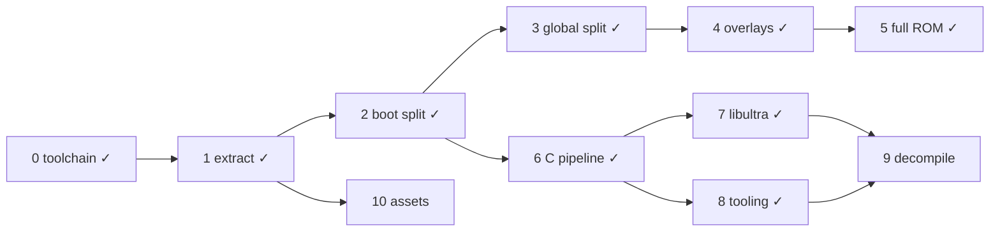

# DK64 Decompilation Roadmap

Target: Donkey Kong 64 (USA), `NDOE`, SHA-1 `cf806ff2603640a748fca5026ded28802f1f4a50`.
Compiler: IDO 5.3, `-O2 -mips2 -G 0`, libultra 2.0J, F3DEX2.

```sh
docker build -t dk64-decomp .   # once
tools/dk make setup             # extract ROM (BASEROM=donkey-kong.n64) + splat split
tools/dk make                   # build build/dk64.us.z64 and check SHA-1
```

## ROM map

Segment table at `0x8000DCC4`, 18 entries of 0x18 bytes:
`romStart, romEnd, vramStart, vramEnd, bssStart, bssEnd`.
ROM fields are written by boot (`0x80000764`); VRAM fields by `func_805FB300`.
Compressed segments are a gzip code member + gzip data member, zero-padded to `romEnd`.

| Table # | Name | ROM | VRAM | Notes |
|---|---|---|---|---|
| — | header / ipl3 | `0x0`–`0x1000` | — | CIC-6105 |
| — | entry | `0x1000`–`0x1050` | `0x80000400` | clears boot bss, jumps to `0x800009D0` |
| 0 | boot | `0x1050`–`0x11320` | `0x80000450` | uncompressed; text→`0x8000DCB0`, data `0xE8B0`, rodata `0x10F60`, bss `0x80010720`–`0x80016630` |
| — | rspboot | `0x11320`–`0x113F0` | — | RSP boot microcode |
| 1 | global | `0x113F0`–`0xCBE70` | `0x805FB300` | text 0x149160, data 0x1CBF0, bss `0x80761050`–`0x807FF100` |
| 2 | multiplayer (`ovl02`) | `0xD4B00`–`0xD6B00` | `0x80024000` | game mode 3 |
| 3 | minecart (`ovl03`) | `0xD6B00`–`0xD9A40` | `0x80024000` | mode 4 |
| 4 | bonus (`ovl04`) | `0xD9A40`–`0xDF600` | `0x80024000` | mode 8: bonus barrels |
| 5 | race (`ovl05`) | `0xDF600`–`0xE6780` | `0x80024000` | mode 5 |
| 6 | critter (`ovl06`) | `0xE6780`–`0xEA0B0` | `0x80024000` | mode 6 |
| 7 | boss (`ovl07`) | `0xEA0B0`–`0xF41A0` | `0x80024000` | mode 7 |
| 8 | arcade (`ovl08`) | `0xF41A0`–`0xFD2F0` | `0x80024000` | mode 9: DK arcade, data holds the arcade assets |
| 9 | jetpac (`ovl09`) | `0xFD2F0`–`0x101A40` | `0x80024000` | mode 10 |
| 10 | menu (`ovl10`) | `0xCBE70`–`0xD4B00` | `0x80024000` | mode 2: main menu / file select |
| 12 | — | `0x101A40`–`0x101C50` | — | raw viewport/display list data |
| 11, 13–17 | assets | `0x101C50`–`0x1FED020` | — | ~8.7k gzip streams |

Full per-segment details (stream offsets, sizes, hashes, gzip header fields): `bin/layout.json` after `make setup`.

## Done

- [x] **0. Toolchain** — `Dockerfile` (IDO 5.3 recomp, binutils, splat 0.50.1, spimdisasm, asm-processor, asm-differ, m2c); `tools/dk` wrapper.
- [x] **1. Extraction** — `tools/extract.py`: any byte order → `baserom.us.z64` (SHA-1 checked); per-stream binaries in `bin/segments/`; `bin/layout.json`. Verifies gzip CRC/size and that `vram + text + data == bssStart` for every segment.
- [x] **2. Boot split** — `dk64.us.yaml` splits entry + boot into 93 files; rest of ROM is one blob. Full ROM rebuilds byte-identical.
- [x] **6. C pipeline** — `src/boot/main.c` compiled with IDO via asm-processor; `dmaCopy` (`0x80000450`) matched in C.
- [x] **3. Global code split** — `dk64.global.us.yaml` splits `bin/segments/global.bin` (text‖data, concatenated by `make split`) into 144 text files + data/rodata (`0x15B390`, VRAM `0x80756690`)/bss; linked to `build/global.elf` with `--just-symbols=build/dk64.us.elf` so boot symbols resolve to the same addresses. `make` checks the ROM and `dk64.global.us.sha1` (text + data). Named `globalInit` (`0x805FB300`: fills segment-table VRAM fields, starts PI manager and the main thread) and `loadOverlay` (`0x80610350`: maps the overlay index in `$a1` to overlay 2–10, lays out the framebuffers and heap after it (sizes from the video-mode byte `0x8074450C`), clears its bss and loads it via `0x8060B140`).
- [x] **4. Overlay splits** — one splat config per overlay (`dk64.<name>.us.yaml`, segment id `ovlNN` kept for `bin/segments/`), all at `0x80024000`; each links to `build/<name>.elf` with `--just-symbols` of global and boot ELFs, is cut at its text size and checked against `dk64.<name>.us.sha1`. Overlay-local names go in `symbol_addrs.<name>.us.txt` (addresses collide across overlays). `loadOverlay`'s index (`$a1`) maps 2→menu, 3→multiplayer, 4→minecart, 5→race, 6→critter, 7→boss, 8→bonus, 9→arcade, 10→jetpac; 0–1 load none. Its caller `func_805FB944` picks the index from `D_807444EC` (3→arcade, 4→jetpac) or the per-map flags `D_807FBB64` (emulator traces, 2026-10-22: `0x1000` critter, `0x1` boss, `0x40000000` menu); `D_80744470` holds the aligned end of the loaded overlay (`0x80024000` = none). Text files: multiplayer 1, minecart 2, bonus 4, race 7, critter 2, boss 9, arcade 1, jetpac 5, menu 4. Data/rodata split everywhere except boss, whose rodata starts at `0x11CC8` (not 16-aligned; a separate subsegment gets `ALIGN(16)` padding), so it stays one `data` subsegment.

- [x] **5. ROM from rebuilt segments** — `dk64.us.yaml` now ends at `0x113F0` (boot ELF only). `tools/compress.py` gzips each built text/data stream with GNU gzip 1.2.4 `-9 -n` (built in the Dockerfile; reproduces all 20 members, while zlib matched 11 and gzip 1.12 matched 18) and zero-pads to the segment's ROM size. `make` assembles `build/dk64.us.z64` = `build/boot.bin` + global, menu, multiplayer … jetpac (ROM order) + `bin/segments/table12.bin` + `bin/segments/assets.bin` (raw tail from `extract.py`). ROM SHA-1 matches with every code segment rebuilt from source.

- [x] **8. Workflow tooling** — `tools/dk ./diff.sh [-s SEGMENT] FUNC` runs asm-differ per function (`diff_settings.py` maps each segment to its map file, built image and original bytes: boot `build/boot.bin` vs `baserom.us.z64`, global/overlays `build/<name>.bin` vs `bin/segments/<stream>.bin`; `-n` skips the rebuild). `tools/dk python3 tools/m2c.py [-s SEGMENT] FUNC` prints m2c starter C (nonmatchings or whole-file asm, referenced rodata files, context preprocessed from `include/common.h` into `build/m2c_ctx.c`). `tools/dk make progress` (`tools/progress.py`, `--json`) reports matched/total function bytes per segment. `tools/permute.py setup/run/best` wraps decomp-permuter (`/opt/decomp-permuter`) for near-miss search hints with `--stack-diffs` and `--stop-on-zero`. `tools/uopt_trace.sh [-l LEVEL] [-s src/...c] <file.c> [FUNC]` traces IDO 5.3 uopt priority-based register coloring via `/opt/ido5.3-trace` (`tools/ido/ecvt_fcvt.patch`, `-Wo,-zdbug:LEVEL`). Reviewed behaviourally equivalent C near-misses park under `#ifdef NON_MATCHING`; `tools/dk make NON_MATCHING=1` builds into `build_nonmatching/` without hash check (default `make` remains the sole matching gate; `make expected`/`progress` refuse `NON_MATCHING=1`). `hardware_regs: True` in every splat config; the 131 spimdisasm register names are linker symbols in `undefined_syms.us.txt`. CI dropped: single contributor, the local `make` hash check already gates every commit, and a hash-checking CI job would need the ROM hosted at a private URL.

- [x] **7. libultra** — DK64 links libultra **2.0J** (`BUILD_VERSION=VERSION_J`): J-only features present (pfs inode cache, separate `pfsselectbank.c`, `__osPfsLastChannel`, `__MotorDataBuf`, 2-arg `__osPfsRequestOneChannel`, `__osEPi*` names) and K/L ones absent (`guMtxXFML` still in `mtxcatl.c`, no `__osEepromRead16K`). Headers are decompals/ultralib's (`include/PR`, `include/PRinternal`, `include/libultra`, `include/compiler/ido`). Boot libultra spans ROM `0x5120`–`0xE8B0`; every C-sourced file is `src/boot/libultra/<ultralib dir>/<file>.c` with its own `.data`/`.rodata`/`.bss` subsegments, compiled with ultralib's J flags by path (Makefile; `io/` files that need `-O1` are listed there). The 23 handwritten-asm files stay splat asm under `asm/libultra/` (`os/exceptasm`, `os/interrupt`, cache/TLB/SR/FPCSR/intmask/compare helpers, `libc/bcopy`/`bcmp`/`bzero`, `gu/sqrtf`). The original identification mislabeled several files (gu shift, sinf/cosf, controller/pfsisplug, getthreadpri/id, vimgr, epirawdma, VI modes, PIF RAM buffers); names now follow code behaviour and data contents. Global holds no libultra; it holds the n_audio library (named in `symbol_addrs.us.txt`, not ultralib). Per-object compare for concurrent matching: `tools/objdiff.sh src/....c` against `expected/` snapshots.

- [x] **11. Emulator tooling** — Docker sessions running ares-64 with GDB server (port 9123), Xvfb/x11vnc (port 5900, password `dk64`), session CLI (`tools/emu/emu.py`), save-state library (`tools/emu/states.py`), map warping and map sweeps via `func_805FF378` safe-point infcall (`tools/emu/warp.py`), dynamic breakpoint coverage (`tools/emu/coverage.py`), and function tracing and argument inspection (`tools/emu/study.py`). Symbol resolution and overlay detection in `tools/emu/symbols.py`. Session runtime output in `emu/` (gitignored). Skill at `.omp/skills/emulator/`.

## To do

### 9. Decompilation (ongoing)
Near-miss and large-function work now follows the stage order with uopt_trace and the permuter. Suggested order, one subsystem per unit of work:
- [ ] Boot game code (ROM `0x1050`–`0x5120`, `0x6690`): C in `src/boot/{main,1630,1CC0,30E0,3630,3D20,6690}.c`, boot at 79.6% of function bytes. Matched: `dmaCopy`, `bootMain`, boot threads and init (`bootMainThread` fills `gSegmentTable` from per-segment `<seg>_ROM_START/END` linker symbols in `undefined_syms.us.txt`, one name per reference), the "Expansion Pak not installed" screen (`noExpPak*`, `bootDrawString/Glyph`), gzip 1.2.4 inflate (`huft_build` … `inflate`, `gunzip`, `get_method`), Rare libc (`_str*`, `_memset`, `_itoa`, `_sprintf`). Hand-written asm, kept as splat `asm`: `memcpy` (`0x3C00`, `ld`/`sd`) and the LZ bit-stream decoder at `0x3390`–`0x3630`. Remaining: `vsprintf` (best draft is 8 instructions off; IDO caches the non-volatile `%e` `value` in a register in the full function but not in reduced tests).
- [ ] Scheduler, threads, message queues (global): `src/global/0.c` (`0x805FB300`, main-thread init, display-list setup) and `src/global/131B0.c` (`0x8060E4B0`, rumble pak + RCP scheduler) are C units with their own `data` (named asm) and, for 131B0, `.rodata` subsegments. 41 of 55 functions matched (13,596 bytes in global; +22 functions matched this unit including `func_805FD088` [1220 insns], `func_805FC2B0`, `func_805FE7FC`, `schedCreate`, `schedHandleRDP`, `schedTaskDone`, `schedAppendTask`, `rumbleMotorStop`, `func_8060EA28`). Remaining 14 GLOBAL_ASM: `0.c` `globalInit` (store ordering), `func_805FB5C4` (needs TU BSS for D_807655E8), `func_805FB944` (1 insn off), `func_805FBFF4` (epilogue .align 5 padding shift), `func_805FC668` (needs TU data for D_807445C0), `func_805FCA94` (5 insns off); `131B0.c` `func_8060E6E8` (delay slot swap), `schedMain` (`func_8060EE60`, 1 insn off), `func_8060F208` (needs TU BSS for D_807F04D0), `func_8060F254` (dead s2 assignment), `func_8060F54C` (11 insns), `schedStartTask` (`func_8060F960`, needs TU BSS for D_807F0508), `schedYield` (`func_8060FA5C`, needs TU BSS for D_807F04C0), `func_8060FAE4` (2 insns off).
- [ ] Heap / memory allocator (global): `src/global/15050.c` (`0x80610350`–`0x80611850`) is a C unit with its own `data` (`0x14B730`, named asm) and `.rodata` (`0x15BF90`, `loadOverlay`'s two jump tables). Types in `include/heap.h`: `HeapBlock` (0x10-byte header: physical prev, size, free-list next/prev; payload[-5] is the tag 0 normal / 1 locked / 2 survives overlay load), `HeapPool` (0x14-byte descriptor in `D_807F0988`, pool 0 = best-fit heap, others fixed-size), `DeferredFree` (queue `D_807F0A58`, 0xA00 entries). 18 of 30 functions matched (`heapFree`, `heapFreeDeferred`, `heapQueueDeferredFree`, `heapCoalesce`, `heapLock/UnlockBlock`, `heapBlockSize`, `heapClearBlock`, `heapFillBlock`, `heapFreeBytes`, `heapAllocFromPool`, `heapSortPools`, `func_80610B84`, `func_80611154/60/6C`, `func_80611724`, `func_80611844`). Remaining 12 GLOBAL_ASM: `loadOverlay`, `func_80610FE8` (malloc, ~275 callers), `func_806111F8` (best-fit alloc; a0/v1 register swap), `func_80610E84` (unregister pool), `func_80611408` (free into sorted list; attempt 16 bytes long), `func_80610BD8`/`func_80610C74` (pool init), `func_806109EC` (bubble sort of surviving blocks; extra induction register), `func_80610A88`, `func_80611730` (deferred-free tick; register renames), `func_806115A8`/`func_80611614` (surviving-block list; the original keeps a dead `ptr - 0x10`, same problem as `func_8060F254`).
- [ ] Controller input (global): `src/global/F600.c` (`0x8060A900`–`0x8060B140`) is a C unit with no own data/rodata (its globals `D_807ECCD0`–`D_807ECDFC` are BSS, the flags `D_807463B8`/`D_807467C4`/`D_80746834` sit in the shared data blob). 9 of 10 functions matched: `controllerInit` (SI queue, `osContInit`, `osContSetCh(4)`, pad buffers `D_807ECD10`/`D_807ECD28`), `controllerStartRead`/`WaitRead`/`GetReadData` (`D_807ECD08` = read pending, `D_807467C4` must be `volatile u8`), `controllerSetActiveMask`, `controllerGetPort` (slot → port table `D_807ECDFC`), `controllerCompactPads` (6-byte `OSContPad` struct copies), `controllerGetActiveMask`, `controllerLatchPad`. Remaining GLOBAL_ASM: `controllerUpdate` (per-frame: pressed/held/auto-repeat `D_807ECD40/48/50/68`, checksum of `func_80611730`–`func_80611844` against `0x624C9A6C`); three independent drafts reach 286/293 instructions, but IDO allocates 5 callee-saved registers instead of the original's 7 (`i` lands in `$ra` because the built code keeps `&D_807ECD48[padIndex]` in `$t4`).
- [ ] Main loop and map loading (global): `src/global/3C10.c` (`0x805FEF10`–`0x80600950`, own data `0x1492E0`–`0x149FA0` as named asm, `.rodata` `0x15B390`–`0x15B4B0` = `jtbl_80756690`), `src/global/5650.c` (data `gTimerQueue`, `0x149FA0`), `src/global/5A50.c` (data `D_807452B0`, `0x149FB0`). 67 of 72 functions matched. 3C10 (33/37): map/mode transitions (`func_805FF378` sets next map `D_807444E4` / exit `D_807444E8`; current map `D_8076A0A8`), the 18-entry 0xC0-byte slot array `D_8076A160` (`Struct8076A160`, ends at `D_8076AEE0`; find/free/free-all by map id), mode tables `D_807445E0`/`D_80744720`/`D_80744734`/`D_8074482C`, `frameTimingReset` (`D_8076AF00` history, `D_8076AF14` per-map flag). 5650 (6/6): timed-callback queue sorted by frame `D_8076A068` (`timerQueueInit/Add/Update/Cancel/PurgeFlagged`; `timerQueueAdd` hides a PI-read anti-piracy check that doubles the delay). 5A50 (28/29): `gSeqPlayers` wrappers (`seqPlayerPlay`, `GetState`, `SetTempo`, `GetSeq`, `GetCurTime`, `SendMidi`, per-channel mask loops). Remaining GLOBAL_ASM: `func_805FEF10` (prologue induction-variable register choice, 3 insns), `func_805FF9AC` (slot create/update: double scale `D_80756680` lands in `$f0` + spill instead of `$f20`, frame 0x60 vs 0x58), `func_80600174` (shared `lui` for adjacent extern floats `D_8076A168`/`D_8076A16C`, `$a0`/`$a3` swap), `frameTimingUpdate` (target keeps values in caller-saved regs, IDO adds `$s1`), `audioInit` (callee-saved permutation `$s4`–`$s7`, ~14 insns).
- [ ] Actors and behaviours (global). First unit: the actor core. `src/global/7CA80.c` (`0x80677D80`–`0x8067B450`, `.rodata` `0x15DF60`, which includes the unreferenced kong-name strings `"DONKEY"`…`"ENGUARDE"` ahead of `jtbl_807592A4`, so they belong to this TU) and `src/global/80150.c` (`0x8067B450`–`0x80684550`, `.rodata` `0x15E090`–`0x15E790`) are C units; data stays in the shared asm blob. Shared types in `include/actor.h` (`Actor`, callback node, delayed-queue entry, `ActorEntry` = active list `D_807FB930` with count `D_807FBB34`, `ActorGlobalState` = `D_807FBB70`). 7CA80: 62 of 73 matched (subsystem `actorInit`, spawn `actorSpawn`/`actorSpawnFromInfo`, despawn `actorDespawn` → deferred queue `D_807FBE10` (`actorQueueOrDespawn`, `actorFlushDespawnQueue`) or `actorFreeImmediate`, active list `actorRegisterActive`/`actorDeregisterActive`/`actorFindByType`/`actorIsActive`/`actorDespawnByOwner`, per-actor callback list at `+0x13C` (`actorAllocCallbackNode`, `actorAppendCallback`, `actorFreeCallbackList`, delayed queue `D_807FBF18` `actorQueueDelayedCallback`, global table `D_807FBFE0` `actorRegisterGlobalCallback`), sorted actor table `D_807FBFF0` (`actorTableClear`/`Insert`/`Remove`/`Contains`/`BinarySearch`/`Sort`)). Remaining GLOBAL_ASM: `func_806790F4` (1 insn, `%lo` order), `func_80679DC4` (2 prologue insns, reassigned `u8` arg), `func_8067A1DC` (frame 0x78 vs 0x70), `func_8067B100` (6 insns `$v0`/`$v1`), `func_8067A09C` (temp rotation), `func_80679334` (`$s0`/`$s1` swap), `func_8067889C` (saved-register permutation), `func_80678824`/`func_806789E4` (adjacent BSS stores `D_807FBFE0`–`EC` need separate `lui`s), `func_80678050` (frame 0x48 vs 0x40), `func_806794EC` (605 insns, sparse flag switch with two jump tables). 80150: 47 of 64 matched (tag barrel: `tagBarrelSpawnKongs`, `tagBarrelIsKongUnlocked`, `tagBarrelInitUnlockedKongs`, `tagBarrelUpdateSelectedKong`, `tagBarrelUpdateInteractable`, recoil `tagBarrelTriggerRecoil`/`tagBarrelCheckRecoil`/`tagBarrelResetMovement`). Near misses: `func_8067DCC0` (2 insns, CSE of constants 1/2), `func_80681E18` (one register), `func_8068412C` (4 regs), `func_80682AB4` (4-insn size, FPR saturation), `func_806832F4` (frame 0x30 vs 0x28), `func_8067BD28`/`func_8067BA7C`/`func_8067B4C8` (saved-register choice), `func_80683AD8` (frame 0xB8 vs 0x108), `func_8067FB6C` (802 insns, `$t1`/`$t2` only), `func_8067E784` (1387, 8 insns), `func_8067C71C` (1419, 19 insns of delay slots); `func_806833DC`, `func_8067BF84`, `func_806836D0`, `func_806822FC` drafted, `func_806809F0` (1139) unattempted. Drafts: `.scratch/<agent>/<FUNC>_best.c` (gitignored, local only). Second unit, behaviour files: `src/global/79890.c` (`.rodata` `0x15DEA0`) 6 of 8, `7A510.c` (`0x15DEC0`) 8 of 13, `7AF60.c` (`0x15DEE0`) 27 of 29, `7BBD0.c` (no rodata) 3 of 6, `89250.c` (`0x15E790`–`0x15E8B0`) 34 of 40 matched; data stays in the shared blob. `77B90` stays asm: hand-written 64-bit collision code (`ld`/`sd`/`dmult`, `$k0`/`$k1`, non-standard register arguments), like `15010`, `16B60`, `61690`. Named (35): actor predicates and helpers (`actorIsFacingTarget`, `actorCheckFacingTarget`, `actorIsTargetWithinAngle`, `actorListContainsId`, `actorIsDamageFatal`, `actorApplyDamage`, `actorInitHealth`/`actorInitDamage`, `actorGetMatrix`), effect spawners in 89250 (`effectSpawn*`: bone, debris, smoke, sparks, rings, `effectSpawnJointBeam`), `actorUpdateEffects`, `particleInitDefaultState`. Near misses: 79890 `func_80674E14` (2 loads swapped), `func_80674B90` (scheduling); 7A510 `func_80675EE0` (2 stores swapped), `func_8067605C` (`$s1`/`$s2`), `func_80675E3C` (`$s2`–`$s4` permutation), `func_80675AFC` (loop shape), `func_80675810` (187 insns) unattempted; 7AF60 `func_8067680C` matches in C (`drafts/global/func_8067680C.c`) but its C jump table loses the 4-byte late_rodata pad before asm `func_80676D00`'s floats, so match it together with `func_80676D00` (1 insn: `move $a3, $a0` vs a spill); 7BBD0 `func_80676ED0` (2-insn scheduling), `func_80677148` (305 insns), `func_806776A0` (387); 89250 `func_80685708`/`func_80686F90` (1 insn each, narrow param reloaded from its home slot), `func_80685F60` (frame 0x20 vs 0x28), `func_806871DC` (3 insns), `func_80685B44` (register rotation), `func_80686390` (5 insns, one stack slot). Third unit, actor lists and rendering helpers: `src/global/8CA50.c` (no rodata) 18 of 19, `8D3E0.c` (`.rodata` `0x15E8B0`) 40 of 47, `8F050.c` (no rodata) 5 of 7, `8F4B0.c` (`0x15EA00`) 11 of 15, `90D80.c` (`0x15EC30`–`0x15EC70`) 11 of 17 matched; data stays in the shared blob. Splat's `8F4B0` is two TUs: the `"%d"`/`"HIT"` strings after its late_rodata start `90D80` (`func_8068C080`), confirmed by its first data object `D_807501E0` being 16-aligned. Named (53): animation-node lists in 8CA50/8F050 (`anim*`: `animListInit`, `animListUpdate`, `animListFree`, `animStopAtFrame`, setters), the actor node list `D_807FC400` in 8D3E0 (`ActorListNode`, `ActorListRecord` in the file; `actorListAllocId`, `actorListRemoveNodeInternal`, `actorListSerialize`, `actorListFreeAll`, `actorSetCustomFloat`, `playerGetMinSquaredDist3D`, `mapIsBossArena`), 8F4B0 `actorSpawnInitialSet`, 90D80 texture cache `D_807FC690` (`texCacheFindOrLoad`, `texCacheUpdate`) and render callbacks `D_807FC630` (`renderCallbacksRegister`, `renderCallbacksExecute`, `renderRotatedQuad`). Near misses (drafts in `drafts/global/`): 8CA50 `func_80687FC8` (int-decrement reassociation); 8D3E0 `func_806886E0` (1 delay-slot insn), `func_80688D20` (bool slot 0x27 vs 0x2F), `func_80688940` (delay slot + `addu` operand order), `func_80689250` (one stack slot), `func_80688A6C`, `func_80689C20` (regalloc), `func_80689418` (176 insns); 8F050 `func_8068A3A0` (`$a0`/`$a2`), `func_8068A508` (2 temps); 8F4B0 `func_8068A858` (26 insns), `func_8068ABE0` (16), `func_8068BBF8` (4), `func_8068AD7C` (713 insns, one-register shift); 90D80 `func_8068DBA4` (1 insn), `func_8068D9DC` (3), `func_8068E7B4` (one stack slot), `func_8068D264` (2 regs), `func_8068DC54` (4 insns of 520), `func_8068C5A8` (815 insns: `u16 arg1` prototype + single-exit epilogue fixed; frame 0x1B0 vs 0x1A8). Fourth unit, actor collision / matrices / projectile behaviour: `src/global/70FD0.c` (`0x8066C2D0`–`0x80672E90`, `.rodata` `0x15DD50`) 52 of 79 matched, and `src/global/936B0.c` (`0x8068E9B0`–`0x80697230`, `.rodata` `0x15EC70`) 39 of 54 matched; data stays in the shared blob. 82 functions named in `symbol_addrs.us.txt`. 70FD0: matrix/vector math, actor sub140 model/subnode lists (`ModelNode`, `ModelSubNode`, `ActorSub140` in `include/actor.h`), collision triangles (`CollisionTri`, `CollisionBox`), angle helpers, facing/offset/extents updates. Named: `collisionTransformNode`, `dynamicBufferFree`, `collisionBufferCacheUpdate`, `collisionPurgeExpiredBuffers`, `collisionIsTriangleDegenerate`, `actorSub140Free`, `actorSetNodeValue`, `actorOrNodeFlags`, `actorClearNodeFlags`, `actorSub140Alloc`, `actorAppendModelSubNode`, `actorAppendModelNode`, `actorFreeModelNodeList`, `actorGetOrSetNodeScale`, `actorSetNodeFlag`, `actorClearNodeFlag`, `actorClearAllNodeFlags`, `actorSub140SetVectors`, `actorUpdateModelMatrices`, `collisionBuildBoxFromMatrix`, `actorSetTargetAngleAndCheck`, `actorClearTargetAngle`, `actorCheckTargetAngle`, `actorQueueCollisionCallbacks`, `actorReflectCollisionAngle`, `actorGetCollisionThreshold`, `actorSetTargetAngleBounds`, `actorCheckTargetAngleBounds`, `actorUpdateFacingAndOffset`, `actorUpdateCollisionExtents`, `actorUpdateSubActorOffsets`, `actorGetPlayerThreshold`, `actorGetNodePos`, `actorGetSubNodePos`, `actorStepSubNodeList`, `actorTouchSub140Timestamp`, `actorUpdateMovementFlags`, `actorHasActiveMovementFlags`, `actorClearMovementFlags`, `actorSetCameraBoundaryMode`, `actorCheckCameraBoundaryCondition`, `actorBoundaryStub`, `actorRng`. Near misses (drafts in `drafts/global/`): `func_8066D4DC` (424 insns, 0-insn size delta, 100% opcodes matched, regalloc only), `func_80671880` (4 insns: `$s5`/`$s6` swap), `func_8066DB40` (4 insns), `func_80671A6C` (1 regalloc swap), `func_8066CCD8` (delay slot), `func_8066CB88` (`$s0`/`$v0`), `func_8066C610` (`$f20` CSE), `func_8066D2F4`, `func_80671E00`, `func_80672328`, `func_8066C7F4`, `func_8066E2C0`; unattempted large `func_8066FE08` (467), `func_80670548` (459). 936B0: actor/projectile behaviours, tracking, particle effects (`D_807FBB40` current actor, `D_8076A068`). Named: `actorSnapToBone`, `actorSyncTransformFromParent`, `mathPickCloserTargetPoint3D`, `actorInterpolateAngles`, `actorAllocSubBuffer`, `actorInitAnimations`, `actorInitFromSpawnPoint`, `actorSpawnChildActor`, `actorUpdatePlayerInteraction`, `actorClearSubState`, `projectileSetSpawnFlag`, `projectileSetTargetCoords`, `projectileGetTargetCoords`, `projectileSpawnNodeEntry`, `projectileCalculateTrajectoryAndSpawn`, `projectileAimAndSpawn`, `projectileClampAngleAndSpawn`, `projectileAimFromActorAndSpawn`, `actorSpawnSparkleBurst`, `projectileSpawnWithShockwave`, `projectileSpawnActor107`, `projectileSparkleUpdate`, `projectileSparkleUpdateGold`, `projectileSparkleUpdateSilver`, `projectileSpawnParticleEffect`, `projectileSpawnParticleEffect2`, `projectileSpawnParticleEffect3`, `projectileSpawnParticleEffectWithScale`, `projectileDespawnOrExplode`, `projectileMultiplayerUpdate`, `projectileSpawnExplosion`, `projectileBeamUpdate`, `projectileRotatingUpdate`, `actorIsActiveType2B`, `projectileMatrixRotationUpdate`, `actorApplyTransformAndRender`, `projectileParticleSpawnerTick`, `projectileHomingParticleUpdate`, `actorAppendActiveCallback8`. Near misses (drafts in `drafts/global/`): `func_8069346C` (665 insns, 2 insns: `$s0`/`$s1` swap), `func_80694948` (2 insns: post-increment equality pattern), `func_806970CC` (3 insns), `func_80692940` (2 insns), `func_80696A6C` (417 insns, 10 insns: `$v0`/`$v1` temps), `func_80695724` (regalloc), `func_80690190` (regalloc), `func_80693EC0` (387 insns); unattempted large `func_8068EF54` (544), `func_8068F72C` (525), `func_80690F30` (428), `func_806919E0` (516).
- [ ] Collision state, triangle tests, collision BST and asset tables (global `0x80663C60`–`0x8066C2D0`): six C units. `src/global/68960.c` (1/1, `mapUpdateFogDistance`), `68AA0.c` (2/3), `68EA0.c` (5/8; `D_807F9420`/`D_807F9430` actor target/proximity tables: `actorInitTargetEntries`, `actorInitEntryPoints`), `699B0.c` (2/2, path-trail particles `particleSpawnPathTrail`), `69E60.c` (14/15, actor velocity/angle math: `actorStepPhysics`, `actorApplyVelocity`, `mathAngleBetweenPointsDeg`), `6AD90.c` (62/88: collision-state bss block `D_807F9460`–`D_807F951D` and getters, floor queries `collisionCheckActorFloor`/`collisionGetFloorHeight`/`collisionTestSubmeshBoundary`, dynamic collision buffers `D_807F9514` (`dynamicBufferAllocateEntry`/`dynamicBufferPurgeExpired`), hit table `D_807F94C0` (`collisionRecordTriangleS`/`F`, `collisionCheckBoxTriangleWinding`), ROM asset tables `D_807F9528`/`D_807F95A8` (`collisionInitTables`, `assetInflateAndFree`, `assetGetSize`, `assetFreeBuffer`, `dmaDrainQueueAndFreeBuffer`), and the 20-bucket collision BST `D_807F9628` with its 64-entry history queue `D_807FB228` (`collisionGetBucketIndex`, `collisionBstInsert`, `collisionBstDelete`, `collisionBstRebalanceBucket`, `collisionBstBuildBalanced`, `collisionQueueSearch`)). 86 of 117 matched, 69 named. Rodata `.rodata` at `0x15DAF0` (68960), `0x15DB10` (68EA0), `0x15DB20` (699B0), `0x15DB30` (69E60), `0x15DBC0` (6AD90); 68AA0 has none. splat's `699B0` file is three TUs (`699B0`/`69E60`/`6AD90`): 8 zero bytes end the rodata at `0x15DB28` and `0x15DBB8` (16-byte object padding, flagged by `tools/rodata_owners.py`). The f32+f64 pairs `D_80758F70`/`D_80758F78` and `D_80758FE4`/`D_80758FE8` need the double forced into its function (`symbol_addrs.us.txt`). Near misses (drafts in `drafts/global/`): `func_8066466C` (1 insn, `add.s` dest), `func_806672B8` (363 insns, 1 insn: `spA0` slot), `func_80666290` (1 regalloc), `func_80666F04` (1: `.double 150` folded to float), `func_8066B4D4` (1: stack slot), `func_80666428` (418, 6 insns: `arg0` spilled vs `$s0`), `func_8066A08C` (332, 9 insns), `func_80668E9C` (458, 20 insns), `func_80665564` (339, regalloc), FP-regalloc-only cross-product triplet `func_80669830`/`func_806689F0`/`func_8066ACA4`, `func_806699C4`, `func_8066BAB8`, `func_8066BFF0`, `func_80666AF8`, `func_80664044`, `func_80664834`/`func_80664A38`, `func_8066A75C`, `func_8066A64C`, `func_8066B5F4`, `func_8066C0DC` (`multu` vs shift stride), `func_80669E04`/`func_8066A988` (twins), `func_80668C30`, `func_80666D88`, `func_80666090`, `func_8066785C`, `func_8066B0F8`; unattempted `func_806679BC` (736 insns).
- [ ] Render segment 6, billboard and matrix caches, effect nodes / water, actor target table and trigger zones (global `0x8065CDA0`–`0x80663C60`): five C units, data in the shared asm blob, `.rodata` at `0x15DA60` (61AA0), `0x15DAC0` (63810), `0x15DAD0` (63EC0), `0x15DAE0` (67890); 684C0 has none. `tools/rodata_owners.py` flags no hidden TU here (the `D_80748310`/`D_80748370`/`D_807483D0` data pads all belong to `renderSetSegment6AndFog`). `src/global/61AA0.c` (15/22: segment-6 display-list templates `renderReplaceSegment6Commands`/`renderSetSegment6AndFog`, distance fade `renderCalcPlayerDistanceAlpha`, 4-entry billboard cache `D_807F8E90` (`billboardCacheInit`), 100-bucket matrix cache `D_807F8EC0` with LRU list `D_807F9050`/`D_807F9054` (`matrixCacheHash`, `matrixCacheDecayLimit`), `mapIsBonusOrSpecial`), `63810.c` (1/3, `actorSetTargetSlotByte`), `63EC0.c` (44/53: effect node list `D_807F93C0` (`EffectNode`), table `D_80748A90` (`EffectTableEntry`), `effectUpdateAndDispatch` (also an anti-piracy PI checksum), `screenShakeStart`/`Step`/`Stop`, texture/mipmap display-list builders, `effectWaterRenderSurfaces`), `67890.c` (3/5: target table `D_807F93F0`/`D_807F93F4`, `actorCalculateTargetDistancesAndAngles`, `renderDepthSortedTargets`), `684C0.c` (5/6: trigger-zone list `D_807F9410`: `triggerZoneInit`, `triggerZoneCheckEntry`, `triggerZoneUpdate`). 68 of 89 matched, 68 named. Near misses (drafts in `drafts/global/`): `func_8065E138` (319 insns, 1 insn), `func_8065E634` (2: prologue `move a0,v1`, return reload slot), `func_8065E81C` (2: home-slot spill / `andi` order), `func_8065E040` (2: `addiu` order), `func_8065D1AC` (3: `addiu` order), `func_80663594` (5: `osVirtualToPhysical` arg register), `func_80663BE8` (`$v1` vs `$a2`), `func_80662B90` (16: `i << 6` CSE), `func_8065EFF0` (8: call arg order), `func_8065F1C0`/`func_8065F678` (`$s7`/`$s8` swap), `func_8065F964`/`func_80660520`/`func_806608FC`/`func_80660D38` (frame size), `func_8065FB64`, `func_8065FEB8`, `func_80660070`, `func_8065EB10` (leaf frame), `func_8065D994` (427, loop-1 induction regalloc), `func_8065D254` (461, far).
- [ ] Audio manager, fog, hash table and lights (global `0x80601A10`–`0x8060A7C0`, `0x80659110`–`0x8065C990`): five C units. `src/global/6710.c` (7/9; audio thread `audioThreadStart/Stop/Main`, AI check `audioCheckAiLength`, libaudio DMA callbacks `audioDmaNew`/`audioDmaCallback`/`audioDmaFrameUpdate`; its data `0x807452C0`–`0x807454F0` ends with an 8-byte TU pad at `0x14A1F0`, so splat's `6710` file is two TUs) and `7130.c` (33/42, `.rodata` `0x15B4B0`, `.bss` `0x80770DF0`–`0x80770F40` (`D_80770DF0`–`D_80770EF8` plus `func_806057F8`'s function-local static pitch at `0x80770F38`; the rest of the global bss stays in the asm blob, split around it): sfx channel table `D_807458DC`/`D_807458F4`/`D_8074593C` (`sfxAllocateChannel`, `sfxStopChannel`, `sfxSetChannelParam`), 22 sound slots (`sfxSlotAllocateActor`/`Source`, `sfxStopSlotSound`, `audioResetAll`), positional wrappers (`sfxPlayFromActor*`, `sfxPlayFromTargetSlot`), sequence volume/fades (`seqLoadAndPlay`, `seqUpdateVolume`, `seqUpdateVolumeFades`), positional play `sfxPlayAtPosition` and `func_80609B80`; the top block masks libaudio's `alCSPSetChlPan` prototype as Rare's `(ALCSPlayer *, f32, f32)`; `D_80756F08`/`D_80756F10` f64 pair split in `symbol_addrs.us.txt`). `5DE10.c` (4/4, fog `fogSetParams`/`fogApply`/`fogRender`), `5E020.c` (8/8, 100-bucket table `D_807F7370`: `hashTableInsert/Lookup/Remove/Traverse`), `5E2F0.c` (17/20, `.rodata` `0x15D9A0`: light colour buffers `D_8076A0B4`–`BC`, light/trigger volumes `D_807F7500`, `lightAdd`, `lightCheckVolumeBounds`, `lightCheckPlayerDistance`). 69 of 83 matched, 67 named. The 14 unmatched: Parked `NON_MATCHING` (drafts in `drafts/global/`): `func_80602498` (1 reg), `func_80605380` (1 insn, arg-register takeover), `func_80609140` (`$v0`/`$v1`), `func_8060A6A0` (uopt sinks float math into the branch), `func_80608DA8` (frame 0x50 vs 0x48), `func_80601EE4` (regalloc), `func_80601A10` (loop regalloc), `func_806086CC` (463, 10 insns), `func_80603450` (1454, frame 0x100 vs 0xE8), `func_8065BAA0` (one `$s` shift), `func_8065C334` (`1.0f` hoist), `func_8065A884` (1179, frame 0x160 vs 0x158). Still GLOBAL_ASM with drafts: `func_806025D4` (305, stage 4), `func_80602E6C` (325, stage 3).
- [ ] Model slots, map chunks and projectile behaviours (global `0x8064F450`–`0x80659110`, `0x80697230`–`0x80699070`): four C units, data in the shared asm blob. `src/global/54150.c` (16/28, `.rodata` `0x15D8E0`: hash-table keyed model slots `D_807F6000` (`ModelSlot`, 0x90 bytes; `modelSlotDataSize`/`CopyData`/`Free`/`StepAnimations`) and their animation entries (`ModelAnimEntry`, `modelAnimEntryStart`/`Stop`/`IsActive`/`GetState`/setters)). `55B20.c` (46/80, `.rodata` `0x15D960`: 0x1C8-byte map chunks `D_807F6C18` (`MapChunk`, count `D_807F6C28`; `mapChunkAllocLists`, `mapChunkActivate`, `mapChunkFrameUpdate`, `mapChunkFindAtPoint`, node lists `mapChunkFreeNodeLists`/`RebuildNodeLists`/`PurgeNodeList`; per-frame draw `mapChunksRender`, written with the GBI macros), collision cells `D_807F70B0`/boxes `D_807F70B4` (`mapCellSetFlag`, `mapTriggerApplyZones`), grid points `D_807F6C24` (`mapGridPointEmit`/`BuildVectors`/`PlaneDistanceWithin`), search table `D_807F72B8` (`mapSearchTableReset`/`GetValue`), clip bounds `mapSetClipBounds`). `9BF30.c` (2/4, `.rodata` `0x15EEF0`: `loadModelAssetTable` (`D_807FC7C0`), `projectileActorUpdate`) and `9CE20.c` (4/5, `.rodata` `0x15EF40`: behaviour-table entries `projectileBehaviourEntryA`–`D` tail-calling `func_80698120`). 68 of 117 matched, 68 named. Parked `NON_MATCHING` (36, drafts in `drafts/global/`): 54150 `func_8064F450` (unroll factor), `func_8064F97C`, `func_8064FA7C`, `func_8065051C`, `func_8065054C`, `func_806505F0`, `func_80650684`, `func_806506E8`, `func_80650794`, `func_80650A70` (stage 5–6, regalloc); 55B20 `func_80650ECC` (531, `&D_807F70AC` CSE spills arg0, frame 0xEE8 vs 0xED8), `func_80651708`, `func_806524A0`, `func_80652A08`, `func_80652B04`, `func_80652BC8`, `func_80652DB4`, `func_80652FDC`, `func_806531B8`, `func_806533C4`, `func_80653804` and its byte-identical twin `func_80654FEC` (stage 4, `arg2` spill), `func_80653DF0`, `func_80654418` (callee-saved rotation), `func_80655258`, `func_80656B98`, `func_80657CB0`, `func_80658134` (target homes `a1`–`a3` but not `a0`), `func_806582F8`, `func_8065850C`, `func_80658930`, `func_80658C10`, `func_80658CCC`, `func_80658E8C`; 9BF30 `func_80697230` (441, frame 0x1A0 vs 0x198), `func_80697988`. Still GLOBAL_ASM with drafts: 54150 `func_8064FB64` (371, stage 5), `func_806500E0` (274, stage 5); 55B20 `func_80651904`, `func_80651C2C` (stage 5), `func_80658624` (175, stage 6, temp renames), `func_806547A8`, `func_80654CCC` (stage 4–5), `func_80655410` (432, stage 3, frame 0xC8 vs 0xD0), `func_80653FA4` (stage 3), `func_806545D4`, `func_8065776C`, `func_80656F14` (stage 2–3; its file prototype has the wrong arg widths); 9CE20 `func_80698120` (971, stage 5: payload pointer coloured `s0` instead of spilled `t1`). Next units: remaining global subsystems after `9CE20` (e.g. `src/global/9DD70.c`, whose rodata `tools/rodata_owners.py` flags as a hidden TU, `A2F10.c`, `A6280.c`, `A7710.c`); split the hidden TUs the tool flags (e.g. in `17B90`, `36880`, `42630`) before round 1.
- [ ] Text markers, round banner, attached/mirrored actors and effect sprites (global `0x80699070`–`0x806A80C0`): six C units, data in the shared asm blob, `.rodata` `0x15EFD0` (`9DD70`), `0x15F110` (`A2F10`; its first labels are the kong-name strings `"DONKEY"`…`"KONG"` used only by the data table `D_807503A4`, kept as rodata `GLOBAL_ASM` lines), `0x15F250` (`A6280`), `0x15F2B0` (`A7710`), `0x15F440` (`A8400`), `0x15F6A0` (`AA960`: hidden TU, `A8400`'s rodata ends with an 8-byte pad at `0x15F6A0` and the 16-aligned data `D_80750400` is used only by `sfxSpawnTableNodes`). Unsymbolised 8-byte empty functions sit inside splat function files (`func_806998E8` now in C; `0x806A1ABC`, `0x806A36F4` still inside asm; `0x806A1FD0` emitted as `stub_806A1FD0`). 93 of 126 matched + `func_806998E8` (9DD70 27/37, A2F10 20/25, A6280 4/8, A7710 4/7, A8400 5/13, AA960 33/36), 52 named in `symbol_addrs.us.txt`: text markers and digit counters (`textSpawnMarker`, `textMarkerUpdate`/`Render`, `textBuildDigitNode`, `textUpdateThreeDigitCounter`/`TwoDigitCounter`), `mathAngleBetweenPoints3D`, round banner (`actorUpdateBannerFade`, `renderScaledSprite`), attached and mirrored actors (`actorSpawnAttachedTo`, `actorShadowFollowUpdate`, `actorMirrorParentModelY`/`Axis`, `actorFallAndBurstUpdate`, `actorUpdateSpinAndVelocity`), camera-facing models (`actorSeekTargetUpdate`, `actorPlaceModelAtCamera`), sprites/node chains (`renderTextureSprite`, `renderAppendNodeChain`), effect spawners (`sfxSpawnTableNodes`, `effectSpawnAttachedSprite`, `actorUpdateSfxAndGround`). Parked `NON_MATCHING` (18, drafts in `drafts/global/`): 9DD70 `func_80699284` (stage 4–5), `func_80699958` (5, 801 vs 817), `func_8069A7C8` (6), `func_8069E088` (6, one dead `li a0,1`); A2F10 `func_8069E210` (6), `func_8069F020` (5–6), `func_806A112C` (5); A8400 `func_806A370C`, `func_806A3E9C`, `func_806A4284`, `func_806A495C`, `func_806A4B84`, `func_806A4DDC`, `func_806A5174`, `func_806A5868` (all stage 4–6); AA960 `func_806A664C`, `func_806A6DB4`, `func_806A7600` (5–6). Still GLOBAL_ASM with drafts: 9DD70 `func_8069A750` (stage 2: IDO deletes two no-op `beq` tests), `func_8069AB74` (3), `func_8069B010`/`func_8069B3FC` (1), `func_8069B908` (1349 insns, stage 3), `func_8069D424` (3–4); A2F10 `func_8069E774` (3–4, 506 vs 503), `func_8069FA40` (2–3); A6280 `func_806A18A8` (6, one `beql`), `func_806A1FD8` (6, frame 0x70 vs 0x68), `func_806A1AC4` (4), `func_806A2328` (1); A7710 `func_806A2A10` (6), `func_806A2B38` (6: IDO stores a symbol `u64` low word first with two `lui`s), `func_806A2E30` (650, stage 1–2). Next units: see the HUD / enemy behaviour bullet below.
- [ ] HUD text screens and enemy behaviours (global `0x806A80C0`–`0x806B5790`): six C units, data in the shared asm blob, `.rodata` `0x15F780` (`ACDC0`; the unreferenced strings `"JUNGLE"`… at `0x15F780`–`0x15F7EC` run into its first label with no gap and stay rodata `GLOBAL_ASM` lines), `0x15FA20` (`B1F60`), `0x15FB20` (`B2CE0`), `0x15FFA0` (`B5EC0`), `0x1600C0` (`B6C50`), `0x1600F0` (`B7490`); the TU end pads `tools/rodata_owners.py` flagged are all file ends (no hidden TU). `func_806B2D5C` (`actorEmptyStub`) came out of splat as C. 69 of 79 matched, counting that empty stub: `ACDC0` 15/21 (HUD: `hudFindItemIndex`, `hudFreeBuffers`, `hudSetupTextState`, `hudDrawItemLabel`, `hudDrawScaledText`, `hudDrawDimOverlay`, text screen actor 0x156 `hudSpawnTextScreen`/`hudTextScreenUpdate`/`hudDrawTextScreen`/`hudFreeTextAndDespawn`, two-option menu actor 0x157 `hudTwoOptionMenuUpdate`/`hudDrawTwoOptionMenu`), `B1F60` 6/7 (`actorSpawnLinkedFollower`, `actorFollowLinkedNodeFadeUpdate`), `B2CE0` 13/13 (incl. the 485–606-insn enemy updates `func_806AE588`, `func_806AEE84`, `func_806AFB58`, `func_806B0848`; `actorSpawnChildAtNode`, `effectSpawnActorParticleBurst`), `B5EC0` 11/11 (incl. 625-insn `func_806B13B4`; `actorSpawnGroundEffectAtNode`, `actorSetAnimStartFrame`), `B6C50` 2/2, `B7490` 22/25 (incl. 431-insn `func_806B2D64`; `projectileSpawnFromActorNode`, `projectileAimAtTargetFromActor`, `actorFlyTowardPosition`, `actorSpawnPeriodicBoneEffect`). Shared behaviour-state types in `include/actor.h`: `Struct807FDC90`/`98`/`9C` (`D_807FDC90`/`98`/`9C`), `Actor *D_807FDC94` (target actor); file-local actor views `B1F60Actor`, `B2CE0Actor`, `B7490Actor`. Parked `NON_MATCHING` (drafts in `drafts/global/`): `ACDC0` `func_806A8158` (1011 insns, stage 5, same size, temp-register cascade), `func_806AA304` (1146, stage 5–6, 9 lines), `func_806ABC94` (stage 6, second-half regalloc), `func_806ABE3C` (stage 6, sum-loop init direction + reloc names), `func_806AC07C` (643, stage 5–6); `B1F60` `func_806AD260` (stage 5, second-switch per-path reload); `B7490` `func_806B3680` (stage 6, 7 rows), `func_806B42A8` (stage 6, `t6`/`t8` scratch swap), `func_806B49B0` (stage 4, 8 insns short). Still `GLOBAL_ASM` with a draft: `ACDC0` `func_806A92B4` (890 insns, stage 4, 16 insns short). Continued by the `BA790`–`BDEE0` unit below.
- [x] Enemy behaviours, cursor actor and emitters (global `0x806B5A90`–`0x806BC1E0`): five C units, all functions matched (42/42, +26,404 function bytes incl. the 530–758-insn enemy updates `func_806B5A90`, `func_806B6DB0`, `func_806B91E0`, `func_806BA93C`, `func_806BB874`); data in the shared asm blob, `.rodata` `0x160420` (`BA790`), `0x160460` (`BB300`), `0x160570` (`BC3B0`), `0x1605B0` (`BD820`), `0x1605D0` (`BDEE0`); `rodata_owners.py` pads are all file ends (no hidden TU), no hidden empty functions. Per file: `BA790` 3/3, `BB300` 7/7 (`actorUpdatePulseIntensity`), `BC3B0` 10/10 (cursor actor `actorCursorDrawSprite`/`actorCursorDrawBurst`/`actorCursorFireProjectile`/`actorCursorSteer`; emitters `actorUpdatePeriodicParticleEmitter`, `actorUpdateAimedProjectileEmitter`, `actorUpdateBurstProjectileEmitter`), `BD820` 4/4 (`effectSpawnRandomParticleAtPoint`), `BDEE0` 18/18 (`actorSpawnRandomParticleNearActor`, `actorBuildNodeAlignedMatrix`, `actorSpawnJitteredChild`). Each stub declares `extern Actor *D_807FBB40`/`D_807FBB4C`, `ActorGlobalState D_807FBB70`, `u8 D_807FBD70` once; file-scoped views `BA790Actor`, `BB300Actor`, `BC3B0CursorActor`, …. Next units: `C0EE0` (4 functions, 996 insns), `C1E70` (4, 776), then `C2A90` (30 functions, 6,240 insns; `rodata_owners.py` flags a TU end pad after `D_8075BCB0` at `0x1609C0` inside its rodata run: hidden TU, split it before round 1), `C8C10`, `CB230`, `CBEA0`.
- [ ] Enemy behaviours, particle node rings, spotlight and matrix sprites (global `0x806BC1E0`–`0x806C7B00`): seven C units, 84 of 88 functions matched (59 of 63 splat function groups; `CBEA0`'s first group holds 26 empty functions) (+~36,400 function bytes, incl. the large `func_806BE8BC` (637 insns), `func_806BF218` (461), `func_806C2DF4` (1029), `func_806C4F5C` (465), `func_806C55E0` (421)); data in the shared asm blob, `.rodata` `0x160830` (`C0EE0`), `0x1608C0` (`C1E70`), `0x1608E0` (`C2A90`), `0x1609C0` (`C4620`), `0x160F60` (`C8C10`), `0x161080` (`CB230`), `0x1610E0` (`CBEA0`). Splat's `C2A90` file is two TUs: the rodata pad after `D_8075BCB0` (`func_806BF218`) ends the first, `func_806BF920` (owner of `jtbl_8075BCC0`) starts `C4620` (`[0xC4620, c, C4620]`). `CBEA0` begins with 26 unsymbolised 8-byte empty functions (`func_806C71A0`–`func_806C7268`, written as C); `func_806C55D8` (`C8C10`) is another. Per file: `C0EE0` 3/4, `C1E70` 3/4, `C2A90` 7/7, `C4620` 22/23, `C8C10` 17/17, `CB230` 5/5, `CBEA0` 27/28. Named: `actorPlaySoundSpawnBoneEffects`, `actorSpawnOctagonRingsByTimer`, `effectSpawnColoredParticleAtPoint`, `actorSpawnParticlesAlongNodeLoop`, `actorSpawnParticlesAlongNodeRanges`, `actorUpdateNearestSpotlight`, plus the actor-core globals `gActiveActors`/`gActiveActorCount`. Parked `NON_MATCHING` (drafts in `drafts/global/`): `func_806BC1E0` (904 insns, stage 5: frame/offsets match, ~43 lines scheduling), `func_806BD3E4` (stage 6, 2 pairs: `li t9,-1` vs `v0`), `func_806BFBF4` (1384, stage 5–6: `li a0,3` rematerialised after a case-local temp takes `a0`), `func_806C7270` (stage 6, 9 pairs: `t>>1` coloured `a0`, target leaves it uncoloured in `t9`). Next units: see the player state machine bullet below.
- [ ] Player state machine, angle math, camera viewports and aiming (global `0x806C7B00`–`0x806EB0C0`): four C units, 466 of 474 functions matched, incl. 5 unsymbolised 8-byte empty functions written as C (`func_806D1270`, `func_806E1864`, `func_806E5E58`, `func_806E5E60`, `func_806EAFEC`, now in `symbol_addrs.us.txt`) (+135,304 function bytes, incl. the large `func_806C8984` (412 insns), `func_806CB53C` (581), `func_806CCC54` (512), `func_806DBB04` (417), `func_806DC410` (420), `func_806DD24C` (402), `func_806DDAB0` (497), `func_806DE264` (441), `func_806E225C` (576)); data in the shared asm blob, `.rodata` `0x161110` (`CC800`), `0x1614B0` (`CEAE0`), `0x1619F0` (`D5E10`), `0x161DE0` (`E4090`). `CC800` is one TU: the `rodata_owners.py` pad flag after `D_8075C430` is its `.rodata`/late_rodata edge (its const tables `D_8075C410`–`D_8075C4B0` stay standalone rodata `GLOBAL_ASM` lines). Splat's `CEAE0` file is three TUs: the rodata pad after `D_8075CCE0` (`mathAngleFromVector2D`) and CEAE0's own data (`D_80750B54` used by `func_806D10D0`, `D_80750FB0` first used by `func_806D205C`) put `D5E10` at `func_806D1110`; the pad after `D_8075D0D0` (`func_806DF280`) puts `E4090` at the next 16-aligned start `func_806DF390` (`func_806DF6D4` owns `D_8075D0E0`). Both boundaries are layout-neutral among the aligned candidates (no padding, no data between them). Per file: `CC800` 32/33, `CEAE0` 88/91, `D5E10` 154/154, `E4090` 192/196. Named (18): `mathAngleStepToward`/`mathAngleStepTowardThreshold`/`mathAngleStepForward` (12-bit angle steppers called by ~40 player state handlers), `mathAngleDistance`, `mathAngleLerp`, `mathApproachF32`, `mathAngleFromVector2D`, `cameraFindViewportEntry`, `cameraSetViewportYRange`, `cameraZoomIn`/`cameraZoomOut`, `aimStickSpeedScale`, `aimUpdateFromStick`, `actorRegisterCurrentActorGlobalCallback`, `actorRegisterSnapToBoneCallback`, `actorGetStateFlags`, `actorAnyActiveHasFlag2000000`, `collectibleCountsClear`. Shared facts: `D_807FD610` is the per-player pad array (stride 0x34: `+0x2A` u16 buttons, `+0x2C` u16, `+0x2E`/`+0x2F` s8 stick; `D_807FD63A`/`D_807FD63C`/`D_807FD63E` are its fields of player 0), `D_807FC924` the 0x2F0-byte per-player camera/player blocks, `D_807FD580` the current player state pointer. Parked `NON_MATCHING` (drafts in `drafts/global/`): `func_806C850C` (stage 6: `sel`/`&D_807FBB48` s-register swap, adjsave of the address constant), `func_806CA5F8` (1063 insns, stage 6, 38 lines: effect pointer a1/s0 split, `D_807FBB48` v0/v1), `func_806CEFBC` (stage 5: target keeps three uncolored midpoint stores), `func_806CF138` (stage 5–6, post-call float registers), `func_806DF6D4` (539, stage 6, ~21 register lines), `func_806DFF34` (stage 6, 4 lines: loop mask coloured `a0`), `func_806E0D40` (stage 6: `temp_v1`/`temp_a0` swap), `func_806E3E40` (stage 6: `D_807FD6E0` gets an address candidate). Next units: see the player-state callback queue bullet below.
- [ ] Player-state callback queue, player state handlers, grid node lists (global `0x806EB0C0`–`0x806F7B6C`): four C units, 135 of 184 functions matched (+23,724 function bytes, incl. the large `func_806ED6B0` (677 insns) and `playerStateHandleSoundEffects` (`func_806F79E0`, 436)); data in the shared asm blob, `.rodata` `0x162080` (`EFDC0`), `0x1622F0` (`F56F0`), `0x162550` (`F93B0`), `0x162560` (`F9450`). Hidden TU: `F56F0`'s rodata pad after `D_8075D848` (`func_806F3E0C`) at `0x162550` makes `func_806F46B0` (owner of `D_8075D850`, the only function) its own TU `F93B0` (`[0xF93B0, c, F93B0]`). `EFDC0` is one TU for rodata; `rodata_owners.py` also flags a data pad after `D_807531C4` (`0x157EE0`), but its users (`func_806EC708`, `func_806EC800`) also use the following table `D_807531FC`, so it is treated as zero data, not a TU end (tentative, layout-neutral: data stays in the blob). Two unsymbolised 8-byte empty functions after `func_806EFF34` (`func_806F006C`, `func_806F0074`) are in `symbol_addrs.us.txt` and C. Per file: `EFDC0` 92/102, `F56F0` 26/44, `F93B0` 0/1, `F9450` 17/37. Named (11): `playerStateQueueCallback`/`playerStateSetCallbackParameters`/`playerStateDispatchQueuedCallback` (per-player priority callback queue in the 0x2F0 blocks, dispatched through `D_80752C70[]`), `playerStateHandleSoundEffects`, `actorSetPositionAndFacingAngle`, `deferredEntryFree`, `timerDecrementOrSetFlag`, `gridCoordsToIndex`, `gridFreeAllNodeLists`, `gridDispatchRect`, `listContainsS16`. Parked `NON_MATCHING`: `func_806EFA3C` (stage 4, aggregate-copy scheduling). Closest remaining (drafts in `drafts/global/`): EFDC0 `func_806EC1A8` (5), `func_806EB400`/`func_806EB744`/`func_806ED244`/`func_806ED5C0` (4), `func_806EC4AC`/`func_806ED508`/`func_806F03C4` (3, frames 8 bytes too big), `func_806EEAF8` (872 insns, stage 1, jump table 16 entries short); F56F0 `func_806F1B58` (5), `func_806F1A18`/`func_806F1B90`/`func_806F1C04`/`func_806F2C48`/`func_806F4528` (4), `func_806F14BC`/`func_806F1668`/`func_806F2754`/`func_806F2A40`/`func_806F2FC0`/`func_806F386C`/`func_806F39E8`/`func_806F3BEC`/`func_806F3E0C` (462, frame 0x60 vs 0x50) (3), `func_806F1EB0`/`func_806F22A8` (2), `func_806F3190` (394, 1); F93B0 `func_806F46B0` (3: IDO folds the limit into `slti`, target `li v0,13`+`slt`); F9450 `func_806F6644` (6), `func_806F4DC0`/`func_806F4F50`/`func_806F50C8`/`func_806F58A0`/`func_806F5A48`/`func_806F5C30`/`func_806F5DF8`/`func_806F603C`/`func_806F6204`/`func_806F6E58`/`func_806F6EDC`/`func_806F6F28`/`func_806F70FC`/`func_806F54E0` (4), `func_806F5CE4`/`func_806F5EB4`/`func_806F73A0` (3), `func_806F4778`/`func_806F69A8` (1). Next units: `FCCD0` (46 functions, 3,372 insns), `100180` (17, 2,328), `1025E0` (66, 11,068).
- [ ] Slot queue, effect sprites, text/font renderer, graphics-resource lists, tiled-texture and grid display lists (global `0x806F7FD0`–`0x8070C200`): seven C units, 57 of 152 functions matched (+6,000 function bytes); data in the shared asm blob, `.rodata` `0x162760` (`FCCD0`), `0x162920` (`100180`), `0x162A40` (`1025E0`), `0x162B70` (`103AB0`), `0x162C90` (`109660`), `0x1630F0` (`10D2D0`), `0x163130` (`10E1D0`). Hidden TUs carved from splat's `1025E0` file: rodata pad after `D_8075DE60` (`func_806FE078`) at `0x162B70` puts the boundary at `func_806FEDB0`, the only 16-aligned start before `D_8075DE70`'s user (`[0x103AB0, c, 103AB0]`); a data pad after `D_80754CC8` (`func_80704484`) at `0x1599E0` puts the next at the first 16-aligned start after it, `func_80704960` (`[0x109660, c, 109660]`; tentative and layout-neutral: rodata `D_8075DF90` is 16-aligned and data stays in the blob). Hidden empty function `func_806FB488` (8 bytes after `func_806FB480`) is symbolised and C. Per file: `FCCD0` 21/46, `100180` 7/18, `1025E0` 10/12, `103AB0` 8/39, `109660` 5/15, `10D2D0` 4/7, `10E1D0` 2/15. Named (17): slot queue (`slotQueueGetAddress` = `D_80754280 + i * 0x2D0`, `slotQueueGetPosition`, `slotQueueUpdate`, `slotQueueClearFlags`, `slotQueueCancel`, `slotQueueReleaseAll`, `slotQueueClearAllFlags`, `slotQueueReset`), `bitfieldSet/Clear/HasMappedFlag`, effect sprites (`effectSetDirection`, `effectSpawnSprite`, `effectSpriteUpdatePosition`), graphics-resource list `D_80754AD0` (`gfxResourceListReset`, `gfxResourceFindById`, `gfxResourceCopyEntry`). Fixed prototypes: `void func_806FC530(s32, s16, s16, s16, s32, u8)` (1025E0), `func_807024E0(Gfx **, s32 ×6, f32 ×6, s32 ×4)` (tiled-texture renderer; wrappers `func_807023E8`/`func_80702464` matched), `D_807FC950` stays `u8[][0x5E]`. Closest remaining (drafts in `drafts/global/`): stage 6 `func_806F9CD0` (index spill `sp+0x28` vs `0x2C`), `func_806FB3D0`/`func_806FB370`/`func_806FB418` (regalloc; permuter best 65/85/30), `func_80704444`, `func_80704130`, `func_80700AE4`, `func_8070A848`, `func_807094D0` (900 s permuter runs, no zero); stage 4–5 `func_806F8004` (frame right, two scalar spills 4 bytes off), `func_806F94AC`, `func_806F9518`, `func_806FAB20`, `func_807035C4`, `func_80707980` (frame/saves match, shared-tail block order), `func_80704B20` (1021 insns, frame 0x148 + `$s0` match; color-interpolation order differs, not parked), `func_806FEF7C`, `func_806FFEAC`, `func_806FFF88`, `func_807002AC`, `func_807009F4`, `func_80703850`; the rest are stage 1–3 drafts, incl. the large `func_806F833C` (483), `func_806FBEF0` (408), `func_806FC530` (470), `func_806FE078` (877), `func_80701098` (767), `func_80701CA0` (484), `func_807024E0` (933), `func_80706F90` (479), `func_80709BC4` (407), `func_8070B7EC` (647). Next units: see the matrix helpers / resource lists / menu state bullet below.
- [ ] Matrix helpers, resource-node lists, display-list helpers, actor updaters and menu/selection state (global `0x8070C200`–`0x80714670`): five C units, 93 of 132 functions matched (+10,800 function bytes), 1 parked; data in the shared asm blob, `.rodata` `0x163170` (`110F00`), `0x163190` (`112080`), `0x1631B0` (`114270`), `0x1632C0` (`117190`); `1135F0` has none. Hidden TU: splat's `114270` file is two TUs: `114270`'s rodata ends with a pad after `D_8075E5B0` (`func_807122B4`) at `0x1632C0`; `func_80712490` is the first 16-aligned start after it and already reads the second TU's data (`D_80755318`; that TU's data starts at or before the 16-aligned `D_807552E0`), so `[0x117190, c, 117190]`. `117190`'s first rodata `D_8075E5C0` is a const table shared by `func_80712B80`/`func_80712BD4`, kept as a rodata `GLOBAL_ASM` line. No hidden empty functions; `func_8070C200` (`round.w.s` + `mfc1`) is hand-written asm. Per file: `110F00` 21/26 (named: `mtxIdentityF/L`, `mtxTranslateF/L`, `mtxScaleTranslateF/L`, `mtxRotateX/Y/ZDegF/L` (degrees via sin/cos `func_80612D1C`/`func_80612D10`), `mtxRotateX/Y/ZRatioF/L` (cos/sin as `a/len`, `b/len`), `mtxMulAffineF`; local `Mat4F`), `112080` 20/29 (resource-node lists rooted at `D_807550C0`, `S112aListNode`), `1135F0` 1/3, `114270` 6/16 (actor angle/threshold updaters; `func_807105D4`, a three-case `gDPLoadTextureBlock` loader, parked under `NON_MATCHING` at stage 6: only the `sw a1,0x74(sp)` parameter-home placement differs), `117190` 45/58 (menu selection state on `D_80755308`–`D_8075536C`, display-list helpers, 8 `s32` predicates that fall through without a final return, 64-bit timers as real `u64` C). Near misses (drafts in `drafts/global/`): stage 5–6: `func_807102AC`, `func_80711BD0`, `func_80712830`, `func_80712BD4`; stage 4: `func_8070C808`, `func_8070E750`, `func_8070F2FC`, `func_80710CA0` (frame `0x160` vs `0x150`), `func_80711410`, `func_807122B4`, `func_80713DFC`, `func_807135B4`, `func_807138CC`, `func_80713EB0`, `func_80713B40`, `func_807144B8`; stage 1–3: `func_8070C2D8`, `func_8070CDD0`, `func_8070D07C`, `func_8070D464`, `func_8070DA28`, `func_8070DA74`, `func_8070DD44`, `func_8070DDDC`, `func_8070DED4`, `func_8070E34C`, `func_8070E548`, `func_8070E8F0` (630, stage 3: macro draft 32 bytes long, frame `0xB0` vs `0xC8`), `func_8070F5CC`, `func_8070FA58`, `func_8070FCCC`, `func_807103E0`, `func_80712574`, `func_807126B0`, `func_80713438`, `func_80713764`, `func_80714060` (needs `Gfx *`-returning declarations for its dispatch callees; casts emit `jalr`). Every file stopped by the stop rule (last passes matched 0). Next units: see the effect grid / effect sprite / path playback bullet below.
- [ ] Effect grid lists, effect sprite behaviours, command queue and path playback (global `0x80714670`–`0x807248B0`, minus the data-in-text `124780`): five C units, 87 of 153 functions matched (+12,576 function bytes), 1 parked; data in the shared asm blob, `.rodata` `0x1633A0` (`119370`), `0x1633D0` (`11BC10`), `0x163800` (`126260`), `0x163840` (`127B00`), `0x163870` (`1292F0`). Hidden TUs: splat's `119370` file is two: rodata pad after `D_8075E6C0` (`func_80715E94`) at `0x1633D0`, rodata users monotonic, so `[0x11BC10, c, 11BC10]` at `func_80716F10`, the first 16-aligned start after it; splat's `127B00` file is two: pad after `D_8075EB60` (`func_80724154`) at `0x163870`, and the 16-aligned `func_807245F0` owns `D_8075EB70`/`D_8075EB78`, so `[0x1292F0, c, 1292F0]`. `124780` (`0x8071FA80`–`0x80721560`) is data inside `.text` (`D_8071FA80`…`D_8071FF18` tables, `D_8071FF18` read by the cutscene code), kept as asm. No hidden empty functions. Per file: `119370` 31/36 (effect grid/list on `D_807FDB00`/`D_807FDB04`/`D_807FDB08` and the creation-state scalars `D_807FDB0C`–`D_807FDB58`; types `EffectNode` (prev/next at `0x398`/`0x39C`), `EffectGridNode`, `EffectRouteEntry`; named `effectResetLists`, `effectGridGetByteDimensions`, `effectGridGetCellDimensions`, `effectGridGetScaledDimensions`, `effectGridRegister`, `effectFlagsOr`, `effectResetState`, `effectFreeByResource`, `effectFreeAll`, `effectFreeAndUnlink`, `distance3D`), `11BC10` 38/86 (per-actor effect sprite behaviours: scale/rotate matrices written to `actor + (D_807444FC << 6) + 0x128`, light emitters via `lightAdd` (7 `f32` + 4 `s32`) and an unprototyped `lightSetFlags()`; views such as `RotatingEffectActorView`, `TimedLightActorView`, `FallingEffectActorView`; `func_80719B88` parked `NON_MATCHING` at stage 6), `126260` 6/9 (command queue on `D_807FDB60`/`D_807FDB70`, types `Command`/`CommandState`; `commandSetParameters`, `commandSetColor`, `commandSetFlags`, `commandStateInit`, `commandQueueReset`), `127B00` 11/20 (path tables `D_807FDB90[]` and playback slots `D_807FDBF8[]`, types `PathEntry`/`PathPlayback`; `pathFreeAsset`, `pathExists`, `pathPlaybackStopForActor`, `pathEntryCount`), `1292F0` 1/2 (`animationOwnerFreeBuffer`). Near misses (drafts in `drafts/global/`): stage 5–6: `func_80719B88` (parked), `func_80717100`, `func_8071D0F0`, `func_8071DB74`, `func_8071F758`, `func_8071F8E4`; stage 4: `func_80714D08`, `func_80715B30`, `func_8071720C`, `func_807189BC`, `func_80718BF4`, `func_807195D4`, `func_8071C9E8`, `func_8071CDE0`, `func_8071E1C8`, `func_8071EEE0`, `func_8071F444`, `func_8072177C`, `func_80722E48`, `func_80723428`; stage 1–3: the other `11BC10` functions (mostly frames 8–0x20 bytes off), `func_8071509C`, `func_80715270`, `func_807245F0`, and `127B00`'s path searches/interpolation (`func_80723020`, `func_80723484`, `func_807238D4`, `func_80723CCC`, `func_80723F88`, `func_80724154`, `func_80724308`). Large, unmatched: `func_80715E94` (1055 insns, stage 2: 128 insns short, frame `0x168` vs `0x160`), `func_80721814` (667, stage 1), `func_80722294` (731, stage 1). Every file stopped by the stop rule (last passes matched 0–1). Next units: `1295B0` (45 functions, 5,268 insns), `12E800` (41, 4,780), `133A90` (20, 2,216), `135D30` (19, 700), `1332B0` (8, 504).
- [ ] Camera (global `0x8061B4B0`–`0x80627A00`): `src/global/201B0.c` (`[0x201B0, c, 201B0]`, `.rodata` `0x15C1A0`, data in the shared asm blob) is a C unit; 1 of 103 functions matched: `func_80622B24` (1941 insns, per-frame camera path/look update). It needed four invisible-in-asm facts: two consecutive post-switch labels (the empty block makes uopt spill the `u8` path type), `mathAngleLerp` declared `s16` (no sign-extension temps after the call), a `f64` ratio local in the frame gap below `angleT` (the `f32` slot at `sp+0x100` stays a pad), and `*arg1 + call * dist` operand order. Local types `CamState`/`CamActor`/`CamPath*` sit at the top of the file.
- [ ] Cutscene script interpreter (global `0x8063D930`–`0x8064F450`): two C units carved from the all-asm `42630` file, data in the shared asm blob: `src/global/42630.c` (`[0x42630, c, 42630]`, `.rodata` `0x15D260`, 41 functions) and `478F0.c` (`[0x478F0, c, 478F0]`, `.rodata` `0x15D630`, 143 functions; hidden TU: `42630`'s rodata ends with an 8-byte pad at `0x15D630` after `func_806425FC`'s double; the boundary between the two 16-aligned candidates is tentative: `func_80642940` reads the `D_807F621C`–`24` bss like `42630`'s functions and `func_80642BF0` reads `D_8071FF18` like `func_80642C78`, which only ranks the candidates. The data pad flagged after `D_807482A4` at `0x14CFB0` (one nonzero float, two zero words) is either a 3-float struct or a scalar plus TU padding, i.e. a possible third TU at a 16-aligned start in `func_8064B5A4`–`func_8064CD3C`; the all-`GLOBAL_ASM` gate cannot tell, re-check when a function there is matched). 0 of 184 matched; `func_8063FA48` (1847 insns, the biggest unmatched function: a 151-case `switch` over an 8-byte cutscene command `{u16 op; s16 a, b, c}` acting on a per-cutscene state block and the cutscene id) is parked `NON_MATCHING` at stage 5–6 (1836 insns, frame `0xC8`, `s0`/`s1` and block order match; every case but nine is instruction-identical). Left: the sfx cases `0xE`/`0x7D`/`0xF`/`0x7E` (the original copies `cmd->c` into a second register before masking it in place; `pan`/`vol`/`pitch` are three packed `u8` locals at `sp+0x57..0x55`), `0x8D` (`map` must take `s1` before `exit`, which the original leaves uncolored with `a2` pieces spilled to `sp+0x70`), the two active-actor loops (`0x76`/`0x2D`: cursor `v0`, count `v1`, `i` `t0`; a declared `ActorEntry *e` pointer loop reproduces the registers but adds 8 frame bytes; `csId` is not hoisted out of the `0x2D` loop) and the ugen scratch-register cascade those cause. Draft notes in `drafts/global/func_8063FA48.c`.
- [ ] n_audio (global `0x80732420`–`0x807412B4`): libnaudio, not in ultralib; needs its own reference source (the n_audio used by other Rare decomps) and has Rare changes.
- [ ] Overlays, smallest first. Overlay C files (`src/<overlay>/*.c`) go through asm-processor and `make expected` like global; each overlay's data stays a named asm `data` subsegment, rodata is split per C file as `.rodata`. All nine overlays are C units; remaining work is the GLOBAL_ASM functions listed per overlay below.
  - multiplayer (`src/multiplayer/0.c`, the whole overlay text; data `0x2F70` named asm, `.rodata` `0x3040`): 26 of 31 matched. Named in `symbol_addrs.multiplayer.us.txt`: `mpGetPlayerScore` (score by mode `D_807552E8`), `mpDetermineWinner`, `mpUpdateMatchTimer` (`osGetTime` countdown), `mpDrawGlyph`, `mpDrawPlayerScores`, `mpFindCurrentMapEntry` (`D_80026FA4` entry for map `D_8076A0A8`), `mpSetFlags` (`D_80026F70`), `mpFindFurthestSpawn`. Remaining GLOBAL_ASM: `func_800246EC` (frame and 12 saves match; `$s7`/`$fp` swap, Gfx setup scheduling), `func_80024CA4` (frame 0x108 and 5 strings match; 117 insns off in the player loop), `func_80025404` (`$s5` hoisting of `&D_8071F3C0`), `func_80025CE8` (stores to `unk1F0`), `func_80026094` (per-frame update, 524 vs 523 insns).
  - minecart (`src/minecart/0.c` `0x0`, `src/minecart/25F0.c` `0x25F0`; shared data `0x4B90` named asm under `0`, `.rodata` `0x4C60` for `0` and `0x4D40` for `25F0`): 18 of 25 matched. Remaining GLOBAL_ASM: `0.c` `func_80024B00` (track-point reversal, frame matched), `func_80024FD0` (308/308 insns, 10-insn FP scheduling diff around `.15`), `func_800253C0` (1286 insns, frame 0x130 matched); `25F0.c` `func_80027DA0` (6/25 insns, load-chain registers), `func_800286EC` (frame matched, register rotation), `func_80027778` (frame 0x80 vs 0x70), `func_80026DA8` (frame 0x60 vs 0x70).
  - critter (`src/critter/{0,3340,4840,5110}.c`; data `0x57F0` named asm under `0`, `.rodata` `0x5FB0`/`0x60B0`/`0x6170`/`0x6190`). splat's 2 text files are 4 TUs: strings (`" "`, `"WELL DONE!"`, `"TIME OUT!"`) in `.rodata` after other functions' `.late_rodata` floats mark the `0x4840` and `0x5110` boundaries. 25 of 55 matched (0.c 21/42, 3340.c 0/4, 4840.c 2/6, 5110.c 2/3). Named: `critterPlayAudio`/`StopAudio`/`UpdateAudio` (2 SFX slots, `func_8066B434` stop), `critterCalcDistToPlayer` (dx²+dz² to `D_807FBB48`), `critterDispatchAll` (per-class update callback switch), `critterRender`, `critterCleanup`, `critterBitwiseNot`. Near misses: `func_80027340` (prologue `sw $ra`/`move $s2` swap), `func_80028DE8` (frame 0x70 vs 0x60, string buffer size), `func_80028EE8` (frame 0x38 vs 0x30), `func_80029118` (~15/431 insns, anti-piracy checksum), `func_80026338` (switch `beql` case 0), `func_80025D1C`, `func_8002646C`, `func_80024154` (frame 0x20 vs 0x30). Larger unmatched: `func_80027448`, `func_80028120`, `func_800288A8`, `func_80028A9C`, `func_8002427C`, `func_800245B8`, `func_80024F28`, `func_80025AD0`, `func_8002601C`, `func_8002658C`, `func_80026A5C`, `func_80027118`, `func_80027DC0`.
  - jetpac (`src/jetpac/{0,1460,3060,3480,4FC0}.c`; data `0x7090` named asm under `0`, `.rodata` `0xA9D0`/`0xAB20`/`0xAB70`/`0xAB80`/`0xABB0`). 63 of 108 matched (0.c 8/19, 1460.c 10/23, 3060.c 6/8, 3480.c 13/22, 4FC0.c 26/36). Named: `jetpacInitGrid` (32×24 cell grid `D_8002F3D0`), `jetpacInitRdp`, `jetpacResetActorState`, `jetpacPlayerStateUpdate`, `jetpacSnapActorToGrid`, `jetpacCheckAabbOverlap`, `jetpacRandFloat`, `jetpacGetEntityCenterX/Y`, `jetpacRoundFloat`, `jetpacRandSpawnX`, `jetpacItemsUpdate`, `jetpacInitLedges`, `jetpacCheckLedgeCollision`, `jetpacFindFreeActor` (pool `D_8002F1DC`); game state `D_8002EC30`. Near misses (1–4 insns): `func_80025368`, `func_80024390`, `func_80024E70`, `func_80024F24`, `func_80027250`, `func_80027330`, `func_80026CA4`/`func_80026CEC` (`$s0`/`$s1` addiu order), `func_80026FE0`, `func_80025C40`, `func_800275F4`, `func_80028B54`, `func_80028E04`, `func_80028E88`, `func_8002A67C`, `func_8002A2DC`, `func_80029F7C`, `func_80029450` (frame 0x28 vs 0x20), `func_800289EC` (frame 0x58 vs 0x50). The rest are larger update/draw routines.
  - bonus (`src/bonus/{0,12A0,2690,9010}.c`; data `0x9860` named asm under `0`, `.rodata` `0x9940`/`0x9C90`/`0x9D20`/`0x9EC0`). splat's 4 text files are the TUs (rodata and data labels partition cleanly per file). `D_8002DDD4` (two-float array) needs `force_migration:True function_owner:func_8002A398` in `symbol_addrs.bonus.us.txt`, else spimdisasm emits it as `.rodata` and shifts `2690.o`'s `.late_rodata` by 8. 16 of 47 matched (0.c 5/6, 12A0.c 7/10, 2690.c 3/27, 9010.c 1/4). Named: `bonusInitSounds`, `bonusGetSoundForMap` (map `D_8076A0A8` → sound id), `bonusInitActors`, `bonusRegisterHit` (hit log `D_8002DEF0`). Near misses: `func_800254B0` (5 insns, hoisting order of `&D_80717404` vs `0.3f`), `func_8002D6F8` (end-pointer `$v0`/`$v1`), `func_8002D010` (sprintf buffer at `0x78` vs `0x70`), `func_8002AAA4` (`$v0`/`$v1` swap), `func_8002733C` (`$s5`/`$s6`), `func_80029B9C` (frame 0x38 vs 0x40).
  - race (`src/race/{0,1770,36B0,52B0,6650,7BD0,A960}.c`; data `0xBB10` named asm under `0`, `.rodata` `0xBD00`/`0xBDD0`/`0xBE70`/`0xBFB0`/`0xC020`/`0xC0C0`/`0xC150`). splat's 7 text files are the TUs. 59 of 113 matched (0.c 0/3, 1770.c 11/17, 36B0.c 7/16, 52B0.c 4/8, 6650.c 5/11, 7BD0.c 27/41, A960.c 5/17). Named: `raceGetNext/PrevWaypointIndex`, `racePlayCheckpointSfx`, `raceAdvanceCheckpoint`, `raceGetPathDistance`, `raceInitParticipants` (one racer per player, `D_807FC928`), `raceLerp`, `raceScaleVelocity`, `raceIsFacingWaypoint`, `raceGetProgressPercent`. Near misses: `raceGetNextWaypointIndex` (delay-slot `move`), `func_8002E960`/`func_8002E9AC` (`D_8002FCF0` in `$a1`), `func_8002ED04` (entry `swc1` order), `func_8002F04C` (`$a2`/`$a3` home-spill order), `func_80024634` (`$a2` vs `$v0`), `func_800280E8` (1 dead `cvt.s.d`), `func_80027920` (1 delay slot), `func_800294A8` (`D_807FBB40` cached in `$s2`), `func_8002BC2C`/`func_8002BCD4` (register allocation).
  - arcade (`src/arcade/0.c`, the whole overlay text: no inter-function nop padding and monotonic `.late_rodata` show one TU; data `0xE220` named asm, `.rodata` `0x26840`). 62 of 98 matched. Shared `ArcadeEntity` (0x20 bytes) pool `D_8004BCD0[80]`; stage `D_8004C722` (1–4 = 25M/50M/75M/100M). Named in `symbol_addrs.arcade.us.txt` (40): high scores (`arcadeSave/LoadHighScores`, `arcadeCheckGameOver`), text (`arcadeSetTextColor/Position`, `arcadeDrawString`), `arcadeRand` (LCG), `arcadeAddScore` (extra life at 10,000), entity pool search (`arcadeFindFreeEntity*`, `arcadeFindEntityByType`, `arcadeCountEntitiesByType`), game-state loops (`arcadeDispatchState`, `arcadeAttractLoop`, `arcadeStageIntroLoop`, `arcadeGameplayLoop`, `arcadeDemoLoop`, `arcadeExit`), per-stage floor/ladder collision (`arcadeCheckStage{1,2,4}Collision`, `arcadeCheckStage{1..4}Ladders`), `arcadeDispatchEntities`. Near misses: `func_80024D90` (2 `lui` swapped), `func_80026680` (1 insn, LHS/RHS address order), `func_80030A04` (`$f0`/`$f2`), `func_800313B8` (`andi` on masked byte), `func_8002AFA4` (all insns match; 0x50 frame slot layout), `func_80024A50` (leaf frame 0x10 vs 0x18), `func_800255F4` (3 insns). Unattempted large: `func_8002B89C` (1231 insns), `func_8002D6FC`, `func_800319D4`, `func_8002EEB8`, `func_8002CD64`, `func_800290F0`, `func_800289F0`.
  - menu (`src/menu/{0,1AF0,3E10,E550}.c`; data `0xEF50` named asm under `0`, `.rodata` `0xF9E0`/`0xFA50`/`0xFB30`/`0xFEF0`). splat's 4 text files are the TUs (3E10 is one TU: all its strings precede all its floats). 57 of 113 matched (0.c 9/13, 1AF0.c 14/25, 3E10.c 34/72, E550.c 0/3). Named in `symbol_addrs.menu.us.txt` (44), e.g. `menuDispatchAction` (top-level state dispatcher), `menuCheckControllerAntiPiracy` (checksums `controllerUpdate`…`controllerLatchPad` against `0xA1C0EB24`), `menuAssign/ReleasePlayerControllerSlot` (`D_8076A0E8`), `menuLoad/SaveHighScores`, `menuInsertHighScore`, `menuFormatOptionValues`. `menuCheckSaveFile` (`0x800322D0`) is a K&R definition (`u8` param reloaded with `lbu` from its home slot; callers use an unprototyped declaration). Near misses: `func_8002907C`/`func_8002AB80`/`func_8002ACD4`/`func_8002AD50` (`$v0`/`$v1` or `$v1`/`$a1` swaps), `func_800317E8` (`$f12`/`$f16`), `func_80030894` (one stack slot), `func_8002D8AC` (5 insns in case 4), `func_80032550` (3 insns), `func_80026250` (1 insn). Unattempted large: `func_8002B708`, `func_8002ADC8`, `func_80030C14`, `func_800252AC`, `func_80027FAC`.
  - boss (`src/boss/{0,3840,52B0,6240,8520,9230,9C60,A7A0,B100,C920,F0D0}.c`; data `0x118B0` named asm under `0`, `.rodata` `0x11C00`/`0x11F90`/`0x12160`/`0x122F0`/`0x125E0`/`0x12660`/`0x12750`/`0x12840`/`0x128C0`/`0x12A90`/`0x12C10`): splat's `9C60` file is three TUs (`9C60`/`A7A0`/`B100`: byte-script rodata after late_rodata at `0x12840` and `0x128C0`, `tools/rodata_owners.py`). The unreferenced float `D_80036B80` is forced into `func_80031AA0`'s late_rodata (`type:f32 force_migration:True`). 59 of 79 matched (0.c 10/14, 3840.c 11/14, 52B0.c 3/3, 6240.c 5/6, 8520.c 4/6, 9230.c 1/1, 9C60.c 4/4, A7A0.c 4/5, B100.c 5/8, C920.c 5/8, F0D0.c 7/10). Named (15): actor attach/despawn (`bossAttachActor`, `bossUpdateAttachment`, `bossDespawnEntities`, `bossResetMinions`, `bossPhaseTick`), stage music/audio via table `D_800359D0` (`bossPlayStageMusic`, `bossUpdateStageState`, `bossResetAudioChannels`), effects (`bossSpawnSparkles`, `bossSpawnParticleRing`), `bossDrawRoundText` ("ROUND %d"), movement (`bossLerpCoords`, `bossClampPosition`, `bossInterpolateWaypoints`, `bossSpawnObjectAtWaypoint`). Near misses, small regalloc/scheduling diffs: `func_800251A0` (`$v1`/`$a0` swap), `func_80024000` (two invariant `lui`s swapped), `func_80032B08` (`$t` permutation around the `D_80035B74` decrement), `func_8002EA7C` (one temp `$t0` vs `$v1`, cascading), `func_80027A30`, `func_8002C7CC` (frame now matched), `func_8002FC98` (`$s4`–`$s6` permutation). Stack-layout blockers: `func_800253AC` (`&D_8071AF30` rematerialized instead of spilled to `0x20($sp)`, shifting a double slot), `func_80033784` (frame 0x28 vs 0x20: `u8` arg must reload from its home slot), `func_800330D0` (frame layout and registers). Far off despite equal size: `func_800254D0` (2346 insns; size, frame, saved regs and all jump-table targets exact, but ~1,880 differing objdump lines remain), `func_80030EC4` (structure done, regalloc across cases). Wrong size: `func_8002A92C` (1918 insns, +32 bytes, frame 0xB0 vs 0x90). Unattempted: `func_80024568`, `func_80027BA8`, `func_80028878`, `func_8002C964`, `func_8002FF74`, `func_8002F100`, `func_80031AA0`, `func_80033AF0`.

### 10. Asset formats (independent)
- [ ] Decode the asset pointer tables (table entries 11, 13–17).
- [ ] Extractors/rebuilders for textures, models, text.
- **Done when:** assets extract to editable files and rebuild to identical bytes.

## Dependencies


