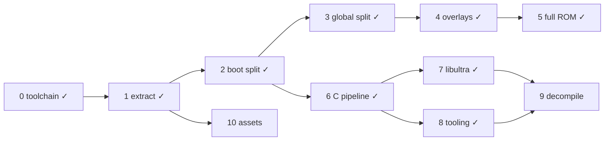

# DK64 Decompilation Roadmap

Target: Donkey Kong 64 (USA), `NDOE`, SHA-1 `cf806ff2603640a748fca5026ded28802f1f4a50`.
Compiler: IDO 5.3, `-O2 -mips2 -G 0`, libultra 2.0J, F3DEX2.

```sh
docker build -t dk64-decomp .   # once
tools/dk make setup             # extract ROM (BASEROM=donkey-kong.n64) + splat split
tools/dk make                   # build build/dk64.us.z64 and check SHA-1
```

## ROM map

Segment table at `0x8000DCC4`, 18 entries of 0x18 bytes:
`romStart, romEnd, vramStart, vramEnd, bssStart, bssEnd`.
ROM fields are written by boot (`0x80000764`); VRAM fields by `globalInit`.
Compressed segments are a gzip code member + gzip data member, zero-padded to `romEnd`.

| Table # | Name | ROM | VRAM | Notes |
|---|---|---|---|---|
| — | header / ipl3 | `0x0`–`0x1000` | — | CIC-6105 |
| — | entry | `0x1000`–`0x1050` | `0x80000400` | clears boot bss, jumps to `0x800009D0` |
| 0 | boot | `0x1050`–`0x11320` | `0x80000450` | uncompressed; text→`0x8000DCB0`, data `0xE8B0`, rodata `0x10F60`, bss `0x80010720`–`0x80016630` |
| — | rspboot | `0x11320`–`0x113F0` | — | RSP boot microcode |
| 1 | global | `0x113F0`–`0xCBE70` | `0x805FB300` | text 0x149160, data 0x1CBF0, bss `0x80761050`–`0x807FF100` |
| 2 | multiplayer (`ovl02`) | `0xD4B00`–`0xD6B00` | `0x80024000` | game mode 3 |
| 3 | minecart (`ovl03`) | `0xD6B00`–`0xD9A40` | `0x80024000` | mode 4 |
| 4 | bonus (`ovl04`) | `0xD9A40`–`0xDF600` | `0x80024000` | mode 8: bonus barrels |
| 5 | race (`ovl05`) | `0xDF600`–`0xE6780` | `0x80024000` | mode 5 |
| 6 | critter (`ovl06`) | `0xE6780`–`0xEA0B0` | `0x80024000` | mode 6 |
| 7 | boss (`ovl07`) | `0xEA0B0`–`0xF41A0` | `0x80024000` | mode 7 |
| 8 | arcade (`ovl08`) | `0xF41A0`–`0xFD2F0` | `0x80024000` | mode 9: DK arcade, data holds the arcade assets |
| 9 | jetpac (`ovl09`) | `0xFD2F0`–`0x101A40` | `0x80024000` | mode 10 |
| 10 | menu (`ovl10`) | `0xCBE70`–`0xD4B00` | `0x80024000` | mode 2: main menu / file select |
| 12 | — | `0x101A40`–`0x101C50` | — | raw viewport/display list data |
| 11, 13–17 | assets | `0x101C50`–`0x1FED020` | — | ~8.7k gzip streams |

Full per-segment details (stream offsets, sizes, hashes, gzip header fields): `bin/layout.json` after `make setup`.

## Done

- [x] **0. Toolchain** — `Dockerfile` (IDO 5.3 recomp, binutils, splat 0.50.1, spimdisasm, asm-processor, asm-differ, m2c); `tools/dk` wrapper.
- [x] **1. Extraction** — `tools/extract.py`: any byte order → `baserom.us.z64` (SHA-1 checked); per-stream binaries in `bin/segments/`; `bin/layout.json`. Verifies gzip CRC/size and that `vram + text + data == bssStart` for every segment.
- [x] **2. Boot split** — `dk64.us.yaml` splits entry + boot into 93 files; rest of ROM is one blob. Full ROM rebuilds byte-identical.
- [x] **6. C pipeline** — `src/boot/main.c` compiled with IDO via asm-processor; `dmaCopy` (`0x80000450`) matched in C.
- [x] **3. Global code split** — `dk64.global.us.yaml` splits `bin/segments/global.bin` (text‖data, concatenated by `make split`) into 144 text files + data/rodata (`0x15B390`, VRAM `0x80756690`)/bss; linked to `build/global.elf` with `--just-symbols=build/dk64.us.elf` so boot symbols resolve to the same addresses. `make` checks the ROM and `dk64.global.us.sha1` (text + data). Named `globalInit` (`0x805FB300`: fills segment-table VRAM fields, starts PI manager and the main thread) and `loadOverlay` (`0x80610350`: maps the overlay index in `$a1` to overlay 2–10, lays out the framebuffers and heap after it (sizes from the video-mode byte `0x8074450C`), clears its bss and loads it via `0x8060B140`).
- [x] **4. Overlay splits** — one splat config per overlay (`dk64.<name>.us.yaml`, segment id `ovlNN` kept for `bin/segments/`), all at `0x80024000`; each links to `build/<name>.elf` with `--just-symbols` of global and boot ELFs, is cut at its text size and checked against `dk64.<name>.us.sha1`. Overlay-local names go in `symbol_addrs.<name>.us.txt` (addresses collide across overlays). `loadOverlay`'s index (`$a1`) maps 2→menu, 3→multiplayer, 4→minecart, 5→race, 6→critter, 7→boss, 8→bonus, 9→arcade, 10→jetpac; 0–1 load none. Its caller `viModeSetup` picks the index from `D_807444EC` (3→arcade, 4→jetpac) or the per-map flags `D_807FBB64` (emulator traces, 2026-10-22: `0x1000` critter, `0x1` boss, `0x40000000` menu); `D_80744470` holds the aligned end of the loaded overlay (`0x80024000` = none). Text files: multiplayer 1, minecart 2, bonus 4, race 7, critter 2, boss 9, arcade 1, jetpac 5, menu 4. Data/rodata split everywhere except boss, whose rodata starts at `0x11CC8` (not 16-aligned; a separate subsegment gets `ALIGN(16)` padding), so it stays one `data` subsegment.

- [x] **5. ROM from rebuilt segments** — `dk64.us.yaml` now ends at `0x113F0` (boot ELF only). `tools/compress.py` gzips each built text/data stream with GNU gzip 1.2.4 `-9 -n` (built in the Dockerfile; reproduces all 20 members, while zlib matched 11 and gzip 1.12 matched 18) and zero-pads to the segment's ROM size. `make` assembles `build/dk64.us.z64` = `build/boot.bin` + global, menu, multiplayer … jetpac (ROM order) + `bin/segments/table12.bin` + `bin/segments/assets.bin` (raw tail from `extract.py`). ROM SHA-1 matches with every code segment rebuilt from source.

- [x] **8. Workflow tooling** — `tools/dk ./diff.sh [-s SEGMENT] FUNC` runs asm-differ per function (`diff_settings.py` maps each segment to its map file, built image and original bytes: boot `build/boot.bin` vs `baserom.us.z64`, global/overlays `build/<name>.bin` vs `bin/segments/<stream>.bin`; `-n` skips the rebuild). `tools/dk python3 tools/m2c.py [-s SEGMENT] FUNC` prints m2c starter C (nonmatchings or whole-file asm, referenced rodata files, context preprocessed from `include/common.h` into `build/m2c_ctx.c`). `tools/dk make progress` (`tools/progress.py`, `--json`) reports matched/total function bytes per segment. `tools/permute.py setup/run/best` wraps decomp-permuter (`/opt/decomp-permuter`) for near-miss search hints with `--stack-diffs` and `--stop-on-zero`. `tools/uopt_trace.sh [-l LEVEL] [-s src/...c] <file.c> [FUNC]` traces IDO 5.3 uopt priority-based register coloring via `/opt/ido5.3-trace` (`tools/ido/ecvt_fcvt.patch`, `-Wo,-zdbug:LEVEL`). Reviewed behaviourally equivalent C near-misses park under `#ifdef NON_MATCHING`; `tools/dk make NON_MATCHING=1` builds into `build_nonmatching/` without hash check (default `make` remains the sole matching gate; `make expected`/`progress` refuse `NON_MATCHING=1`). `hardware_regs: True` in every splat config; the 131 spimdisasm register names are linker symbols in `undefined_syms.us.txt`. CI dropped: single contributor, the local `make` hash check already gates every commit, and a hash-checking CI job would need the ROM hosted at a private URL.

- [x] **7. libultra** — DK64 links libultra **2.0J** (`BUILD_VERSION=VERSION_J`): J-only features present (pfs inode cache, separate `pfsselectbank.c`, `__osPfsLastChannel`, `__MotorDataBuf`, 2-arg `__osPfsRequestOneChannel`, `__osEPi*` names) and K/L ones absent (`guMtxXFML` still in `mtxcatl.c`, no `__osEepromRead16K`). Headers are decompals/ultralib's (`include/PR`, `include/PRinternal`, `include/libultra`, `include/compiler/ido`). Boot libultra spans ROM `0x5120`–`0xE8B0`; every C-sourced file is `src/boot/libultra/<ultralib dir>/<file>.c` with its own `.data`/`.rodata`/`.bss` subsegments, compiled with ultralib's J flags by path (Makefile; `io/` files that need `-O1` are listed there). The 23 handwritten-asm files stay splat asm under `asm/libultra/` (`os/exceptasm`, `os/interrupt`, cache/TLB/SR/FPCSR/intmask/compare helpers, `libc/bcopy`/`bcmp`/`bzero`, `gu/sqrtf`). The original identification mislabeled several files (gu shift, sinf/cosf, controller/pfsisplug, getthreadpri/id, vimgr, epirawdma, VI modes, PIF RAM buffers); names now follow code behaviour and data contents. Global holds no libultra; it holds the n_audio library (named in `symbol_addrs.us.txt`, not ultralib). Per-object compare for concurrent matching: `tools/objdiff.sh src/....c` against `expected/` snapshots.

- [x] **11. Emulator tooling** — Docker sessions running ares-64 with GDB server (port 9123), Xvfb/x11vnc (port 5900, password `dk64`), session CLI (`tools/emu/emu.py`), save-state library (`tools/emu/states.py`), map warping and map sweeps via `func_805FF378` safe-point infcall (`tools/emu/warp.py`), dynamic breakpoint coverage (`tools/emu/coverage.py`), and function tracing and argument inspection (`tools/emu/study.py`). Symbol resolution and overlay detection in `tools/emu/symbols.py`. Session runtime output in `emu/` (gitignored). Skill at `.omp/skills/emulator/`.

## To do

### 9. Decompilation (ongoing)
Near-miss and large-function work now follows the stage order with uopt_trace and the permuter. Suggested order, one subsystem per unit of work:
- [ ] Boot game code (ROM `0x1050`–`0x5120`, `0x6690`): C in `src/boot/{main,1630,1CC0,30E0,3630,3D20,6690}.c`, boot at 79.6% of function bytes. Matched: `dmaCopy`, `bootMain`, boot threads and init (`bootMainThread` fills `gSegmentTable` from per-segment `<seg>_ROM_START/END` linker symbols in `undefined_syms.us.txt`, one name per reference), the "Expansion Pak not installed" screen (`noExpPak*`, `bootDrawString/Glyph`), gzip 1.2.4 inflate (`huft_build` … `inflate`, `gunzip`, `get_method`), Rare libc (`_str*`, `_memset`, `_itoa`, `_sprintf`). Hand-written asm, kept as splat `asm`: `memcpy` (`0x3C00`, `ld`/`sd`) and the LZ bit-stream decoder at `0x3390`–`0x3630`. Remaining: `vsprintf` (stored stage-4 draft `drafts/boot/vsprintf.c`: frame 440 and saved-register set match, 1168 vs 1189 insns; the `conv` u8 is never coloured into s4).
- [ ] Scheduler, threads, message queues (global): `src/global/0.c` (`0x805FB300`, main-thread init, display-list setup) and `src/global/131B0.c` (`0x8060E4B0`, rumble pak) + `src/global/13980.c` (`0x8060EC80`, RCP scheduler: hidden TU found 2026-11-02 via `schedMain`'s `.align 5` tail nops) are C units with their own `data` (named asm) and, for 131B0, `.rodata` subsegments. 53 of 55 functions matched (131B0 28/30; 13,596 bytes in global; +22 functions matched this unit including `func_805FD088` [1220 insns], `func_805FC2B0`, `func_805FE7FC`, `schedCreate`, `schedHandleRDP`, `schedTaskDone`, `schedAppendTask`, `rumbleMotorStop`, `rumbleUpdate`). **2026-10-29 early-units revisit:** the unit carved 0.c's `.data` (`0x149160`) and `.bss` (`0x80761050`) and 131B0's `.bss` (`0x807F02D0`–`0x807F0570`) into C, and found a hidden TU `src/global/450.c` at `seg11DmaRead` (`0x805FB750`, proven by `mainThreadLoop`'s `.align 5` epilogue) with its own part of 0.c's data/bss and `.rodata` `0x15B290`–`0x15B2E0`. Matched: `globalInit`, `mainThreadHalt`, `viModeSetup`, `mainThreadLoop`, `pauseStateUpdate`, `playerViewsBuildMatrices`, `rumbleResetAll`, `schedStartAudioOrYield`, `schedStartTask`, `schedYield`, `schedHandleRetrace`, `schedHandleRSP`. Remaining (parked NON_MATCHING): `schedMain` (stage 6: one `bnez`/`bnezl` delay-slot choice, `move s0,zero` must be live at the branch target), `schedDlDebugDump` (stage 4-5: uopt hoists `D_807F0568`/`D_80746A2C` addresses into pointer registers where the target re-emits `lui`). 2026-10-31 leftovers revisit 3: no new matches in 131B0, both parks stay (`schedMain` stage 6: the second compare of the `-0x9F..-0x100` range check gives `bnez; move s0,zero` where the target has `bnezl` + `slti`, ~3800 single dead-statement insertions and every loop/compare spelling gave no `bnezl`; `schedDlDebugDump` stage 4-5: spelling the `osContGetReadData` argument as `(u8 *)&D_807F0564 + 4` took the diff from 142 to 133 lines, `D_80746A2C` is still pointerised into `a1`). Named: rumble pak `rumbleResetAll`, `rumbleGetPakState`, `rumbleRequest`, `rumbleInfoCancel`, `rumbleCancel`, `rumbleShutdown`/`rumbleInit` (identical bodies, told apart by caller), `rumbleShouldPause`, `rumbleUpdate`, `rumbleSetPaused` (state `gRumbleInfo` (was `D_807F0470`), `gRumblePfs` (`D_807F02D0`), `gRumblePaused` (`D_80746810`), `gRumbleResetPending` (`D_80746818`)), scheduler `schedGetCmdQueue`, `schedHandleNewTask`.
- [ ] Heap / memory allocator (global): `src/global/15050.c` (`0x80610350`–`0x80611850`) is a C unit with its own `data` (`0x14B730`, named asm) and `.rodata` (`0x15BF90`, `loadOverlay`'s two jump tables). Types in `include/heap.h`: `HeapBlock` (0x10-byte header: physical prev, size, free-list next/prev; payload[-5] is the tag 0 normal / 1 locked / 2 survives overlay load), `HeapPool` (0x14-byte descriptor in `D_807F0988`, pool 0 = best-fit heap, others fixed-size), `DeferredFree` (queue `D_807F0A58`, 0xA00 entries). 29 of 30 functions matched (`heapFree`, `heapFreeDeferred`, `heapQueueDeferredFree`, `heapCoalesce`, `heapLock/UnlockBlock`, `heapBlockSize`, `heapClearBlock`, `heapFillBlock`, `heapFreeBytes`, `heapAllocFromPool`, `heapSortPools`, `heapRebaseHandles`, `func_80611154/60/6C`, `func_80611724`, `func_80611844`). **2026-10-29 early-units revisit:** 11 more matched (`heapSortSurvivors`, `heapMoveWords`, `heapInitGeneralPool`, `heapBestFitAlloc`, `heapFreeToPool`, `heapRegisterSurvivor`, `heapUnregisterSurvivor`, `heapTickDeferredFrees`, ...). Remaining (parked): `loadOverlay` (stage 4, regalloc of `bssSize`/`cur`). 2026-10-31 leftovers revisit 3: `heapInitBlockPool` (narrows the `u16` formal in place, a separate `u32` copy for the stores), `heapReleasePool` (real `x`/`y` locals plus three tagged FAKEs) and `heapAlloc` (the first loop header moved onto the function's `{` line: the `.loc` line order steers as1's prologue schedule) matched; named `heapRebaseHandles`, `heapReclaimMatrixCache`, `heapTickDeferredFrees`.
- [ ] Controller input (global): `src/global/F600.c` (`0x8060A900`–`0x8060B140`) is a C unit with no own data/rodata (its globals `D_807ECCD0`–`D_807ECDFC` are BSS, the flags `D_807463B8`/`D_807467C4`/`D_80746834` sit in the shared data blob). 9 of 10 functions matched: `controllerInit` (SI queue, `osContInit`, `osContSetCh(4)`, pad buffers `D_807ECD10`/`D_807ECD28`), `controllerStartRead`/`WaitRead`/`GetReadData` (`D_807ECD08` = read pending, `D_807467C4` must be `volatile u8`), `controllerSetActiveMask`, `controllerGetPort` (slot → port table `D_807ECDFC`), `controllerCompactPads` (6-byte `OSContPad` struct copies), `controllerGetActiveMask`, `controllerLatchPad`. **2026-10-29 early-units revisit:** F600's `.bss` `0x807ECCD0`–`0x807ECE00` is now defined in C (`D_807ECD40/48/50` are `u16`). Remaining: `controllerUpdate` parked at stage 5 (7 callee-saved and frame match with 4 FAKEs; register assignment of the row pointer / const 2 / pressed pointer differs). 2026-10-31 leftovers revisit 3: `controllerUpdate` stays parked at stage 5 (callee-saved set s0-s6 and frame 56 match; the target keeps one extra caller-saved register busy in the pressed/row-pointer window, about 250k variants, best 59 lines from 87).
- [ ] Main loop and map loading (global): `src/global/3C10.c` (`0x805FEF10`–`0x80600950`, own data `0x1492E0`–`0x149FA0` as named asm, `.rodata` `0x15B390`–`0x15B4B0` = `jtbl_80756690`), `src/global/5650.c` (data `gTimerQueue`, `0x149FA0`), `src/global/5A50.c` (data `D_807452B0`, `0x149FB0`). 67 of 72 functions matched. 3C10 (33/37): map/mode transitions (`func_805FF378` sets next map `D_807444E4` / exit `D_807444E8`; current map `gCurrentMap`), the 18-entry 0xC0-byte slot array `D_8076A160` (`Struct8076A160`, ends at `D_8076AEE0`; find/free/free-all by map id), mode tables `D_807445E0`/`D_80744720`/`D_80744734`/`D_8074482C`, `frameTimingReset` (`D_8076AF00` history, `D_8076AF14` per-map flag). 5650 (6/6): timed-callback queue sorted by frame `D_8076A068` (`timerQueueInit/Add/Update/Cancel/PurgeFlagged`; `timerQueueAdd` hides a PI-read anti-piracy check that doubles the delay). 5A50 (28/29): `gSeqPlayers` wrappers (`seqPlayerPlay`, `GetState`, `SetTempo`, `GetSeq`, `GetCurTime`, `SendMidi`, per-channel mask loops). **2026-10-29 early-units revisit:** 3C10 now defines its `.bss` (`0x8076A160`–`0x8076AF00`); a hidden TU `src/global/5230.c` (`func_80600530`, `frameTimingReset`, `frameTimingUpdate`; `.bss` `0x8076AF00`–`0x8076AF20`, `.rodata` from `0x15B390`) was split off, and 3C10's `.rodata` now starts at `0x15B2E0`. Matched: `func_805FEF10`, `func_805FF9AC` (literal 255.0), `func_80600174`, `frameTimingUpdate`, `audioInit`. 3C10/5230/5A50 have no GLOBAL_ASM left.
- [ ] Actors and behaviours (global). First unit: the actor core. `src/global/7CA80.c` (`0x80677D80`–`0x8067B450`, `.rodata` `0x15DF60`, which includes the unreferenced kong-name strings `"DONKEY"`…`"ENGUARDE"` ahead of `jtbl_807592A4`, so they belong to this TU) and `src/global/80150.c` (`0x8067B450`–`0x80684550`, `.rodata` `0x15E090`–`0x15E790`) are C units; data stays in the shared asm blob. Shared types in `include/actor.h` (`Actor`, callback node, delayed-queue entry, `ActorEntry` = active list `D_807FB930` with count `D_807FBB34`, `ActorGlobalState` = `D_807FBB70`). 7CA80: 62 of 73 matched (subsystem `actorInit`, spawn `actorSpawn`/`actorSpawnFromInfo`, despawn `actorDespawn` → deferred queue `D_807FBE10` (`actorQueueOrDespawn`, `actorFlushDespawnQueue`) or `actorFreeImmediate`, active list `actorRegisterActive`/`actorDeregisterActive`/`actorFindByType`/`actorIsActive`/`actorDespawnByOwner`, per-actor callback list at `+0x13C` (`actorAllocCallbackNode`, `actorAppendCallback`, `actorFreeCallbackList`, delayed queue `D_807FBF18` `actorQueueDelayedCallback`, global table `D_807FBFE0` `actorRegisterGlobalCallback`), sorted actor table `D_807FBFF0` (`actorTableClear`/`Insert`/`Remove`/`Contains`/`BinarySearch`/`Sort`)). Remaining GLOBAL_ASM: `actorGlobalCallbacksDispatchAndFree` (1 insn, `%lo` order), `playerHandleDamageReaction` (2 prologue insns, reassigned `u8` arg), `func_8067A1DC` (frame 0x78 vs 0x70), `playerSetActiveGlobals` (6 insns `$v0`/`$v1`), `actorCallbackListSort` (temp rotation), `actorDelayedCallbacksTick` (`$s0`/`$s1` swap), `actorUpdateActiveList` (saved-register permutation), `actorGlobalCallbacksReset`/`func_806789E4` (adjacent BSS stores `D_807FBFE0`–`EC` need separate `lui`s), `func_80678050` (frame 0x48 vs 0x40), `actorDispatchCallbacks` (605 insns, sparse flag switch with two jump tables). 80150: 47 of 64 matched (tag barrel: `tagBarrelSpawnKongs`, `tagBarrelIsKongUnlocked`, `tagBarrelInitUnlockedKongs`, `tagBarrelUpdateSelectedKong`, `tagBarrelUpdateInteractable`, recoil `tagBarrelTriggerRecoil`/`tagBarrelCheckRecoil`/`tagBarrelResetMovement`). Near misses: `tagBarrelDespawnEffects` (2 insns, CSE of constants 1/2), `func_80681E18` (one register), `tagBarrelUpdate` (4 regs), `func_80682AB4` (4-insn size, FPR saturation), `func_806832F4` (frame 0x30 vs 0x28), `func_8067BD28`/`func_8067BA7C`/`func_8067B4C8` (saved-register choice), `func_80683AD8` (frame 0xB8 vs 0x108), `func_8067FB6C` (802 insns, `$t1`/`$t2` only), `func_8067E784` (1387, 8 insns), `func_8067C71C` (1419, 19 insns of delay slots); `func_806833DC`, `tagBarrelCheckProximityAndFall`, `func_806836D0`, `func_806822FC` drafted, `func_806809F0` (1139) unattempted. Drafts: `.scratch/<agent>/<FUNC>_best.c` (gitignored, local only). Second unit, behaviour files: `src/global/79890.c` (`.rodata` `0x15DEA0`) 6 of 8, `7A510.c` (`0x15DEC0`) 8 of 13, `7AF60.c` (`0x15DEE0`) 27 of 29, `7BBD0.c` (no rodata) 3 of 6, `89250.c` (`0x15E790`–`0x15E8B0`) 34 of 40 matched; data stays in the shared blob. `77B90` stays asm: hand-written 64-bit collision code (`ld`/`sd`/`dmult`, `$k0`/`$k1`, non-standard register arguments), like `15010`, `16B60`, `61690`. Named (35): actor predicates and helpers (`actorIsFacingTarget`, `actorCheckFacingTarget`, `actorIsTargetWithinAngle`, `actorListContainsId`, `actorIsDamageFatal`, `actorApplyDamage`, `actorInitHealth`/`actorInitDamage`, `actorGetMatrix`), effect spawners in 89250 (`effectSpawn*`: bone, debris, smoke, sparks, rings, `effectSpawnJointBeam`), `actorUpdateEffects`, `particleInitDefaultState`. Near misses: 79890 `func_80674E14` (2 loads swapped), `func_80674B90` (scheduling); 7A510 `actorCollisionCheckBoundingBoxes` (2 stores swapped), `actorCollisionUpdateNodeFlags` (`$s1`/`$s2`), `actorCollisionFindTableEntry` (`$s2`–`$s4` permutation), `func_80675AFC` (loop shape), `func_80675810` (187 insns) unattempted; 7AF60 `actorCheckPlayerProximityVertical` matches in C (`drafts/global/actorCheckPlayerProximityVertical.c`) but its C jump table loses the 4-byte late_rodata pad before asm `actorTriggerPlayerKnockbackSound`'s floats, so match it together with `actorTriggerPlayerKnockbackSound` (1 insn: `move $a3, $a0` vs a spill); 7BBD0 `actorCheckCollisionsAgainstActiveActors` (2-insn scheduling), `actorCollisionReflectAndPush` (305 insns), `func_806776A0` (387); 89250 `effectSpawnMultiTierRingWithActor`/`effectSpawnChildAtNode` (1 insn each, narrow param reloaded from its home slot), `effectActorCheckGroundScaleSpawn` (frame 0x20 vs 0x28), `func_806871DC` (3 insns), `effectSpawnScatterRandom` (register rotation), `effectSpawnDebrisParticles` (5 insns, one stack slot). Third unit, actor lists and rendering helpers: `src/global/8CA50.c` (no rodata) 18 of 19, `8D3E0.c` (`.rodata` `0x15E8B0`) 40 of 47, `8F050.c` (no rodata) 5 of 7, `8F4B0.c` (`0x15EA00`) 11 of 15, `90D80.c` (`0x15EC30`–`0x15EC70`) 11 of 17 matched; data stays in the shared blob. Splat's `8F4B0` is two TUs: the `"%d"`/`"HIT"` strings after its late_rodata start `90D80` (`texCacheReset`), confirmed by its first data object `D_807501E0` being 16-aligned. Named (53): animation-node lists in 8CA50/8F050 (`anim*`: `animListInit`, `animListUpdate`, `animListFree`, `animStopAtFrame`, setters), the actor node list `D_807FC400` in 8D3E0 (`ActorListNode`, `ActorListRecord` in the file; `actorListAllocId`, `actorListRemoveNodeInternal`, `actorListSerialize`, `actorListFreeAll`, `actorSetCustomFloat`, `playerGetMinSquaredDist3D`, `mapIsBossArena`), 8F4B0 `actorSpawnInitialSet`, 90D80 texture cache `D_807FC690` (`texCacheFindOrLoad`, `texCacheUpdate`) and render callbacks `D_807FC630` (`renderCallbacksRegister`, `renderCallbacksExecute`, `renderRotatedQuad`). Near misses (drafts in `drafts/global/`): 8CA50 `animNodeAdvanceTime` (int-decrement reassociation); 8D3E0 `actorMapModelsSetup` (1 delay-slot insn), `actorListSetCustomFloat` (bool slot 0x27 vs 0x2F), `actorListInitOffsets` (delay slot + `addu` operand order), `actorListSpawnNodeInternal` (one stack slot), `func_80688A6C`, `actorListFindClosestTargetIndex` (regalloc), `func_80689418` (176 insns); 8F050 `actorConfigLookup` (`$a0`/`$a2`), `actorProximityUpdate` (2 temps); 8F4B0 `lightUpdateFromActorLighting` (26 insns), `cutsceneTriggerCheck` (16), `playerCameraUpdateFromTarget` (4), `actorCutsceneDispatchEvents` (713 insns, one-register shift); 90D80 `renderCountdownTimerHUD` (1 insn), `renderHitCounterHUD` (3), `renderTimerMinutesSecondsHUD` (one stack slot), `renderScrollingBackdropQuad` (2 regs), `hudDrawRollingCounter` (4 insns of 520), `renderRotatedSprite` (815 insns: `u16 arg1` prototype + single-exit epilogue fixed; frame 0x1B0 vs 0x1A8). Fourth unit, actor collision / matrices / projectile behaviour: `src/global/70FD0.c` (`0x8066C2D0`–`0x80672E90`, `.rodata` `0x15DD50`) 73 of 79 matched, and `src/global/936B0.c` (`0x8068E9B0`–`0x80697230`, `.rodata` `0x15EC70`) 53 of 54 matched; data stays in the shared blob. 82 functions named in `symbol_addrs.us.txt`. 70FD0: matrix/vector math, actor sub140 model/subnode lists (`ModelNode`, `ModelSubNode`, `ActorSub140` in `include/actor.h`), collision triangles (`CollisionTri`, `CollisionBox`), angle helpers, facing/offset/extents updates. Named: `collisionTransformNode`, `dynamicBufferFree`, `collisionBufferCacheUpdate`, `collisionPurgeExpiredBuffers`, `collisionIsTriangleDegenerate`, `actorSub140Free`, `actorSetNodeValue`, `actorOrNodeFlags`, `actorClearNodeFlags`, `actorSub140Alloc`, `actorAppendModelSubNode`, `actorAppendModelNode`, `actorFreeModelNodeList`, `actorGetOrSetNodeScale`, `actorSetNodeFlag`, `actorClearNodeFlag`, `actorClearAllNodeFlags`, `actorSub140SetVectors`, `actorUpdateModelMatrices`, `collisionBuildBoxFromMatrix`, `actorSetTargetAngleAndCheck`, `actorClearTargetAngle`, `actorCheckTargetAngle`, `actorQueueCollisionCallbacks`, `actorReflectCollisionAngle`, `actorGetCollisionThreshold`, `actorSetTargetAngleBounds`, `actorCheckTargetAngleBounds`, `actorUpdateFacingAndOffset`, `actorUpdateCollisionExtents`, `actorUpdateSubActorOffsets`, `actorGetPlayerThreshold`, `actorGetNodePos`, `actorGetSubNodePos`, `actorStepSubNodeList`, `actorTouchSub140Timestamp`, `actorUpdateMovementFlags`, `actorHasActiveMovementFlags`, `actorClearMovementFlags`, `actorSetCameraBoundaryMode`, `actorCheckCameraBoundaryCondition`, `actorBoundaryStub`, `actorRng`. 2026-10-29 unit matched 21 more (incl. `actorBuildCollisionHit`, `collisionBuildPlane`, `actorSub140BuildBoxes`, `collisionTestSphereSlots`); left, all with drafts: parked stage 6 `func_8066D4DC` (413 insns, FP `add.s` destinations only), `func_8066DB40` (7 insns: min/max `a0`/`v0`/`v1` picks), `func_80671528` (FP temp numbering); stage 5 `func_80670548` (458, two spill slots 4 bytes low + one `or` operand order); stage 4 `func_8066E2C0` (copy-loop `k`/`dst` registers swapped); GLOBAL_ASM stage 3–4 `func_8066FE08` (464, frame exact, regalloc). 936B0: actor/projectile behaviours, tracking, particle effects (`D_807FBB40` current actor, `D_8076A068`). Named: `actorSnapToBone`, `actorSyncTransformFromParent`, `mathPickCloserTargetPoint3D`, `actorInterpolateAngles`, `actorAllocSubBuffer`, `actorInitAnimations`, `actorInitFromSpawnPoint`, `actorSpawnChildActor`, `actorUpdatePlayerInteraction`, `actorClearSubState`, `projectileSetSpawnFlag`, `projectileSetTargetCoords`, `projectileGetTargetCoords`, `projectileSpawnNodeEntry`, `projectileCalculateTrajectoryAndSpawn`, `projectileAimAndSpawn`, `projectileClampAngleAndSpawn`, `projectileAimFromActorAndSpawn`, `actorSpawnSparkleBurst`, `projectileSpawnWithShockwave`, `projectileSpawnActor107`, `projectileSparkleUpdate`, `projectileSparkleUpdateGold`, `projectileSparkleUpdateSilver`, `projectileSpawnParticleEffect`, `projectileSpawnParticleEffect2`, `projectileSpawnParticleEffect3`, `projectileSpawnParticleEffectWithScale`, `projectileDespawnOrExplode`, `projectileMultiplayerUpdate`, `projectileSpawnExplosion`, `projectileBeamUpdate`, `projectileRotatingUpdate`, `actorIsActiveType2B`, `projectileMatrixRotationUpdate`, `actorApplyTransformAndRender`, `projectileParticleSpawnerTick`, `projectileHomingParticleUpdate`, `actorAppendActiveCallback8`. 2026-10-29 unit matched 14 more incl. the large `projectileBounceExplodeScaledUpdate` (663 insns), `func_8068EF54` (533), `projectileBounceParticleUpdate` (515), `projectileChaseTargetUpdate` (414), `projectileFindHomingTarget` (427); left: `func_8068F72C` (522, parked stage 5–6: actor/`temp_v0` should share `s0` while `arg3` is re-`lbu`d per use). **2026-10-29 revisit unit** (all 66 remaining functions of these 12 files; 26 matched, +16,468 function bytes): hidden TU `src/global/7BA00.c` (`[0x7BA00, c]`, `.rodata` `0x15DF50`) split off 7AF60 at `actorTriggerPlayerKnockbackSound` (7AF60's rodata ends with a 4-byte pad after `jtbl_807591E8`), which landed `actorCheckPlayerProximityVertical` + `actorTriggerPlayerKnockbackSound`. Now matched: 7CA80 64/73, 80150 51/64, 79890 6/8, 7A510 11/13, 7AF60 28/28, 7BA00 1/1, 7BBD0 4/6, 89250 39/40, 8CA50 18/19, 8D3E0 41/47, 8F050 6/7, 8F4B0 13/15 (incl. the 676-insn `actorCutsceneDispatchEvents`), 90D80 16/17 (incl. `hudDrawRollingCounter`, `renderScrollingBackdropQuad`); 44 functions named. Left (drafts in `drafts/global/`, parked = `#ifdef NON_MATCHING` in src): stage 5 parked `func_80678050`, `playerHandleDamageReaction`, `actorCallbackListSort`, `func_80681E18`, `func_806832F4` (3 insns), `func_806833DC` (one spill slot), `func_80683AD8`, `actorCollisionReflectAndPush`, `func_806871DC`, `actorMapModelsSetup` (1 delay slot), `actorListInitOffsets` (1 insn), `actorProximityUpdate`, `lightUpdateFromActorLighting`, `playerCameraUpdateFromTarget`; stage 4 parked `func_80682AB4`, `func_806836D0`, `actorListSpawnNodeInternal`, `actorListFindClosestTargetIndex`; stage 5 drafts `actorUpdateActiveList`, `actorDispatchCallbacks` (605, 7 insns), `func_8067FB6C` (802), `func_8067E784` (1387), `func_8067C71C` (1419, temp coloring only), `func_80674B90`, `func_80674E14`, `func_80675810`, `func_80675AFC`, `animNodeAdvanceTime`, `func_80688A6C`, `func_80689418`; stage 4 `actorGlobalCallbacksReset`/`func_806789E4` (the `D_807FBFE0`..`EC` clears: target shares one `lui $at` per pair, no tried C form reproduces it), `func_806822FC` (497), `func_806776A0`; stage 3 `actorDelayedCallbacksTick` (frame 0x30 vs 0x28), `func_8067A1DC` (0x78 vs 0x70), `func_8067B4C8`, `func_8067BA7C`, `func_806809F0` (1139, 3 insns short), `renderRotatedSprite` (815, one extra insn). 2026-10-31 oldest-leftovers revisit 2: 70FD0 +4 (`collisionBuildStaticTri`, `actorComputeBoxNormal`, `actorResolveModelSlotCollision`, `actorSub140CreateFromData`; `actorSub140Alloc` now returns its `ActorSub140 *`); left parked: 70FD0 `func_8066D4DC` (stage 6, FP temp phase in the second cross product), `func_8066FE08` (stage 5, 6 rows: `subu` temp `v0` vs `a0`, sin/cos spill `0x3C` vs `0x44`); 936B0 `func_8068F72C` (stage 5, equivalent park replacing one that loaded the wrong field; t-ring and `sp48` web left). **2026-10-31 actor revisit 2** (the 40 functions left in 7CA80, 80150, 79890, 7A510, 7BBD0, 89250, 8CA50, 8D3E0, 8F050, 8F4B0, 90D80; supersedes the near-miss lists above): 39 matched, these eleven files are complete except `func_80682AB4` (80150, parked stage 5: chain 2's `andi`/`sll` ring temps t3/t4 vs t8/t9, ~25k probes). 7CA80 now owns `.bss` `D_807FBFE0[4]` (`0x807FBFE0`–`0x807FBFF0`: `actorGlobalCallbacksReset`/`actorUpdateWhilePaused` clear it with one `lui at` per store pair). Largest matches: `func_8067C71C` (1385 insns, two unused-result callees declared `s32`), `transformBarrelUpdate` (1233, `(u32)` selector casts), `tagBarrelActorUpdate` (1097, counterless loop via a `switch` with `default`), `renderRotatedSprite` (815, narrow params), `func_8067FB6C` (770). Named 56 (`actorAllocate`, `actorUpdateWhilePaused`, `actorDispatchCollisionResults`, `actorCollisionProcessHit`, `actorCollisionCheckNodeSpheres`, `actorListBuildLookupTable`, `actorListUpdateSpawns`, `tagBarrelStartSelection`/`UpdateSelection`/`RenderSelectionHud`/`CheckKongFlag`, `rocketbarrelUpdate`, `cannonUpdate`, `effectSpawnActorBoneEffects`, the `actorList*` spawn/despawn predicates, ...); `func_8067B4C8`, `func_8067FB6C`, `func_8067C71C`, `func_8067BA7C` stay unnamed (object unidentified).
- [ ] Collision state, triangle tests, collision BST and asset tables (global `0x80663C60`–`0x8066C2D0`): six C units. `src/global/68960.c` (1/1, `mapUpdateFogDistance`), `68AA0.c` (3/3), `68EA0.c` (8/8; `D_807F9420`/`D_807F9430` actor target/proximity tables: `actorInitTargetEntries`, `actorInitEntryPoints`), `699B0.c` (2/2, path-trail particles `particleSpawnPathTrail`), `69E60.c` (15/15, actor velocity/angle math: `actorStepPhysics`, `actorApplyVelocity`, `mathAngleBetweenPointsDeg`), `6AD90.c` (81/88: collision-state bss block `D_807F9460`–`D_807F951D` and getters, floor queries `collisionCheckActorFloor`/`collisionGetFloorHeight`/`collisionTestSubmeshBoundary`, dynamic collision buffers `D_807F9514` (`dynamicBufferAllocateEntry`/`dynamicBufferPurgeExpired`), hit table `D_807F94C0` (`collisionRecordTriangleS`/`F`, `collisionCheckBoxTriangleWinding`), ROM asset tables `D_807F9528`/`D_807F95A8` (`collisionInitTables`, `assetInflateAndFree`, `assetGetSize`, `assetFreeBuffer`, `dmaDrainQueueAndFreeBuffer`), and the 20-bucket collision BST `D_807F9628` with its 64-entry history queue `D_807FB228` (`collisionGetBucketIndex`, `collisionBstInsert`, `collisionBstDelete`, `collisionBstRebalanceBucket`, `collisionBstBuildBalanced`, `collisionQueueSearch`)). 86 of 117 matched, 69 named. Rodata `.rodata` at `0x15DAF0` (68960), `0x15DB10` (68EA0), `0x15DB20` (699B0), `0x15DB30` (69E60), `0x15DBC0` (6AD90); 68AA0 has none. splat's `699B0` file is three TUs (`699B0`/`69E60`/`6AD90`): 8 zero bytes end the rodata at `0x15DB28` and `0x15DBB8` (16-byte object padding, flagged by `tools/rodata_owners.py`). The f32+f64 pairs `D_80758F70`/`D_80758F78` and `D_80758FE4`/`D_80758FE8` need the double forced into its function (`symbol_addrs.us.txt`). 2026-10-29 unit: 68AA0/68EA0/69E60 complete; 6AD90 matched 19 more incl. `collisionTestStaticMeshFloor` (731 insns, needed `u8` returns on `collisionTestHardcodedFloorPlane`/itself and an ANSI `collisionStoreTriangleNormalAnglesS16`) and the three normal-angle callers once `collisionStoreSurfaceNormalAngles` took a word-sized unused first param. Left, all parked with drafts: `func_80666090` (stage 5, two commutative `addu` operand orders), `collisionFindFloorAtPoint` (418, stage 4–5: `sp34` triple vs f32 spill temp slots), `func_80668C30` (stage 4–5, FP picks), `func_80668E9C` (445) and `collisionTestActorBoxFloor` (stage 4–5: uopt CSEs `ny*2000.0` the target recomputes), twins `func_80669E04`/`func_8066A988` (stage 4: target keeps three of six vertex floats in memory). 2026-10-31 oldest-leftovers revisit 2: 6AD90 +2 (`collisionBuildCellTable`, `collisionPointInTriangleXZS16`); left parked: `collisionFindFloorAtPoint` (stage 5, three u8 expression candidates coloured), `func_80668E9C` (stage 5, compiler-temp slots 12 bytes low), `collisionTestActorBoxFloor` (stage 5, 2000.0 not kept in `f26`), `func_80669E04`/`func_8066A988` (stage 4, stack-home layout).
- [ ] Render segment 6, billboard and matrix caches, effect nodes / water, actor target table and trigger zones (global `0x8065CDA0`–`0x80663C60`): five C units, data in the shared asm blob, `.rodata` at `0x15DA60` (61AA0), `0x15DAC0` (63810), `0x15DAD0` (63EC0), `0x15DAE0` (67890); 684C0 has none. `tools/rodata_owners.py` flags no hidden TU here (the `D_80748310`/`D_80748370`/`D_807483D0` data pads all belong to `renderSetSegment6AndFog`). `src/global/61AA0.c` (22/22: segment-6 display-list templates `renderReplaceSegment6Commands`/`renderSetSegment6AndFog`, distance fade `renderCalcPlayerDistanceAlpha`, 4-entry billboard cache `gBillboardCache` (`billboardCacheInit`), 100-bucket matrix cache `D_807F8EC0` with LRU list `D_807F9050`/`D_807F9054` (`matrixCacheHash`, `matrixCacheDecayLimit`), `mapIsBonusOrSpecial`), `63810.c` (3/3, `actorSetTargetSlotByte`), `63EC0.c` (53/53: effect node list `gEffectNodeList` (`EffectNode`), table `D_80748A90` (`EffectTableEntry`), `effectUpdateAndDispatch` (also an anti-piracy PI checksum), `waterRippleStart`/`Step`/`Stop`, texture/mipmap display-list builders, `effectWaterRenderSurfaces`), `67890.c` (3/5: target table `D_807F93F0`/`D_807F93F4`, `actorCalculateTargetDistancesAndAngles`, `renderDepthSortedTargets`), `684C0.c` (5/6: trigger-zone list `D_807F9410`: `triggerZoneInit`, `triggerZoneCheckEntry`, `triggerZoneUpdate`). 89 of 89 matched, 89 named. Near misses (drafts in `drafts/global/`): `matrixCacheLookup` (319 insns, 1 insn), `matrixCacheInsert` (2: prologue `move a0,v1`, return reload slot), `matrixCacheEvict` (2: home-slot spill / `andi` order), `matrixCacheInit` (2: `addiu` order), `billboardCacheEvictStale` (3: `addiu` order), `renderTargetQuad` (5: `osVirtualToPhysical` arg register), `triggerZoneRemoveSpawned` (`$v1` vs `$a2`), `actorTargetTableLoad` (16: `i << 6` CSE), `lightFlushQueued` (8: call arg order), `effectWaterInitNodes`/`effectWaterUpdateMeshes` (`$s7`/`$s8` swap), `effectNodeComputeBounds`/`effectWaterSetMeshHeightsAlpha`/`effectWaterGetHeightAt`/`effectWaterSetMeshPositionsUV` (frame size), `effectWaterApplyLights`, `effectWaterSetScissor`, `effectWaterBuildMeshGdl`, `lightQueueKeyframed` (leaf frame), `billboardRenderQueued` (427, loop-1 induction regalloc), `billboardSubmit` (461, far). **2026-10-29 early-units revisit:** 61AA0 now 21/22, plus 63810, 67890, 684C0 and 63EC0: matched `billboardCacheEvictStale`, `matrixCacheInit`, `matrixCacheLookup`, `matrixCacheInsert`, `matrixCacheEvict`, `billboardRenderQueued`, `lightFlushQueued`, `renderTargetQuad`, `actorTargetTableLoad`, `triggerZoneRemoveSpawned`, `effectWaterSetScissor`, `effectWaterApplyLights`, `effectWaterInitNodes`, `effectWaterUpdateMeshes`, `effectWaterSetMeshHeightsAlpha`, `effectWaterSetMeshPositionsUV`. Remaining: none, all five units are matched. 2026-10-31 leftovers revisit 3: `billboardSubmit` (the loop-2 compare is now `(u32)gBillboardCache[i].unk0 == 0xFFFFFFFF` plus a tagged dead read of the same typed `-1`, which moves the hoisted constant load to the front of the preheader so as1 fills the `bnez` delay slot with it), `lightQueueKeyframed` (key-frame base written `k0 + (n0 - k0) * t` then `* factor`, the `gLightQueueCount++` folded into the last store's index, `unk10` stored first), `effectWaterGetHeightAt` (own `r` result local, `WATER_SUB`/`WATER_ABS` inlined so no `sub`/`d`/`sin1` frame slots, one tagged `/ (100.0 * 1.0)` FAKE left), `effectNodeComputeBounds` (`i`/`idx` declared before a `0x30`-byte buffer: frame 0xD0 to 0xC8, first check `((u8 *)gMapChunks + idx * 0x1C8)[0] == 1`) and `effectWaterBuildMeshGdl` (no `step`/`rowEnd` slots, the two `addu` updates on one source line) matched. Named: `billboardSubmit` (queues one billboard of a texture-cache slot into `gBillboardQueue`, scaled by height above ground), `billboardRenderQueued` (draws the queued billboards of one owner), `lightQueueKeyframed` (queues a light whose colour/radius interpolate along the keyframe table `gLightKeyframeTable` by `arg1 + frame counter` modulo the total duration, dedup by id, 30 entries), `effectWaterGetHeightAt` (wave sines for type 0, ripple ring for types 1/2, edge fade for type 2), `effectWaterInitNodes`, `effectWaterUpdateMeshes`, `effectWaterApplyLights`; `screenShakeStart`/`Step`/`Stop` renamed `waterRippleStart`/`Step`/`Stop` (the expanding ripple ring only `effectWaterGetHeightAt` reads; callers are in `boss/0.c` and `936B0.c`); data `gBillboardQueue`/`gBillboardQueueCount`/`gBillboardFlags`/`gBillboardCache`, `gLightQueue`/`gLightQueueCount`/`gLightKeyframeTable`, `gEffectNodeList`, `gWaterRipple*` (`Active`, `Center`, `MaxAmplitude`, `Amplitude`, `AmplitudeRate`, `Radius`, `RadiusRate`, `MaxRadius`, `FalloffStart`), `gFrameCounter`.
- [ ] Audio manager, fog, hash table and lights (global `0x80601A10`–`0x8060A7C0`, `0x80659110`–`0x8065C990`): five C units. `src/global/6710.c` (7/9; audio thread `audioThreadStart/Stop/Main`, AI check `audioCheckAiLength`, libaudio DMA callbacks `audioDmaNew`/`audioDmaCallback`/`audioDmaFrameUpdate`; its data `0x807452C0`–`0x807454F0` ends with an 8-byte TU pad at `0x14A1F0`, so splat's `6710` file is two TUs) and `7130.c` (42/42, `.rodata` `0x15B4B0`, `.bss` `0x80770DF0`–`0x80770F40` (`D_80770DF0`–`D_80770EF8` plus `sfxUpdateSourceGroups`'s function-local static pitch at `0x80770F38`; the rest of the global bss stays in the asm blob, split around it): sfx channel table `D_807458DC`/`D_807458F4`/`D_8074593C` (`sfxAllocateChannel`, `sfxStopChannel`, `sfxSetChannelParam`), 22 sound slots (`sfxSlotAllocateActor`/`Source`, `sfxStopSlotSound`, `audioResetAll`), positional wrappers (`sfxPlayFromActor*`, `sfxPlayFromTargetSlot`), sequence volume/fades (`seqLoadAndPlay`, `seqUpdateVolume`, `seqUpdateVolumeFades`), positional play `sfxPlayAtPosition` and `sfxPlayAtPositionForPlayer`; the top block masks libaudio's `alCSPSetChlPan` prototype as Rare's `(ALCSPlayer *, f32, f32)`; `D_80756F08`/`D_80756F10` f64 pair split in `symbol_addrs.us.txt`). `5DE10.c` (4/4, fog `fogSetParams`/`fogApply`/`fogRender`), `5E020.c` (8/8, 100-bucket table `D_807F7370`: `hashTableInsert/Lookup/Remove/Traverse`), `5E2F0.c` (17/20, `.rodata` `0x15D9A0`: light colour buffers `D_8076A0B4`–`BC`, light/trigger volumes `D_807F7500`, `lightAdd`, `lightCheckVolumeBounds`, `lightCheckPlayerDistance`). 80 of 83 matched, 83 named. The 14 unmatched: Parked `NON_MATCHING` (drafts in `drafts/global/`): `sfxStartAreaAmbient` (1 reg), `sfxSlotFreeSource` (1 insn, arg-register takeover), `sfxPlayOnFreeSlot` (`$v0`/`$v1`), `seqLoadAndPlayWithReverb` (uopt sinks float math into the branch), `sfxPlayWithRandomPan` (frame 0x50 vs 0x48), `audioBuildTask` (regalloc), `audioThreadInit` (loop regalloc), `sfxPlayAtPositionPooled` (463, 10 insns), `sfxUpdateLevelAmbient` (1454, frame 0x100 vs 0xE8), `lightCollectVolumesInBounds` (one `$s` shift), `lightSampleColorAtPosition` (`1.0f` hoist), `lightApplyToActors` (1179, frame 0x160 vs 0x158). Still GLOBAL_ASM with drafts: `sfxUpdateChannels` (305, stage 4), `sfxCalcDistanceVolumePan` (325, stage 3). **2026-10-29 early-units revisit:** `audioThreadInit`, `audioBuildTask` matched; 6710 now defines its `.data` (`0x149FC0`–`0x14A1F0`) and `.bss` (`0x8076D4C0`–`0x80770560`) in C. 6710 has no GLOBAL_ASM left. 2026-10-30 revisit: 7130 +6 (`sfxStartAreaAmbient`, `sfxCalcDistanceVolumePan`, `sfxPlayAtPositionPooled`, `sfxPlayWithRandomPan`, `sfxPlayOnFreeSlot`, `seqLoadAndPlayWithReverb`); left parked: `sfxUpdateChannels` (stage 5, `andi` delay-slot scheduling), `sfxUpdateLevelAmbient` (stage 6, ~27 insns), `sfxSlotFreeSource` (stage 6, one `move`). 5E2F0 still 17/20, all three parked: `lightApplyToActors` (stage 4, needs memory-resident dx..aZ floats), `lightCollectVolumesInBounds` (stage 5, 23 lines), `lightSampleColorAtPosition` (stage 5, ~80 lines). 2026-10-31 leftovers revisit 3: 7130 40/42 (`sfxUpdateLevelAmbient` matched in the ACDC0 round; `sfxUpdateChannels` stage 5, `sfxSlotFreeSource` stage 6 stay parked); 5E2F0 still 17/20, all parked: `lightApplyToActors` (stage 4), `lightCollectVolumesInBounds` (stage 5, 21 text lines from 23: sqrt sum spelled `(x*x + y*y) + z*z`, `volatile` dropped; the remaining diff is `move a0,s0` placement and case-0 FP colours), `lightSampleColorAtPosition` (stage 5, 80 lines from 192: a tagged dead `if (arg0 > 0.0f) {}` and `f32 pad[10]` hoist the `mtc1 zero,$f28`/`ldc1 $f30` loop constants into callee-saved registers like the target; still missing `d[]` at 96..104, the `nx/ny/nz` homes and caller-saved `dx/dy/dz` around `sqrtf`). 2026-11-01 leftovers revisit 4: 7130 all 42 matched (+2: `sfxSlotFreeSource`, `sfxUpdateChannels`); 5E2F0 still 17/20 parked.
- [ ] Model slots, map chunks and projectile behaviours (global `0x8064F450`–`0x80659110`, `0x80697230`–`0x80699070`): four C units, data in the shared asm blob. `src/global/54150.c` (27/28, `.rodata` `0x15D8E0`: hash-table keyed model slots `D_807F6000` (`ModelSlot`, 0x90 bytes; `modelSlotDataSize`/`CopyData`/`Free`/`StepAnimations`) and their animation entries (`ModelAnimEntry`, `modelAnimEntryStart`/`Stop`/`IsActive`/`GetState`/setters)). `55B20.c` (73/80, `.rodata` `0x15D960`: 0x1C8-byte map chunks `gMapChunks` (`MapChunk`, count `gMapChunkCount`; `mapChunkAllocLists`, `mapChunkActivate`, `mapChunkFrameUpdate`, `mapChunkFindAtPoint`, node lists `mapChunkFreeNodeLists`/`RebuildNodeLists`/`PurgeNodeList`; per-frame draw `mapChunksRender`, written with the GBI macros), collision cells `D_807F70B0`/boxes `D_807F70B4` (`mapCellSetFlag`, `mapTriggerApplyZones`), grid points `gMapGridTrianglePlanes` (`mapGridPointEmit`/`BuildVectors`/`PlaneDistanceWithin`), search table `D_807F72B8` (`mapSearchTableReset`/`GetValue`), clip bounds `mapSetClipBounds`). `9BF30.c` (4/4, `.rodata` `0x15EEF0`: `loadModelAssetTable` (`D_807FC7C0`), `projectileActorUpdate`) and `9CE20.c` (4/5, `.rodata` `0x15EF40`: behaviour-table entries `projectileBehaviourEntryA`–`D` tail-calling `func_80698120`). 108 of 117 matched, 116 named. Parked `NON_MATCHING` (36, drafts in `drafts/global/`): 54150 `modelSlotAllocAnimBuffers` (unroll factor), `modelAnimEntryBuildNodeMatrices`, `modelAnimEntryQueueMatrixCopies`, `mtxCopyQueueReset`, `mtxCopyQueuePush`, `mtxCopyQueueCancelDest`, `mtxCopyQueueCancelGroup`, `mtxCopyQueueFlush`, `modelAnimEntrySetUnk13`, `modelAnimEntryGetUnkC` (stage 5–6, regalloc); 55B20 `mapChunksInitFromMapData` (531, `&D_807F70AC` CSE spills arg0, frame 0xEE8 vs 0xED8), `mapFaceBuildTriangleFan`, `mapChunkMarkRenderEntry`, `mapChunkBuildSpriteChains`, `mapChunkUpdateModelNodes`, `mapChunkCheckActorCollision`, `mapPointIsInRenderedChunk`, `mapCellFindAtPoint`, `mapChunkFindByPosition`, `mapFloorHeightIsBetter`, `mapNodeTriangleContainsPoint` and its byte-identical twin `mapTriangleContainsPoint` (stage 4, `arg2` spill), `mapChunkLoadAssetRefs`, `mapChunkBuildClipFrusta` (callee-saved rotation), `mapCellUpdateVisibility`, `mapChunkEmitLayerDisplayLists`, `mapGridPlaneProjectPoint`, `mapGridQuadClipToFrustum` (target homes `a1`–`a3` but not `a0`), `mapPolyClipToFrustumPlane`, `mapFrustumPlaneIntersectEdge`, `mapNodeAssetParse`, `mapSearchTableAddProbe`, `mapSearchTableUpdateVisibility`, `mapPointOutsideClipBounds`; 9BF30 `projectileRenderSpriteRing` (441, frame 0x1A0 vs 0x198), `projectileSpriteRingUpdate`. Still GLOBAL_ASM with drafts: 54150 `modelAnimEntryBuildKeyMatrix` (371, stage 5), `modelAnimEntryAdvance` (274, stage 5); 55B20 `mapChunkBuildCellTable`, `mapGridTriangleBuildPlane` (stage 5), `mapPolyProjectToScreenRect` (175, stage 6, temp renames), `mapTriggerCollectZonesAtPoint`, `mapTriangleHeightAtPoint` (stage 4–5), `mapChunksApplyLights` (432, stage 3, frame 0xC8 vs 0xD0), `mapChunkUpdateAssetStreaming` (stage 3), `mapScreenRectBuildFrustum`, `mapGridQuadContainsPoint`, `mapChunkTraversePortals` (stage 2–3; its file prototype has the wrong arg widths); 9CE20 `func_80698120` (971, stage 5: payload pointer coloured `s0` instead of spilled `t1`). Next units: remaining global subsystems after `9CE20` (e.g. `src/global/9DD70.c`, whose rodata `tools/rodata_owners.py` flags as a hidden TU, `A2F10.c`, `A6280.c`, `A7710.c`); split the hidden TUs the tool flags (e.g. in `17B90`, `36880`, `42630`) before round 1. **2026-10-29 early-units revisit:** 54150: 9 matched (`mtxCopyQueuePush`/`Flush`/`CancelGroup`/`CancelDest`, `modelAnimEntrySetUnk13`, `modelAnimEntryGetUnkC`, `modelSlotAllocAnimBuffers`, `modelAnimEntryBuildNodeMatrices`, `modelAnimEntryQueueMatrixCopies`). Remaining: `modelAnimEntryAdvance` (parked stage 6, FP register numbering only), `modelAnimEntryBuildKeyMatrix` (stage 4-5, 9 distinct rodata doubles and float spill order). 2026-10-30 revisit: 55B20 +21 (map clipping/frustum `mapGridQuadClipToFrustum`, `mapPolyClipToFrustumPlane`, `mapPolyProjectToScreenRect`, `mapSearchTableUpdateVisibility`, chunk queries `mapChunkFindByPosition`, `mapCellFindAtPoint`, `mapChunkBuildClipFrusta`, triangle planes `mapGridTriangleBuildPlane`, `mapFaceBuildTriangleFan`, ...); `.bss` `0x807F6C80`–`0x807F6CC0` carved into 55B20 (`D_807F6C80`, `D_807F6C84`, `D_807F6C88[12]`: `mapGridQuadClipToFrustum`'s unrolled stores share one `lui` only when the TU defines the array; a carve must start 16-aligned). Left (13): parked stage 6 `mapChunkLoadAssetRefs`, `mapChunksApplyLights` (one `move`), `mapChunkEmitLayerDisplayLists`, `mapNodeAssetParse`; stage 4–5 `mapChunksInitFromMapData` (527 insns, stage 3–4), `mapChunkBuildCellTable`, `mapNodeTriangleContainsPoint`/`mapTriangleContainsPoint` (identical bytes), `mapChunkUpdateAssetStreaming`, `mapScreenRectBuildFrustum`, `mapGridQuadContainsPoint`, `mapChunkTraversePortals`; stage 3 `mapTriangleHeightAtPoint`. 9BF30 complete (`projectileRenderSpriteRing`, `projectileSpriteRingUpdate`). 2026-10-31 leftovers revisit 3: 54150 27/28 (`modelAnimEntryAdvance` matched; `modelAnimEntryBuildKeyMatrix` left, parked stage 4-5: frame 0x100 and saved set match, 131 of 387 deadsweep lines differ because the target keeps all nine float locals memory-homed); 55B20 +6 (`mapChunkLoadAssetRefs`: loop test read straight from memory and copied into a second local only inside the call block, one tagged dead `arg0 && arg0`; `mapChunkUpdateAssetStreaming` and `mapChunksApplyLights`: `mapObjectCollectIdsByType` returns `s16`, index loop over `buf`, `(s32)` casts on both `func_8065C990` arguments; `mapGridQuadContainsPoint`, `mapNodeTriangleContainsPoint`, `mapTriangleContainsPoint`), 73/80. Left in 55B20 (stage from `unit_check left`): `mapChunksInitFromMapData` (4, parked), `mapChunkBuildCellTable` (4, parked: the target multiplies by a hoisted 36 only for `n*0x24`), `mapScreenRectBuildFrustum` (5, parked: the target spills `t` and colours only five FP candidates), `mapTriangleHeightAtPoint` (4, GLOBAL_ASM: frame 0x40 now matches, 99 text lines left), `mapChunkEmitLayerDisplayLists` (6, parked: `gfx` must outrank both `_g` candidates, `lui a2` vs `lui v0` for `D_807F70B0`), `mapChunkTraversePortals` (5, parked: 56 t-register lines; prototype `void mapChunkTraversePortals(s16, s32, s32, s32, s32, s32, f32, f32, f32)`), `mapNodeAssetParse` (6, parked: two lines, the `li s8,-32768` delay-slot pick). Named: `modelSlotAllocAnimBuffers`, `modelAnimEntryBuildNodeMatrices`, `modelAnimEntryQueueMatrixCopies`, `mtxCopyQueueReset`; data `gMapChunks` (was `D_807F6C18`, `MapChunk[gMapChunkCount]`, allocated `count * 0x1C8`), `gMapChunkCount`, `gMapGridTrianglePlanes` (was `D_807F6C24`: one 0x30-byte plane per grid triangle, built by `mapGridTriangleBuildPlane`). `D_807F6C0C`/`D_807F6C10` (relocated entry table of the map header, 0x10-byte entries with two rebased offsets) stay unnamed.
- [ ] Text markers, round banner, attached/mirrored actors and effect sprites (global `0x80699070`–`0x806A80C0`): six C units, data in the shared asm blob, `.rodata` `0x15EFD0` (`9DD70`), `0x15F110` (`A2F10`; its first labels are the kong-name strings `"DONKEY"`…`"KONG"` used only by the data table `D_807503A4`, kept as rodata `GLOBAL_ASM` lines), `0x15F250` (`A6280`), `0x15F2B0` (`A7710`), `0x15F440` (`A8400`), `0x15F6A0` (`AA960`: hidden TU, `A8400`'s rodata ends with an 8-byte pad at `0x15F6A0` and the 16-aligned data `D_80750400` is used only by `sfxSpawnTableNodes`). Unsymbolised 8-byte empty functions sit inside splat function files (`func_806998E8`, `func_806A1ABC` (symbolised in `symbol_addrs.us.txt`) and `func_806A36F4` now in C; `0x806A1FD0` emitted as `stub_806A1FD0`). 128 of 129 matched, counting those three empty functions (9DD70 37/38, A2F10 25/25, A6280 9/9, A7710 8/8, A8400 13/13, AA960 36/36), 80 named in `symbol_addrs.us.txt`: text markers and digit counters (`textSpawnMarker`, `textMarkerUpdate`/`Render`, `textBuildDigitNode`, `textUpdateThreeDigitCounter`/`TwoDigitCounter`), `mathAngleBetweenPoints3D`, round banner (`actorUpdateBannerFade`, `renderScaledSprite`), attached and mirrored actors (`actorSpawnAttachedTo`, `actorShadowFollowUpdate`, `actorMirrorParentModelY`/`Axis`, `actorFallAndBurstUpdate`, `actorUpdateSpinAndVelocity`), camera-facing models (`actorSeekTargetUpdate`, `actorPlaceModelAtCamera`), sprites/node chains (`renderTextureSprite`, `renderAppendNodeChain`), effect spawners (`sfxSpawnTableNodes`, `effectSpawnAttachedSprite`, `actorUpdateSfxAndGround`). Parked `NON_MATCHING` (16, drafts in `drafts/global/`): 9DD70 `actorPhotoUpdate` (stage 4–5), `actorSagWaveUpdate` (5, 801 vs 817), `actorSagSingleUpdate` (6), `func_8069E088` (6, one dead `li a0,1`); A2F10 `func_806A112C` (5); A8400 `textBoxRenderNode`, `textBoxRenderTail`, `textBoxRender`, `textBoxRowUpdateIcon`, `textBoxRowUpdateNodes`, `textBoxUpdateRows`, `textBoxUpdatePosition`, `textBoxUpdate` (all stage 4–6); AA960 `func_806A664C`, `func_806A6DB4`, `func_806A7600` (5–6). Still GLOBAL_ASM with drafts: 9DD70 `actorCheckAlwaysFalse` (stage 2: IDO deletes two no-op `beq` tests), `actorSpotLightUpdate` (3), `func_8069B010`/`func_8069B3FC` (1), `func_8069B908` (1349 insns, stage 3), `textMarkerRenderString` (3–4); A2F10 `func_8069E774` (3–4, 506 vs 503), `func_8069FA40` (2–3); A6280 `func_806A2328` (1); A7710 `hudSpawnCountdownTimer` (6), `hudCountdownTimerSaveElapsed` (6: IDO stores a symbol `u64` low word first with two `lui`s), `hudCountdownTimerUpdate` (650, stage 1–2). Next units: see the HUD / enemy behaviour bullet below. 2026-10-30 revisit: 9DD70 +6 (`actorPhotoUpdate`, `actorSagSingleUpdate`, `actorSpotLightUpdate`, `func_8069B010`, `func_8069B3FC`, `func_8069E088`); A7710 complete (`hudSpawnCountdownTimer`, `hudCountdownTimerUpdate` + the empty `func_806A36F4`, `hudCountdownTimerSaveElapsed`; `.bss` `0x807FC7D0`–`0x807FC7E0` carved into A7710: `D_807FC7D0` u64, `D_807FC7D8`); A8400 +7 (text box `textBoxRender`, `textBoxRenderTail`, `textBoxUpdate`, `textBoxUpdateRows`, `textBoxUpdatePosition`, `textBoxRowUpdateIcon`/`Nodes`). Left: 9DD70 `actorCheckAlwaysFalse` (stage 2, empty two-test wait loop), parked `actorSagWaveUpdate` (stage 5, same size), `func_8069B908` (stage 4, 1317 insns), `textMarkerRenderString` (stage 5); A8400 `textBoxRenderNode` (stage 6). 2026-10-30 oldest-leftovers revisit: A2F10 +2 (`actorTriggerRampWithSfx`, `actorShockwaveUpdate`); A6280 +3 (`actorUpdateRampTarget`, `actorSinkAndDespawn`, `func_806A1AC4`) and the hidden empty `func_806A1ABC` is now a symbol and C. Left: A2F10 `func_8069E774` (stage 3), `func_8069FA40` (stage 2), parked `func_806A112C` (stage 5); A6280 `func_806A2328` (stage 1). 2026-10-31 oldest-leftovers revisit 2: A2F10 +3 (`actorBannerTextRender` now returns `Gfx *`, `func_806A112C`, `func_8069E774`), A6280 +1 (`actorMidpointOrbitUpdate`), AA960 +3 (`actorDropBounceExpireUpdate`, `actorBounceFadeInSpinUpdate`, `actorPathCollectibleUpdate`): A2F10, A6280 and AA960 complete. 2026-10-31 leftovers revisit 3: 9DD70 +3 (`actorCheckAlwaysFalse`: a dead carrier `v` of the two state tests plus two tagged steering reads reproduce the `beq`-to-latch shape, it returns 0 whatever the loop sees; `actorSagWaveUpdate`: commutative sums swapped, the four `unkB8` stores written as an unrolled-by-IDO loop whose dead `i = 4` stops uopt hoisting `i = 0` above the call, last loop as `for (i = 0; i < arg0; i++)`; `textMarkerRenderString`: returns `Gfx *` and ends in the `gDPSetPrimColor` macro, 37/38) and A8400 +1 (`textBoxRenderNode`: `mdl->unk88`, `arg3->unk2`, local `union` buffer, GBI macros for the tail, 13/13: complete). Left: 9DD70 `func_8069B908` (stage 4, parked). Named: `actorCheckAlwaysFalse` (was `func_8069A750`, always returns 0).
- [ ] HUD text screens and enemy behaviours (global `0x806A80C0`–`0x806B5790`): six C units, data in the shared asm blob, `.rodata` `0x15F780` (`ACDC0`; the unreferenced strings `"JUNGLE"`… at `0x15F780`–`0x15F7EC` run into its first label with no gap and stay rodata `GLOBAL_ASM` lines), `0x15FA20` (`B1F60`), `0x15FB20` (`B2CE0`), `0x15FFA0` (`B5EC0`), `0x1600C0` (`B6C50`), `0x1600F0` (`B7490`); the TU end pads `tools/rodata_owners.py` flagged are all file ends (no hidden TU). `actorEmptyStub` (`actorEmptyStub`) came out of splat as C. 75 of 79 matched, counting that empty stub: `ACDC0` 19/21 (HUD: `hudFindItemIndex`, `hudFreeBuffers`, `hudSetupTextState`, `hudDrawItemLabel`, `hudDrawScaledText`, `hudDrawDimOverlay`, text screen actor 0x156 `hudSpawnTextScreen`/`hudTextScreenUpdate`/`hudDrawTextScreen`/`hudFreeTextAndDespawn`, two-option menu actor 0x157 `hudTwoOptionMenuUpdate`/`hudDrawTwoOptionMenu`), `B1F60` 6/7 (`actorSpawnLinkedFollower`, `actorFollowLinkedNodeFadeUpdate`), `B2CE0` 13/13 (incl. the 485–606-insn enemy updates `func_806AE588`, `func_806AEE84`, `func_806AFB58`, `func_806B0848`; `actorSpawnChildAtNode`, `effectSpawnActorParticleBurst`), `B5EC0` 11/11 (incl. 625-insn `func_806B13B4`; `actorSpawnGroundEffectAtNode`, `actorSetAnimStartFrame`), `B6C50` 2/2, `B7490` 24/25 (incl. 431-insn `func_806B2D64`; `projectileSpawnFromActorNode`, `projectileAimAtTargetFromActor`, `actorFlyTowardPosition`, `actorSpawnPeriodicBoneEffect`). Shared behaviour-state types in `include/actor.h`: `Struct807FDC90`/`98`/`9C` (`D_807FDC90`/`98`/`9C`), `Actor *D_807FDC94` (target actor); file-local actor views `B1F60Actor`, `B2CE0Actor`, `B7490Actor`. Parked `NON_MATCHING` (drafts in `drafts/global/`): `ACDC0` `hudPauseMenuUpdate` (1011 insns, stage 5, same size, temp-register cascade), `hudPauseMenuBuildPage` (1146, stage 5–6, 9 lines), `hudPauseMenuSlidePage` (stage 6, second-half regalloc), `hudPauseMenuRefreshTotals` (stage 6, sum-loop init direction + reloc names), `hudPauseMenuIconUpdate` (643, stage 5–6); `B1F60` `func_806AD260` (stage 5, second-switch per-path reload); `B7490` `func_806B3680` (stage 6, 7 rows), `func_806B49B0` (stage 4, 8 insns short). Still `GLOBAL_ASM` with a draft: `ACDC0` `hudPauseMenuRender` (890 insns, stage 4, 16 insns short). Continued by the `BA790`–`BDEE0` unit below. 2026-10-30 revisit: ACDC0 +2 (`hudPauseMenuBuildPage`, `hudPauseMenuRefreshTotals`); left parked: `hudPauseMenuUpdate` (stage 6, 21 reg lines), `hudPauseMenuRender` (stage 4, 890 insns), `hudPauseMenuSlidePage` (stage 6, 2 insns), `hudPauseMenuIconUpdate` (stage 6, FP temp order). 2026-10-30 oldest-leftovers revisit: B7490 +1 (`func_806B42A8`); left parked: `func_806B3680` (stage 6), `func_806B49B0` (stage 4-5). 2026-10-31 oldest-leftovers revisit 2: B7490 +1 (`actorSwellBurstUpdate`); left parked `func_806B49B0` (stage 4-5). 2026-10-31 leftovers revisit 3: ACDC0 +2 (`hudPauseMenuIconUpdate`, 643 insns: the call results go through the existing local `sc` because a compound `x op= f()` makes cfe add a hidden 4-byte temp that shifts every spill slot, one tagged `if (sc < -8.0) sc = -8.0f;` line join; `hudPauseMenuSlidePage`: no `idx2` local, `arg0->unk15` read directly so the load and shift are CSE'd), 19/21. Left parked: `hudPauseMenuUpdate` (stage 6), `hudPauseMenuRender` (stage 4, 890 insns). 2026-11-01 leftovers revisit 4: named `actorPatrolFollowerUpdate` (B1F60, parked stage 5) and `actorAirPatrolStep` (B7490, parked stage 5).
- [x] Enemy behaviours, cursor actor and emitters (global `0x806B5A90`–`0x806BC1E0`): five C units, all functions matched (42/42, +26,404 function bytes incl. the 530–758-insn enemy updates `func_806B5A90`, `func_806B6DB0`, `func_806B91E0`, `func_806BA93C`, `func_806BB874`); data in the shared asm blob, `.rodata` `0x160420` (`BA790`), `0x160460` (`BB300`), `0x160570` (`BC3B0`), `0x1605B0` (`BD820`), `0x1605D0` (`BDEE0`); `rodata_owners.py` pads are all file ends (no hidden TU), no hidden empty functions. Per file: `BA790` 3/3, `BB300` 7/7 (`actorUpdatePulseIntensity`), `BC3B0` 10/10 (cursor actor `actorCursorDrawSprite`/`actorCursorDrawBurst`/`actorCursorFireProjectile`/`actorCursorSteer`; emitters `actorUpdatePeriodicParticleEmitter`, `actorUpdateAimedProjectileEmitter`, `actorUpdateBurstProjectileEmitter`), `BD820` 4/4 (`effectSpawnRandomParticleAtPoint`), `BDEE0` 18/18 (`actorSpawnRandomParticleNearActor`, `actorBuildNodeAlignedMatrix`, `actorSpawnJitteredChild`). Each stub declares `extern Actor *D_807FBB40`/`D_807FBB4C`, `ActorGlobalState D_807FBB70`, `u8 D_807FBD70` once; file-scoped views `BA790Actor`, `BB300Actor`, `BC3B0CursorActor`, …. Next units: `C0EE0` (4 functions, 996 insns), `C1E70` (4, 776), then `C2A90` (30 functions, 6,240 insns; `rodata_owners.py` flags a TU end pad after `D_8075BCB0` at `0x1609C0` inside its rodata run: hidden TU, split it before round 1), `C8C10`, `CB230`, `CBEA0`.
- [ ] Enemy behaviours, particle node rings, spotlight and matrix sprites (global `0x806BC1E0`–`0x806C7B00`): seven C units, 85 of 88 functions matched (60 of 63 splat function groups; `CBEA0`'s first group holds 26 empty functions) (+~36,400 function bytes, incl. the large `func_806BE8BC` (637 insns), `func_806BF218` (461), `func_806C2DF4` (1029), `func_806C4F5C` (465), `func_806C55E0` (421)); data in the shared asm blob, `.rodata` `0x160830` (`C0EE0`), `0x1608C0` (`C1E70`), `0x1608E0` (`C2A90`), `0x1609C0` (`C4620`), `0x160F60` (`C8C10`), `0x161080` (`CB230`), `0x1610E0` (`CBEA0`). Splat's `C2A90` file is two TUs: the rodata pad after `D_8075BCB0` (`func_806BF218`) ends the first, `func_806BF920` (owner of `jtbl_8075BCC0`) starts `C4620` (`[0xC4620, c, C4620]`). `CBEA0` begins with 26 unsymbolised 8-byte empty functions (`func_806C71A0`–`func_806C7268`, written as C); `func_806C55D8` (`C8C10`) is another. Per file: `C0EE0` 3/4, `C1E70` 4/4, `C2A90` 7/7, `C4620` 22/23, `C8C10` 17/17, `CB230` 5/5, `CBEA0` 27/28. Named: `actorPlaySoundSpawnBoneEffects`, `actorSpawnOctagonRingsByTimer`, `effectSpawnColoredParticleAtPoint`, `actorSpawnParticlesAlongNodeLoop`, `actorSpawnParticlesAlongNodeRanges`, `actorUpdateNearestSpotlight`, `actorNodeRingUpdate`, plus the actor-core globals `gActiveActors`/`gActiveActorCount`. Parked `NON_MATCHING` (drafts in `drafts/global/`): `func_806BC1E0` (904 insns, stage 5: frame/offsets match, ~43 lines scheduling), `func_806BFBF4` (1384, stage 5–6: `li a0,3` rematerialised after a case-local temp takes `a0`), `func_806C7270` (stage 6, 9 pairs: `t>>1` coloured `a0`, target leaves it uncoloured in `t9`). Next units: see the player state machine bullet below. 2026-10-31 oldest-leftovers revisit 2: no new matches; `func_806C7270` (stage 6, 11 lines: `sra`/`andi` roles) and C4620 `func_806BFBF4` (stage 5-6, entry `li t8,255` hoist, latch reload, case-23 `s16 t` web; `func_8072881C` now returns `s32`) stay parked. 2026-11-01 leftovers revisit 4: C1E70 all 4 matched (+1: `actorNodeRingUpdate`); C0EE0 `func_806BC1E0` parked stage 5.
- [ ] Player state machine, angle math, camera viewports and aiming (global `0x806C7B00`–`0x806EB0C0`): four C units, 468 of 474 functions matched, incl. 5 unsymbolised 8-byte empty functions written as C (`func_806D1270`, `playerInputNoop`, `func_806E5E58`, `func_806E5E60`, `func_806EAFEC`, now in `symbol_addrs.us.txt`) (+135,304 function bytes, incl. the large `func_806C8984` (412 insns), `func_806CB53C` (581), `playerUpdateHorizontalVelocity` (512), `func_806DBB04` (417), `func_806DC410` (420), `func_806DD24C` (402), `func_806DDAB0` (497), `func_806DE264` (441), `playerFireWeapon` (576)); data in the shared asm blob, `.rodata` `0x161110` (`CC800`), `0x1614B0` (`CEAE0`), `0x1619F0` (`D5E10`), `0x161DE0` (`E4090`). `CC800` is one TU: the `rodata_owners.py` pad flag after `D_8075C430` is its `.rodata`/late_rodata edge (its const tables `D_8075C410`–`D_8075C4B0` stay standalone rodata `GLOBAL_ASM` lines). Splat's `CEAE0` file is three TUs: the rodata pad after `D_8075CCE0` (`mathAngleFromVector2D`) and CEAE0's own data (`D_80750B54` used by `func_806D10D0`, `D_80750FB0` first used by `func_806D205C`) put `D5E10` at `func_806D1110`; the pad after `D_8075D0D0` (`func_806DF280`) puts `E4090` at the next 16-aligned start `playerHolsterGun` (`playerInputUpdate` owns `D_8075D0E0`). Both boundaries are layout-neutral among the aligned candidates (no padding, no data between them). Per file: `CC800` 32/33, `CEAE0` 88/91, `D5E10` 154/154, `E4090` 194/196. Named (18): `mathAngleStepToward`/`mathAngleStepTowardThreshold`/`mathAngleStepForward` (12-bit angle steppers called by ~40 player state handlers), `mathAngleDistance`, `mathAngleLerp`, `mathApproachF32`, `mathAngleFromVector2D`, `cameraFindViewportEntry`, `cameraSetViewportYRange`, `cameraZoomIn`/`cameraZoomOut`, `aimStickSpeedScale`, `aimUpdateFromStick`, `actorRegisterCurrentActorGlobalCallback`, `actorRegisterSnapToBoneCallback`, `actorGetStateFlags`, `actorAnyActiveHasFlag2000000`, `collectibleCountsClear`. Shared facts: `gPlayerPadState` is the per-player pad array (stride 0x34: `+0x2A` u16 buttons, `+0x2C` u16, `+0x2E`/`+0x2F` s8 stick; `D_807FD63A`/`D_807FD63C`/`D_807FD63E` are its fields of player 0), `gPlayerSlots` the 0x2F0-byte per-player camera/player blocks, `gActivePlayerState` the current player state pointer. Parked `NON_MATCHING` (drafts in `drafts/global/`): `func_806C850C` (stage 6: `sel`/`&D_807FBB48` s-register swap, adjsave of the address constant), `playerUpdateCommon` (1063 insns, stage 6, 38 lines: effect pointer a1/s0 split, `D_807FBB48` v0/v1), `playerHeldActorFollowStep` (stage 5: target keeps three uncolored midpoint stores), `func_806CF138` (stage 5–6, post-call float registers), `playerInputUpdate` (539, stage 6, ~21 register lines), `inputRemapButtons` (stage 6, 4 lines: loop mask coloured `a0`), `playerTurnByStickX` (stage 6: `temp_v1`/`temp_a0` swap), `func_806E3E40` (stage 6: `D_807FD6E0` gets an address candidate). Next units: see the player-state callback queue bullet below. 2026-10-30 revisit: E4090 +2 (`playerInputUpdate`, `playerTurnByStickX`); left parked: CEAE0 `playerUpdateCommon` (stage 6, 9 lines), `playerHeldActorFollowStep` (stage 5), `func_806CF138` (stage 6); E4090 `inputRemapButtons` (stage 6, 2 lines), `func_806E3E40` (stage 6). 2026-10-31 leftovers revisit 3: no new matches (CEAE0 88/91, E4090 194/196); `func_806CF138` now 6 lines (stage 6: the sp4C multiply takes `$f14`/`$f0` where the target has `$f2`/`$f14`; a swapped commutative sqrt sum and dead tests on `sp6C`/`sp68` helped, without them 43 lines), `playerHeldActorFollowStep` stage 5 (19 lines: dead tests on `arg0->unk8->unk7C`/`unk80` steer FP colouring; the uninitialised-read tests were dropped), `playerUpdateCommon` stage 6 (9 lines, only `fx` in `a1` vs `s0`), `inputRemapButtons` stage 6 (2 lines: all 7 uopt candidates are unconstrained and coloured in index order, the mask is a sub-expression of the and-result so it is coloured first), `func_806E3E40` stage 6 (12 lines, the `D_807FD6E1` load coloured `v0` where the target has `v1`). Named (CEAE0, 38 more): hit/attacker bookkeeping `actorResolveKillCreditOwner`, `playerSetRecentAttacker`, `playerRecordHitSource`, `playerHitSourceIsStale`, `playerClearStaleHitSource`; angle helpers `mathAngleSignedDistance`, `mathAngleEaseToward`; movement `playerApplyMotion`, `playerApplyGravity`, `playerUpdateHorizontalVelocity`, `playerApproachVelocity`, `playerApplyDeceleration`, `playerSelectMoveTier`, `playerSelectCarryMoveState`, `playerSelectCarryMoveTier`, `playerSetBaseGravity`/`playerSetBaseGravityIfFalling`, `playerEnterFall`, `playerResumeLocomotion`, `playerSetCarryMoveParams`, `playerSetNormalMoveParams`, `playerInitMoveParams`, `playerInitNormalMoveParams`; carrying `playerStartPickupApproach`, `playerRegisterHeldActorFollow`, `playerRegisterHeldActorAlign`, `playerComputePickupHoldPitch`, `playerGetHoldNodeIndices`, `playerThrowHeldActor`, `playerDropHeldActor`, `actorReleaseFromPlayerHold`; ledge `playerCheckLedgeGrab`, `playerProbeLedgeAhead`; size mode `playerSetLargeModeScale`, `playerSetSizeMode`, `playerScaleTransitionStep`, `playerIsSmallerThanAttacker`; `actorChildEffectUpdate` (class 0x139). Named (E4090, 27 more): `mathScaleByAngleDeltaCos`, `playerProjectMoveSpeedOntoAngle`, `playerClearMoveTarget`, `playerUpdateMoveTargetFromStick`, `inputLerpByStickAbsX`/`Y`, `playerClampYawToArc`, `playerPathMoveByStickY`, `playerPathMoveByStickYAndTurn`, `playerSetMoveSpeedFromStickX`, `playerFlipHeading180`, `playerStepPitchAngleToward`, `playerInputNoop` (the 8-byte empty default of the input-handler table `gPlayerInputHandlers`, was `D_80751004`), gun `playerHolsterGun`, `playerDrawGun`, `playerToggleGun`, `playerFireWeapon`, `playerFireWeaponIfOwned`, `playerFireWeaponFirstPerson`, `actorTestNodeSegmentCollision`, input slots `playerInputRequestPause`, `playerInputRecordAPress`, `playerInputRecordBPress`, `playerInputCycleCameraZoom`, `playerInputCamRotateLeft`/`Right`, `cameraZoomStopSound`. Shared globals now named: `gFrameCounter`, `gCurrentMap` (was `D_8076A0A8`), `gPlayerCount`, `gCurrentPlayerIndex`, `gPlayerSlots` (the 0x2F0 blocks), `gActivePlayerState`, `gPlayerCharacterId`, `gPlayerPadState` (was `D_807FD610`), `gPlayerInputHandlers` (107 rows of 17 slot pointers, stride 0x44), `gPausingPlayer`, `gPlayerLargeModeScale`.
- [ ] Player-state callback queue, player state handlers, grid node lists (global `0x806EB0C0`–`0x806F7B6C`): four C units, 182 of 184 functions matched (+47 in the 2026-10-29 revisit, incl. the large `playerTakeDamage` (846 insns), `func_806F3190` (372), `gridBuildNodeLists` (382), `gridCollectActorsInRange`→`gridCollectActorsInRange` (400)); data in the shared asm blob, `.rodata` `0x162080` (`EFDC0`), `0x1622F0` (`F56F0`), `0x162550` (`F93B0`), `0x162560` (`F9450`). Hidden TU: `F56F0`'s rodata pad after `D_8075D848` (`playerStateWaypointAimUpdate`) at `0x162550` makes `func_806F46B0` (owner of `D_8075D850`, the only function) its own TU `F93B0` (`[0xF93B0, c, F93B0]`). `EFDC0` is one TU for rodata; `rodata_owners.py` also flags a data pad after `D_807531C4` (`0x157EE0`), but its users (`func_806EC708`, `func_806EC800`) also use the following table `D_807531FC`, so it is treated as zero data, not a TU end (tentative, layout-neutral: data stays in the blob). Two unsymbolised 8-byte empty functions after `func_806EFF34` (`func_806F006C`, `func_806F0074`) are in `symbol_addrs.us.txt` and C. `D_8075D380` (EFDC0, a 10-byte `u16[5]` const copied by struct assignment) stays a rodata `GLOBAL_ASM` line. Per file: `EFDC0` 101/102, `F56F0` 43/44, `F93B0` 1/1, `F9450` 37/37. Named: `playerStateQueueCallback`/`playerStateSetCallbackParameters`/`playerStateDispatchQueuedCallback` (per-player priority callback queue in the 0x2F0 blocks, dispatched through `gPlayerStateCallbacks[]`), `playerStateHandleSoundEffects` (second parameter `u8`, unused), `actorSetPositionAndFacingAngle`, `deferredEntryFree`, `timerDecrementOrSetFlag`, `playerStateWaypointAimUpdate`, grid lists (`gridCoordsToIndex`, `gridFreeAllNodeLists`, `gridDispatchRect`, `gridBuildNodeLists`, `gridAppendPositionNode`, `gridMoveNode`, `gridAddModelNode`, `gridCheckNodeCondition`, `gridUpdatePlayerNodes`, `gridTickPlayers` (per-frame entry from `450.c`), `gridCollectActorsInRange`), delayed-spawn queue (`delayedSpawnQueueAdd`/`Contains`/`Tick`, 60 slots of 0x14 at `D_80754240`), `actorTypeIsRespawnPickup`, `effectSpawnRandomSpread`, `listContainsS16`. Prototypes: `void func_806F54E0(u8, s32, u8);` before its K&R definition (cfe warning 642 only). Parked `NON_MATCHING` (drafts in `drafts/global/`): `func_806F03C4` (stage 5, 2 lines: as1 hoists the jump-table default arm's `lui %hi(gCurrentPlayerIndex)` into the range check's load-use stall; `case 7: default:` or a dead block before the switch removes the hoist but changes the table or uopt's live-range split; 3 passes), `playerStateWaypointAimUpdate` (stage 5, opcode-identical, registers only: `close`/`&gWaypointIndex`/`gWaypointFlags` roles; ~100 min permuter + beam/declaration/statement sweeps; 2026-10-31 leftovers revisit 3: now stage 6 with 6 diff lines, `close` is a `u8` assigned from the comparison; the `yawT` temp is coloured `t2` where the target uses ring `t8`, and an extra `lw t7,80(sp)` reloads arg0; 47k more hill-climb iterations plateau at 6). Named in the same revisit: `playerCanTakeHit`, `playerTakeDamage`, `playerRevertToSavedKong`, `playerTakeFallDamage`, `playerTakeQueuedDamage` (EFDC0 101/102, no new matches), the waypoint auto-walk `playerWaypointPathsLoad`, `playerWaypointPathsParse`, `playerWaypointPathStart`, `playerWaypointPathStartPacked`, `playerWaypointPathStartLineFromPoint`, `playerWaypointPathStartLineFromActor`, `playerWaypointSnapInput` and `mathAngleRadDeltaTurns` (F56F0 43/44); data `gPlayerStateCallbacks`, `gPlayerStateCallbackParams`, `gWaypointPaths` and `gWaypointPathEntry`/`Cursor`/`Actor`/`Index`/`Flags`/`CallbackId`/`CallbackParam`. `func_806F03C4` stays parked at stage 5 (2 text lines plus 2 reloc lines: as1 hoists the default arm's `lui` into the entry block's load stall; `case 7: default:` for any N from 7 to 16 removes the hoist and the reloc diff but leaves `sltiu at,t7,N-1` and the larger table). Next units: `FCCD0` (46 functions, 3,372 insns), `100180` (17, 2,328), `1025E0` (66, 11,068).
- [ ] Slot queue, effect sprites, text/font renderer, graphics-resource lists, tiled-texture and grid display lists (global `0x806F7FD0`–`0x8070C200`): seven C units, 146 of 152 functions matched (+74,500 function bytes; +68,524 in the 2026-10-28 unit); data in the shared asm blob, `.rodata` `0x162760` (`FCCD0`), `0x162920` (`100180`), `0x162A40` (`1025E0`), `0x162B70` (`103AB0`), `0x162C90` (`109660`), `0x1630F0` (`10D2D0`), `0x163130` (`10E1D0`). Hidden TUs carved from splat's `1025E0` file: rodata pad after `D_8075DE60` (`textDrawAnimated`) at `0x162B70` puts the boundary at `playerViewGfxSetup`, the only 16-aligned start before `D_8075DE70`'s user (`[0x103AB0, c, 103AB0]`); a data pad after `D_80754CC8` (`screenFadeUpdate`) at `0x1599E0` puts the next at the first 16-aligned start after it, `func_80704960` (`[0x109660, c, 109660]`; tentative and layout-neutral: rodata `D_8075DF90` is 16-aligned and data stays in the blob). Hidden empty function `func_806FB488` (8 bytes after `func_806FB480`) is symbolised and C. Per file: `FCCD0` 44/46, `100180` 16/18, `1025E0` 12/12, `103AB0` 38/39, `109660` 15/15, `10D2D0` 7/7, `10E1D0` 14/15. Named (~114): slot queue = per-player HUD counter popups (`gSlotQueue`, `slotQueueInit`, `slotQueueGetValue`, `slotQueueSetShownValue`, `slotQueueGetDisplayMode`/`SetDisplayMode`, `slotQueueSpawnNodes`, `slotQueueStateFadeIn`/`MoveToTarget`/`FadeOut`, `slotQueueBuildDisplayList`, `slotQueueDrawLabel`, `slotQueuePushActiveMask`/`PopActiveMask`, ...), text/font renderer (`textMapCharToGlyph`, `textGetStringWidth`, `textGetCharAdvance`, `textFontLoadSheet`, `textFontAgeSheets`, `textLoadFontSheetGfx`, `textDrawString`, `textDrawStringVtx`, `textObjectDrawFlat`/`Rotated`, `textDrawAnimated`, `textBlitGlyph`/`String`), graphics-resource list (`gGfxResourceList`, `gfxResourceCreate`/`Free`/`SetString`/`FindById`), view setup and screen effects (`playerViewGfxSetup`, `lensFlareAddSource`/`BuildDisplayList`/`DrawSource`, `zbufferReadDepth`, `zbufferDepthToDistance`, `screenFadeUpdate`, `gfxBuildScanlineNoise`, `vtxSetColor`/`PosTex`), background renderers (`gfxDrawBackgroundQuad`, `gfxBuildScrollingBackground`, `gfxDrawRotatedTiledBackground`, `gfxDrawMapBackground`, `gfxDrawPlayerViewBackground`), health HUD (`healthHudDraw`, `healthHudUpdateDraw`, `healthApplyPendingDelta`), transition mesh (`gTransitionProgress`, `transitionRunFrame`, `transitionRender`, `meshDrawTextured`, `meshApplyAnimation`). Prototypes: `Gfx *textDrawStringVtx(Gfx *, s16 font, s16 x, s16 y, u8 *str, u8 flags)` returns the next `Gfx *` (1025E0 still declares it `void`, harmless in that TU); FCCD0's K&R `slotQueueGetAddress` must stay unprototyped (a later `(s32)` prototype flips its `andi` to `sll/sra` once any pragma becomes C). Remaining (drafts in `drafts/global/`): parked stage 6 `textDrawStringVtx` (regalloc: `count` in `t2` vs `s8`), `func_80709890` (15 lines, register naming; `p` forbidden `v0` by a call-return block); stage 5 `slotQueueStateMoveToTarget` (4 lines, as1 scheduling around `beqz`/`jal`), `textBlitGlyph` (frame 0x50, dst/src priority), `gfxDrawTexturedTileGrid` (933 insns, 0x1D8 frame and saved set match, ~21 hunks of row-prologue spill order; draft only, its C needs the file's later typedefs); stage 4 `slotQueueAddValue` (CSE spill slots 4 bytes off). `D_8075DC20` is a standalone rodata `GLOBAL_ASM` line (used as `extern` by `textMapCharToGlyph`). 2026-10-31 oldest-leftovers revisit 2: FCCD0 +1 (`slotQueueStateMoveToTarget`, via a dead `*p` test reproducing the target's speculative delay-slot load); left parked: `slotQueueAddValue` (stage 4, nested-call cfe word moves the spills), 100180 `textBlitGlyph` (stage 5), `textDrawStringVtx` (stage 6), 10E1D0 `func_80709890` (stage 6, 6 lines), 103AB0 `gfxDrawTexturedTileGrid` (stage 5, GLOBAL_ASM with draft: `u` must stay memory-only and the late temp slots differ; the closest draft relies on uninitialised reads, the best legal form is ~430 lines).
- [ ] Matrix helpers, resource-node lists, display-list helpers, actor updaters and menu/selection state (global `0x8070C200`–`0x80714670`): five C units, 130 of 132 functions matched (+35 in the 2026-10-29 revisit, incl. `dlAppendTextureLoad` (630 insns), `effectSpriteRenderPool`'s sibling `effectSpritePoolLoadTexture` (435, formerly parked), `textLayoutAppendRows` (246)); data in the shared asm blob, `.rodata` `0x163170` (`110F00`), `0x163190` (`112080`), `0x1631B0` (`114270`), `0x1632C0` (`117190`); `1135F0` has none. Hidden TU: splat's `114270` file is two TUs: `114270`'s rodata ends with a pad after `D_8075E5B0` (`effectSpritePoolFadeOut`) at `0x1632C0`; `func_80712490` is the first 16-aligned start after it and already reads the second TU's data (`D_80755318`; that TU's data starts at or before the 16-aligned `D_807552E0`), so `[0x117190, c, 117190]`. `117190`'s first rodata `D_8075E5C0` is a const table shared by `func_80712B80`/`func_80712BD4`, kept as a rodata `GLOBAL_ASM` line. No hidden empty functions; `func_8070C200` (`round.w.s` + `mfc1`) is hand-written asm. Per file: `110F00` 24/26 (named: `mtxLookDirF`/`mtxLookDirL`/`mtxLookDirPosL` (orthonormal basis from a direction vector plus its transpose; `meshApplyAnimation` uses the parked `func_8070D07C` variant to align a rotation axis), `mtxIdentityF/L`, `mtxTranslateF/L`, `mtxScaleTranslateF/L`, `mtxRotateX/Y/ZDegF/L`, `mtxRotateX/Y/ZRatioF/L`, `mtxMulAffineF`, `mtxMulAffineAliasSafeF`, `mtxTransformPointF`; local `Mat4F`), `112080` 29/29 (resource-node lists rooted at `D_807550C0`: `resNodeListFree`, `resQueueRemove`, `resListTick`, `resNodeGetOrLoad`, `resApplyKind`, `textLayoutAppendRows`, `textTableGetString` (heap copy of a string from a cached text table, language `D_807550C8`)), `1135F0` 3/3 (`dlAppendTextureLoad`, `dlAppendTextureRectangle`), `114270` 16/16 (actor angle/threshold updaters, effect spawners; sprite particle pool `effectSpritePoolReset`/`Spawn`/`LoadTexture`/`FadeOut`, `effectSpriteParticleTrackCamera`, `effectSpriteParticleWrapX`), `117190` 58/58 (menu/screen state on `D_80755308`–`D_8075536C`: `screenStateTickAndDraw`, `hudDrawCountdownTimer`; `func_80713438`/`func_80713764`/`func_807138A4` return `Gfx *`). Parked `NON_MATCHING` (drafts in `drafts/global/`): `func_8070D07C` (stage 6 per `unit_check left`, 29 text lines from 54: scheduling only, the target hoists the `arg1` dot-product `mul.s` above the `neg.s` stores and loads `1.0` earlier). 2026-10-31 leftovers revisit 3: `func_8070CDD0` (now `mtxLookDirF`: a named `t = -arg2 * inv` shared by `m10`/`m02` reproduces the spill roles, `padtop` shrinks to `[3]`, the `arg0`/`arg1` store tail reordered) and `effectSpriteRenderPool` (one tagged dead `if (count == 0) {}` fixes the `count` spill slot) matched. `func_8070C200` (hand-written asm, stage 1) is the other left function. Every file stopped by the stop rule (only these parks left). Next units: see the effect grid / effect sprite / path playback bullet below.
- [ ] Effect grid lists, effect sprite behaviours, command queue and path playback (global `0x80714670`–`0x807248B0`, minus the data-in-text `124780`): five C units, 139 of 153 functions matched, 12 parked; data in the shared asm blob, `.rodata` `0x1633A0` (`119370`), `0x1633D0` (`11BC10`), `0x163800` (`126260`), `0x163840` (`127B00`), `0x163870` (`1292F0`). Hidden TUs: splat's `119370` file is two: rodata pad after `D_8075E6C0` (`func_80715E94`) at `0x1633D0`, rodata users monotonic, so `[0x11BC10, c, 11BC10]` at `func_80716F10`, the first 16-aligned start after it; splat's `127B00` file is two: pad after `D_8075EB60` (`pathRefineClosestPoint`) at `0x163870`, and the 16-aligned `func_807245F0` owns `D_8075EB70`/`D_8075EB78`, so `[0x1292F0, c, 1292F0]`. `124780` (`0x8071FA80`–`0x80721560`) is data inside `.text` (`D_8071FA80`…`D_8071FF18` tables, `D_8071FF18` read by the cutscene code), kept as asm. No hidden empty functions. Per file: `119370` 32/36 (effect grid/list on `D_807FDB00`/`D_807FDB04`/`D_807FDB08` and the creation-state scalars `D_807FDB0C`–`D_807FDB58`; types `EffectNode` (prev/next at `0x398`/`0x39C`), `EffectGridNode`, `EffectRouteEntry`; named `effectResetLists`, `effectGridGetByteDimensions`, `effectGridGetCellDimensions`, `effectGridGetScaledDimensions`, `effectGridRegister`, `effectFlagsOr`, `effectResetState`, `effectFreeByResource`, `effectFreeAll`, `effectFreeAndUnlink`, `distance3D`), `11BC10` 80/86 (45 more callbacks named this unit, e.g. `effectOrbitXZUpdate`, `effectWispWanderUpdate`, `timedLightPulse`, `effectShockwaveRingUpdate`; file declares `char randomNonNegative(void); // FAKE` for `effectWispHomeUpdate`; per-actor effect sprite behaviours: scale/rotate matrices written to `actor + (D_807444FC << 6) + 0x128`, light emitters via `lightAdd` (7 `f32` + 4 `s32`) and an unprototyped `lightSetFlags()`; views such as `RotatingEffectActorView`, `TimedLightActorView`, `FallingEffectActorView`; 6 left, 5 parked), `126260` 7/9 (`commandQueuePush`) (command queue on `D_807FDB60`/`D_807FDB70`, types `Command`/`CommandState`; `commandSetParameters`, `commandSetColor`, `commandSetFlags`, `commandStateInit`, `commandQueueReset`), `127B00` 19/20 (`pathTableLoad`, `pathPlaybackStart`, `pathPlaybackFree`, `pathPlaybackGetPosition`, `pathSplineSample`, `pathFindClosestPoint`, `pathRefineClosestPoint`, `pathSplineDistance`) (path tables `D_807FDB90[]` and playback slots `D_807FDBF8[]`, types `PathEntry`/`PathPlayback`; `pathFreeAsset`, `pathExists`, `pathPlaybackStopForActor`, `pathEntryCount`), `1292F0` 1/2 (`animationOwnerFreeBuffer`). Left (drafts in `drafts/global/`, notes carry the closest diff): parked stage 6: `func_807245F0` (2 insns, GPR temp numbering), `func_8071D0F0` (10 lines, motion web split at the `actorGetNodePos` call); parked stage 5: `func_8071E3EC` (FP overflow ring f12/f2/f14 one step off), `effectCircleRiseFadeUpdate` (`dir` in v1 + move), `func_80718BF4`, `func_8071910C` (16 bytes long even with the `s16` `sfxPlayAtPositionPooled` decl), `func_80723484` (FP step computation), `func_8071509C`, `func_80715270` (`beq`/`beql` layout), `func_80715E94` (1055 insns, 57 regalloc lines), `func_80722294` (729 insns, s1/s2 swap); parked stage 4: `func_80714D08`; GLOBAL_ASM stage 3: `func_8071ABDC` (one home 4 bytes off), `func_80721814` (671 insns, frame 0x28 vs 0x38). The 2026-10-29 unit ran in two sessions (the first stopped on subagent credits); the second pass and near-miss passes ended by the stop rule (last round 1 match in 3 agents). Next units: see the spawn-node / zone / behaviour-state bullet below. 2026-10-31 oldest-leftovers revisit 2: 11BC10 +5 (`effectTumbleBounceUpdate`, `effectWobbleRiseUpdate`, `effectLightGrowShrinkUpdate`, `effectRadialSprayUpdate`, `effectConvergeOnNodeUpdate`), 119370 +4 (`effectCreate`, `effectBuildGridVertices`, `effectUpdateAll`, `effectGridBuildDisplayList`: complete), 126260 +2 (`commandApplyToLight`, `actorBuildLightDisplayList`: complete), 127B00 +1 (`pathPlaybackAdvance`), 1292F0 +1 (`pathFollowUpdateHeading`); left parked 11BC10 `effectCircleRiseFadeUpdate` (stage 6, 4 schedule lines).
- [ ] Spawn nodes, zones, behaviour-state helpers, volume triggers, proximity paths and flag bitsets (global `0x807248B0`–`0x80731B20`): five C units, 121 of 133 functions matched (+36,832 function bytes), data in the shared asm blob, `.rodata` `0x163880` (`1295B0`: const spawn table `D_8075EB80`, 0x18-byte entries, kept as a standalone rodata `GLOBAL_ASM` line, also read by `12E800`), `0x164880` (`12E800`), `0x164C50` (`133A90`); `1332B0` and `135D30` have none. TU ends from `tools/rodata_owners.py` pads (after `D_8075FB70`, `D_8075FFE0`) and monotonic per-function rodata ranges; no hidden TU, no hidden empty functions. An unreferenced late_rodata float (`D_8075F670`) stopped splat's migration of `func_80724E48`'s literals (alignment error on the first build) and unreferenced 0.1 doubles sit among `actorTurnTowardTarget`'s: all `force_migration` in `symbol_addrs.us.txt`. Per file: `1295B0` 38/45, `12E800` 38/41 (incl. the 983-insn `func_8072B7CC` and 493-insn `actorMoveWithinZone`), `1332B0` 7/8, `133A90` 19/20, `135D30` 18/19. Named (69): spawn nodes on the 0x48-byte list `D_80755694` (`spawnNodeSpawnById`, `spawnNodesUpdate`, `spawnNodeActivate`, `spawnNodeHasState`, …), zones on `D_80755690` (`zoneCanReachPoint`, `polygonContainsPoint2D`, `rectContainsPoint2D`, `segmentIntersectsCircle2D`), behaviour-state helpers (`behaviourFrameBegin` loads `D_807FDC90`–`D_807FDCA0`, `actorTurnTowardTarget`, `actorSetBehaviourState`, `actorApproachTargetSpeed`, `actorApplyGravity`, `actorAddPulsingLight`), volume triggers on `D_80755A14` (`volumeTriggerUpdate`, `volumeTriggerTableInit`), proximity paths on `D_807FDCC0` (`proxPathAdd`, `proxPathAttachNearestToPlayer`, `proxPathInterpolatePosition`, `mtxLerpL`), flag bitsets (`flagGet`/`flagSet` on banks via `func_8060E25C` or `D_807FDD90`, `flagCountRange`, table `D_807FDCD0` of 24 8-byte entries). Parked `NON_MATCHING` (drafts in `drafts/global/`): `1295B0` `lineSegmentIntersect2D` (stage 4, float colouring of `det`/zero), `zoneCheckActorInside` (5, 9 lines: s3/s8 swap after an `if (D_807FDC9C == 0) {}` sweep), `spawnNodeInitActorFromEntry` (5, one extra `li a1,255`, entry spill 0x24 vs 0x20), `func_807289E8` (5, 1137 insns, t-register numbering); `12E800` `func_8072C918` (6, one `beq` operand order), `patrolPathStep` (5, frame/size exact, register numbering); `1332B0` `func_8072E868` (5); `133A90` `proxPathActorFollowSpline` (5, all 28 stack slots exact, v0/v1 regalloc); `135D30` `spawnFlagLookup` (6, a0-a3 regalloc). Still GLOBAL_ASM with drafts: `spawnNodeActorOutOfRangeOrHidden` (6, `cvt.s.w`/`add.s` order), `spawnNodeActorOutOfRangeScaled` (6, 4 lines), `spawnNodeListInitFromMap` (3, target s0-s7 + 0x60 frame vs ours s0-s8 + 0x58). 2026-10-30 revisit: `patrolGetNextWaypointPos` (`func_8072CFE8`) matched. Every file stopped by the stop rule (last passes matched 0-1 per agent). Next units: `136820` (14 functions, 620 insns; strings rodata at `0x164CF0`), `1371D0` (6, 280), `137630` (6, 376), `137C10` (11, 2,768), `13A7A0` (21, 2,144). 2026-10-31 oldest-leftovers revisit 2: 1332B0 +1 (`volumeTriggerUpdateAll`; `volumeTriggerSetEnabled` is `void`), 1295B0 +1 (`zoneEntrySpawnEffect`, 1071 insns). 2026-11-01 leftovers revisit 4: 1295B0 +1 (`zoneFindBestReachablePoint`, 38/45; `spawnNodeActorOutOfRangeOrHidden`, `spawnNodeActorOutOfRangeScaled`, `spawnNodeListInitFromMap` named), 133A90 +2 (`proxPathFindDistanceSegment`, `proxPathFollowerStep`, 19/20; `proxPathActorFollowSpline` parked stage 5), 135D30 +1 (`flagsClearAllBank2`, 18/19, .bss carve `D_807FDCD0`/`D_807FDD90`; `spawnFlagLookup` parked stage 6). Near-miss: 12E800 `func_8072C918` (1 insn, beq operand order).
- [ ] Camera (global `0x8061B4B0`–`0x80627A00`): `src/global/201B0.c` (`[0x201B0, c, 201B0]`, `.rodata` `0x15C1A0`, one TU) also owns its `.data` (`[0x14C3A0, .data, 201B0]`, `0x807476A0`–`0x80747750`, carved from the shared blob) and `.bss` (`0x807F5B10`–`0x807F5D30`, `{type: .bss, name: 201B0}`), all defined in C: `u64` stores to `gCamCueStartTime`/`gCamPathLastTime`-style globals use one `lui` for both halves only when the symbol is defined in the TU. Interior labels the asm still uses (`D_807476CC`, `D_807476D4`, `D_807F5BD4`, `D_807F5CE4`) are in `undefined_syms.us.txt`. Hidden empty `func_8061D058` after `camClearActorRefs`. 101 of 104 functions matched (+35,228 function bytes), 84 named (`cam*`), 44 globals named (`gCam*`, e.g. `gCamActor`, `gCamPathFlags`, `gCamCueTable`): cue timer (`camCueTimerTick`), path playback (`camStartPath`, `camEndPath`, `camPathGetLength`), target/fixed-view setters (`camSetTarget`), floor snap and hit sort (`camFloorSnap`), shake (`camApplyShake`), follow/eye/focus computation (`camComputeFollowPos` 781 insns, `camComputeEyeFocus` 1941, `camUpdate` 954, `camUpdateFollowBlend`), projection (`camProjectToScreen`), path loading (`camInit`, `camLoadPathPoint`). Parked (`NON_MATCHING`): `func_8061F53C` (1102 insns, stage 6: 8 hunks, scheduling of two `sll`/`sra` pairs after `mathAngleDistance`), `camInitZones` (stage 5: 13 insns short, missing `s16` conversions/index copies in the sort loop), `func_806264DC` (460 insns, stage 5: frame matched, count temp `a1` vs `v1`, part-2 `s0`/`s1` swap). The NON_MATCHING build already overflowed the global segment size before this unit. 2026-10-30 oldest-leftovers revisit: `camLoadPathPoint` matched (100 → 101 of 104); left parked: `func_8061F53C`, `camInitZones`, `func_806264DC`. 2026-10-31 oldest-leftovers revisit 2: `camEvaluateZones` (1083 insns) matched (`s16 mathAngleDistance` in this file); left parked `camInitZones`, `func_806264DC`.
- [ ] Cutscene script interpreter (global `0x8063D930`–`0x8064F450`): two C units carved from the all-asm `42630` file, data in the shared asm blob, shared types in `include/cutscene.h` (`CsCmd` 8-byte command `{u16 op; s16 a, b, c}`, `CsState` per-cutscene playback state, `CsCmdFunc`): `src/global/42630.c` (`[0x42630, c, 42630]`, `.rodata` `0x15D260`) and `478F0.c` (`[0x478F0, c, 478F0]`, `.rodata` `0x15D630`; hidden TU: `42630`'s rodata ends with an 8-byte pad at `0x15D630` after `func_806425FC`'s double; the `csCmdSpawnSparkAndLight`/`csCmdSpawnFixedNodeEffects` boundary is tentative, and matching `csCmdStepLightColor`–`func_8064CD3C` showed no third TU). 180 of 185 matched (42630.c 41/42, 478F0.c 139/143; +60,308 function bytes), incl. `csCondEval` (`csCondEval`, 1099 insns, the condition evaluator) and the hidden empty `func_80641F68` after `csStartCamPath`. Named (87 functions + 12 globals in `symbol_addrs.us.txt`): core `csStateInit`/`csStateUpdate` (per node: all condition commands through `csCondEval`, then its commands through `csCmdExec`)/`csStateEndUpdate`/`csStateIntegrateMotion`, `csScriptLoad`, model-id table and timer queue (`csModelIdTableReset/Alloc`, `csTimerQueueClear/Add/Fire`), position helpers (`csSetPos`, `csSetRot`, `csSnapToGround`), command handlers `csCmd*` (table `gCsCmdTable` `0x80747E70`, `void (CsState *, s16 csId, s16 b, s16 c)`) and condition handlers `csCond*` (table `gCsCondTable` `0x80748048`, returning `u8`); globals `gCsPosX/Y/Z` (`0x807F621C`), `gCsRotX/Y/Z`, `gCsModelIds`, `gCsTimerQueue`. The menu anti-piracy check patches through `&csCmdExec` (`src/menu/1AF0.c`). `42630`'s `.bss` `0x807F61B0`–`0x807F6940` is carved into C (`gCsTimerQueue` … `D_807F693F`, yaml `.bss` subsegment `42630`, interior label `D_807F61F4` in `undefined_syms.us.txt`): `csModelIdTableReset` is text-identical only because the TU defines `u8 gCsVarsDirty[0x212]` (as1 shares one `lui at` only for same-TU symbols). 2026-10-30 oldest-leftovers revisit: `csModelIdTableReset` and `csCmdBobbingLights` matched. Parked `NON_MATCHING` (drafts in `drafts/global/`): `csCmdExec` (`csCmdExec`, the 151-case command interpreter, stage 5-6, deadsweep 633 → 22 lines: case `0x7E` `ucvt(pan)` wins `s0` over `vol`, case `0x68` `&D_807F61F0` in `a3` vs `v0`, cases `0xE`/`0x7D` `andi a3` vs `move a3`), `csSplineLightStep` (`csSplineLightStep`, the original leaves `frac` uncoloured and spilled; 2 insns short), `func_80646058` (13 lines, `start` kept in `a1`), `func_80649E34` (2-line delay-slot swap), `func_8064AC28` (19 insns, PRE shares `p+6` between two loops). 2026-10-31 oldest-leftovers revisit 2: `csCmdExec` re-parked equivalently (the previous best draft relied on uninitialised reads): 4 instructions left in case 0x68 (`&D_807F61F0` piece `a3` vs `v0`).
- [ ] Fault screen and audio library, first part (global `0x80731B20`–`0x80737C20`): seven C units, 57 of 58 functions matched (+24,352 function bytes), data in the shared asm blob. `136820.c` (`.rodata` `0x164CF0`: fault-message strings reached only through the data table `D_80756360`, kept as standalone rodata `GLOBAL_ASM` lines, plus `faultDrawRegs`'s floats) is IDO 5.3 `-O2` game code: the crash screen (`faultFontInit`, `faultFontSetColorMode`, `faultDrawGlyph`, `faultPrintf`, `faultDrawRegs`, `faultSetMessage`, `faultThreadInit`, `faultThreadMain`) and a MIPS stack unwinder (`faultUnwindStack`, `unwindDecodeLoadRa/AddiuSp/JrRa`, trace table `D_807FEF88`). Everything from `alHeapInit` (`0x80732420`, a TU start inside splat's `136820` file) on is Rare's audio library built with **IDO 7.1 `-g`** (unoptimised; Makefile `GLOBAL_G_FILES` sets `CC := /opt/ido7.1/cc`, `OPT_FLAGS := -g`; the Dockerfile installs IDO 7.1). 5.3 `-g` gets the statement shapes right but never emits 7.1's in-place `sll s0,v0,16; sra s0,s0,16` / `srl a0,a0,1; andi a0,a0,0xff` / in-place multiplies. Files: `137120.c` (`alHeapInit`/`alHeapDBAlloc`, no alignment in `alHeapInit`), `1371D0.c` (`alSeqFileNew`, `alBnkfNew`, `_bnkfPatch*`), `137630.c` (`.rodata` `0x164E90`; Rare oscillators `oscInit`/`oscUpdate`/`oscStop`/`oscSetupConfig`, `oscSinAngle`, `oscVibratoDepthPow`), `137C10.c` (`.rodata` `0x164EA0`; n_csplayer: `n_alCSPlayerNew`, `__n_CSPVoiceHandler`, `__n_CSPHandleNextSeqEvent`, `__n_CSPHandleMIDIMsg`, `__n_CSPHandleMetaMsg`, `__n_CSPRepostEvent`, `__n_CSPPostNextSeqEvent`, `__n_setUsptFromTempo`, `__n_CSPUpdateChanVol/FxPan`, `n_alCSPSetMaxVoices`), `13A750.c` (`alCSPSetBank`), `13A7A0.c` (`.rodata` `0x165150`; n_sndplayer: `n_alSndpNew`, `__n_sndpVoiceHandler`, `__n_handleEvent`, `n_alSndpPlay/Stop/GetState/SetPriority/PostEvent/StopAll/StopChained/StopSustained`, `n_alSndpGet/SetGroupVol` on `D_807FF0E4`, state lists `__n_allocState`/`__n_freeState`/`__n_sndpDestroyState`/`__n_removeEvents`). The early `n_alCSP*`/`n_alSndp*` symbol names were shifted against the code and are corrected; `func_80737B48` was not a function (the dead `jr/nop` tail of `n_alSndpGetGroupVol` at `-g`). Parked `NON_MATCHING`: `faultDrawRegs` (stage 6, temp numbering only: the target burns one temp before the first `D_807563B8` load, ours two at the `&D_807FEF88` induction-pointer init; ~700 source variants and a permuter run tried; draft in `drafts/global/`). The rest of n_audio is the next bullet.
- [x] Audio library, second part: n_audio (global `0x80737C20`–`0x80741310`): 31 C units, all IDO 7.1 `-g` (`GLOBAL_G_FILES`), 117 of 117 functions matched (+38,428 function bytes), data in the shared asm blob. Files: `13C920.c` (`configureCSPOutputMode`, `updateCSPOutputChannelMode`), `13CB30.c` (`alCSPGetState`), `13CB50.c` (`alCSPPlay` and csplayer channel helpers `setCSPInstrumentFlags`, `setCSPChannelStateValue`, `resetCSPChannelStates`, `enableCSPChannel`, `setCSPChannelPortamento`, `setCSPChannelStopControl`, Rare controller posts `func_80737FD8`/`func_80738080`), `13CE70.c` (`alCSPSetChlFX1Mix`/`alCSPSetChlFX2Mix` post CC 0x5B/0x5C, `alCSPSetChlPanVolume` posts Rare event 24 with two `f32`), `13CFA0.c`, `13D020.c`, `13D0B0.c` (`alCSPGetTempo`), `13D100.c` (`postCSPChannelCommand`, Rare event 25), `13D170.c` (n_cseq: `n_alCSeqNew`, `__n_alCSeqTrackEvent`, markers, `__readVarLen`, `n_alInit`/`n_alClose`), `13E0E0.c` (`alLink`/`alUnlink`), `13E160.c` (`.rodata` `0x165190`; `n_alSynNew`, `n_alAudioFrame`, param pool, pvoice lists, `_n_timeToSamples*`), `13EC00.c`, `13EC90.c`, `13ECE0.c` (`.rodata` `0x1651A0`; seqplayer voice state: `__n_mapVoice`/`__n_unmapVoice`, `__n_lookupSoundQuick`, `__n_vsVol`/`Pan`/`Delta`, `n_alCSPClampVoiceFXMix`, channel state init), `13FED0.c` (`alEvtq*`, `n_alSynAddSndPlayer`/`AddCSPPlayer`, stop/free voice), `140530.c`, `140600.c` (`.rodata` `0x1651B0`; pitch/pan/fxmix setters, `computeBiquadCoefficients`, `rebuildLowPassCoefficients`, `n_alSemitonesToPitchRatio`, `n_alFxNew`, `alN_PVoiceNew`), `141520.c` (`.rodata` `0x1651D0`; fx getters/setters), `1417C0.c` (`n_alSynAllocVoice`, `__n_allocPVoice`), `141AD0.c`, `141C00.c`, `141E40.c`, `141E60.c` (`n_alSynNewFx`), `141EF0.c` (`.rodata` `0x1651E0`; reverb: `n_alFxParamHdl`, circular-buffer load/save, `_doModFunc`, `n_alSynOutputPull`), `1435A0.c`, `1435C0.c` (`.rodata` `0x165210`; envmixer), `1445A0.c` (hidden TU carved by `1435C0`'s rodata pad at `0x165260`: `n_alAuxBusPull`), `144A90.c` (`n_alMainBusPull`), `144E00.c` (adpcm load), `145950.c` (`.rodata` `0x165270`; resampler), `145D70.c` (`.rodata` `0x165280`; save). `D_807563E4` is `n_syn`, `D_807563E0` `n_globals`. Two fake 4-insn functions were dead `jr $ra` tails at `-g` (`alCSPGetTempo`'s old address, `alCSeqTicksToSec`): `alCSPGetState`/`alCSeqGetTicks` carry `size:0x18`. Splat's `145D70` tail from `0x80741310` is RSP microcode (`[0x146010, asm]`), not C, like `146C40`. `n_alFxPull` and `n_alAdpcmPull` matched in the 2026-10-30 revisit (the `-g` temp-register ring follows commutative operand order). Next units: see the F4C0–19A00 bullet below.
- [ ] EEPROM thread, RNG, math helpers and actor script interpreter (global `0x8060A7C0`–`0x8061ACA0`): 14 C units, 217 of 245 functions matched (+28,736 function bytes), data in the shared asm blob. Files: `F4C0.c` (0/1), `FE40.c` (0/1; `dmaReadAssetDecompress` parked), `10130.c` (10/10: `recordInitPositionBuffers`), `104F0.c` (`.rodata` `0x15BD20`; EEPROM/save thread: `sleepMilliseconds`, `eepromDispatchCommand`, `eepromThreadMain`, `eepromInit`, `eepromCalculateCrc32`, `eepromGetSaveDataSectionOffset`, `eepromCalculateTotalModelCount`, `eepromClearSlotData`, `eepromSetCurrentSlot`, `eepromInitConfigs`; 26/37), `14CF0.c` (2/3; `schedSubmitGfxTask` parked), `16550.c` (`.rodata` `0x15BFD0`; `asinApprox`, `acosApprox`; 2/2), `166A0.c` (`.rodata` `0x15BFF0`; RNG: `setRandomSeed`, `randomNonNegative`, `randomLcgNext`, `randomFloat`; 6/6), `169F0.c` (`truncateFloat`, `floatToS32`; 2/2), `16A20.c` (`acosFixed16`/`asinFixed16` over the u16 table `D_80746A50`, `mathFixedPointInterp`; 3/3), `17540.c` (`vec3fSub/Add/Scale/Normalize/Dot/Cross/Set`, `Vec3f` passed by value; 7/7), `17800.c` (hidden TU: `vec3fSet` ends with two nops of TU padding; `.rodata` `0x15C010`; `powfInt`, `floorLog10`, `matrixMakeRotationX/Y/Z`; 5/5), `17B40.c` (`floatCeil`; 1/1), `17B90.c` (`.rodata` `0x15C060`; controller command lists and animation slots/cache: `controllerCommandRelocateAssets`, `controllerLookupStateByHash`, `controllerAnimScaleInterpolate`, `controllerAnimCacheGetOrLoad`, `renderActorDisplayList`, `renderEmitSegmentNodes`; 15/27), `19A00.c` (hidden TU, layout-neutral boundary after `controllerStepMotionWindows`; `.rodata` `0x15C070`; actor script interpreter: cursor `D_807F5AF0`, readers `scriptReadU8/U16/U24/U32`, `actorScriptStart`, `actorScriptExecute`, ~40 `scriptOp*`/`scriptCmd*` handlers; 138/140). 2026-10-30 revisit: 33 of the 61 leftovers matched (+12,188 bytes with the 3 other-file matches). Not C: `17A10` (hand-written: `cosApprox` adds pi/2 and falls into `sinApprox`), `1E2D0` (hand-written: prologue-less entries, `j` into alabels, shared `$s`/`$f` state, like `16B60`), `1F9A0` (0x204-word f32 table in `.text`, `D_8061ACA0`). spimdisasm split 4 `17B90` functions at continuation labels: `size:` in `symbol_addrs.us.txt`. Parked `NON_MATCHING` (drafts in `drafts/global/`): stage 6 `eepromReadChecksumBit` (identical text if `func_8060B9D0` returned `u16`; with the matched s32 definition one byte slot differs); stage 5 `eepromCopySlot`, `eepromReadBitfield`, `schedSubmitGfxTask`, `controllerAnimInit`, `controllerAnimFreeSub`, `controllerAnimSetState`; stage 4 `func_8060A7C0` (4 insns short: target strength-reduces `table + 0 * 6`), `dmaReadAssetDecompress`, `eepromGetSectorOffset`, `eepromValidateSaveSlots`, `eepromReadAllSectors` (one `move s0,zero` slot), `eepromSaveRecords`, `eepromHalveRecords` (one instruction), `eepromLoadPlayerData`, `eepromSavePlayerData`, `controllerBuildSubcommandList`, `controllerStepMotionWindows`, `controllerApplyMotionWindow`, `scriptOpPlaySoundAndShake`, `sfxPlayScriptActorSoundForPlayer`. Still GLOBAL_ASM with drafts: stage 6 `func_80613AF8`/`func_80613BA0` (twins, a1/t7), `func_80613FB0` (t7/t9); stage 5 `func_80613944`; stage 4 `func_80612E90` (frame/saved exact; parking needs a `D_807FB630` declaration above it); stage 3 `func_8060BB18` (target saves `$s0` in an 8-byte frame of a leaf), `func_806130A4` (2x unroll avoided by `do { ...; if (p == end) break; } while (1)`; s-register set differs). Next units: see the 2C700–41090 bullet below.
- [ ] Splines, screen wipe, map tree / offset slots / clipping, render entry lists, model slots, texture animation, sprite lists and map surface effects (global `0x80627A00`–`0x8063D930`): seven C units, 209 of 227 functions matched (+67,660 function bytes), data in the shared asm blob. `2C700.c` 2/2 (`splineEvalCubic`, `splineSetBasisTension`), `2C910.c` (`.rodata` `0x15CC70`, the palette `D_80757F70` now C) 5/7, `2DE90.c` (`.rodata` `0x15CE00`; screen wipe `screenWipeStart`/`screenWipeDraw` and per-pixel alpha callbacks, `blurBuildDivTable`, `screenBufferAllocate`/`Free`) 14/15, `2F550.c` (`.rodata` `0x15CE60`; map offset slots `D_807F5FB8` `mapOffsetSlots*`, map tree `mapTreeRender`/`mapTreeFrameUpdate`/`mapTreeDistributeEntries`, polygon clipping `clipPolyToBox`, `planeFromTwoPoints`, `polyFlipWinding`, map header `mapHeaderLoad`, `matrix3Invert`/`matrix4Invert`, `playerViewsRender`, `viewportSetFromRect`) 56/63, `35000.c` (`.rodata` `0x15CED0`; render entry lists `renderEntryAddOrUpdate`/`renderEntryListBuildDisplayList`, `actorBuildModelMatrix`) 13/15, `36880.c` (`.rodata` `0x15CF00`; `ModelSlot *D_807F6000` 0x90 records: `modelSlotInit`, `modelSlotsLoadMap`, `modelSlotsPackRecords`/`ApplyRecords`, `modelTypeCountsInit`, `boundsTransformToAabb`, texture animation `texAnimUpdateNodes`, display-list helpers `dl*`/`displayListFreeQueue*`, `renderModelQuadGfx` (1492 insns), sprite lists `spriteListBuildDisplayChain`) 94/100, `41090.c` (`.rodata` `0x15D1F0`) 25/25 (surface-effect table `D_80747D80`: `mapSurfaceEffectsReset`/`Init`/`Draw`/`Update`). Hidden TU: splat's `36880` file is two TUs: its rodata pads after `D_807584E4` (`modelPendingQueueInsert`) at `0x15D1F0`; the 16-aligned data `D_80747D80` is first used by `mapSurfaceEffectsReset`, and `modelSlotsApplyRecords`–`modelSlotGetType` still use 36880's `D_807F6000`/`D_807F6240` bss, so `[0x41090, c, 41090]`. Parked `NON_MATCHING` (stage 5): `func_80627C5C` (two spill slots one word low), `screenBlurApply` (loop 3/4 scheduling), `cameraStepAspectScale` (`D_80747CD0` address CSE), `func_8062A944` (FP colouring order), `frustumOrientPolyNormals` (3 lines: one FP temp), `renderEntryListSortByDistance` (tail temps), `func_80630DCC` (sunk trunc.w.s), `modelSlotSerializeAll` (2 insns: `size` computed in place). Drafts only: `camPathCommandDispatch` (1170, stage 4), `func_8062C29C` (stage 5, t-reg numbering from `gDPSetTileSize`), `mapBspPlaneDistanceCheck` (stage 4), `mapBspBoxInFrustum`/`mapBspPlaneSideTest` (stage 3, frame), `func_80636FFC` (732, stage 4), `modelSlotResolveAssetTextures` (stage 4, K&R), `modelPendingQueueInsert` (stage 5), `func_806358E8`/`modelSegmentFreeUnusedTextures` (stage 3, callee-saved set). Every global code file is now C or kept asm (hand-written asm, data in `.text`, RSP microcode: `146010` and `146C40`, whose two "functions" are handwritten `mfc0`/`mtc0` helpers inside microcode). 2026-10-30 oldest-leftovers revisit: no new matches in these files; named the near-misses above and `planePolyCalcEquation`. Next units: matching rounds on the near-misses above and in the other global bullets, or the overlays. 2026-10-31 oldest-leftovers revisit 2: 2C910 +1 (`textSpawnSubtitle`); left: 2C910 `camPathCommandDispatch` (stage 4, 1169 insns, uopt spill-slot layout), 2F550 `func_8062C29C` (stage 5, one hidden ring pick before the `gDPSetTileSize` words).
- [ ] Leftovers revisit 4 (2026-11-01): 96 stage 3-6 near-misses (top of `tools/ledger.py rank`), 21 matched: global `sfxSlotFreeSource`, `sfxUpdateChannels` (7130), `eepromReadBitfield`, `eepromReadAllSectors`, `eepromSavePlayerData`, `eepromLoadPlayerData`, `eepromWriteBitfield` (104F0), `zoneFindBestReachablePoint` (1295B0), `mapActionLookupEntry` (F4C0), `schedSubmitGfxTask` (14CF0), `sfxPlayScriptActorSoundForPlayer` (19A00), `proxPathFindDistanceSegment`, `proxPathFollowerStep` (133A90), `controllerAnimInit` (17B90), `actorNodeRingUpdate` (C1E70), `flagsClearAllBank2` (135D30: new `.bss` subsegment `D_807FDCD0[0x18]`/`D_807FDD90[14]` `0x807FDCD0`-`0x807FDDA0`; the zeroing loop shares one `lui` only when the TU defines the array); critter `critterUpdateZoneProximity` (critter complete); menu `menuMysteryDrawFileSlotLabel`, `menuDrawFileSlotLabel`; boss `bossDogadonStep`; jetpac `jetpacUpdateStateAndInput`. Closest parks left (1-2 insns): `func_8072C918` (`beq t5,v0` operand order: uopt orders commutative compares by candidate number), `menuUpdateElementTargetAndColor` (one store order), `bonusActorUpdateVertexPositions` (as1 hoisted `slti` after a store), `bossSpawnerUpdate` (1 extra `move`), `eepromReadChecksumBit` (matches if `func_8060B9D0` returned `u16`), `modelSlotSerializeAll`, `eepromHalveRecords`, `jetpacDrawScoreboard`, `jetpacGridAddTiledSprite`, `csCmdModelStepAnimation`. Not parked (stage 3, insn count differs): `vsprintf`, `modelSlotResolveAssetTextures`, `mapBspBoxInFrustum`, `spawnNodeListInitFromMap`, `menuHandleControllerSlotInput`, `arcadeInsertHighScore`, `gfxSwapGeometryModeCullBits`.
- [ ] Leftovers revisit 5 (2026-11-01/02): all 127 tier-2 near-misses of `tools/ledger.py rank` in 4 waves (per-file, rest of the ranking, then two waves regrouped by diff kind: schedule/as1, FP, int regalloc, frame/spill), 45 matched (total 88.35% -> 92.23%): global `csCmdExec` (1847 insns), `actorScriptedCommandUpdate` (1545), `playerUpdateCommon`, `hudPauseMenuUpdate`, `actorBoneChainSwingUpdate`, `controllerAnimStateLoadAsset`, `controllerAnimSetState`, `controllerApplyMotionWindow`, `controllerStepMotionWindows`, `controllerBuildSubcommandList`, `controllerAnimSetFromTable` (17B90), `eepromReadChecksumBit`, `eepromGetSectorOffset`, `eepromHalveRecords` (104F0), `collisionCheckTriangleContainsPointXZ`, `collisionCheckBoxTriangleContainsPointXZ` (6AD90), `collisionTriangleNormalYaw` (70FD0), `mapRenderPlayerView`, `mapBspPlaneDistanceCheck`, `frustumOrientPolyNormals` (2F550), `screenBlurApply` (2DE90), `mapChunkTraversePortals`, `mapTriangleHeightAtPoint` (55B20), `lightCollectVolumesInBounds` (5E2F0), `camLoadPathData` (201B0), `modelSlotSerializeAll`, `modelSlotTransformBoundsAndNodes` (36880), `renderActorEntryBuildDisplayList` (35000), `csCmdModelStepAnimation` (478F0), `spawnNodeActorOutOfRangeOrHidden`, `spawnNodeActorOutOfRangeScaled`, `spawnNodeInitActorFromEntry`, `lineSegmentIntersect2D` (1295B0), `spawnFlagLookup` (135D30), `enemyAggroStateUpdate` (12E800), `actorAirPatrolStep` (B7490), `mtxLookDirPosF` (110F00), `tagBarrelOrbitKongs` (80150), `slotQueueAddValue` (FCCD0); menu `menuDrawFileSummary`, `menuUpdateElementTargetAndColor`; race `raceOpponentBehaviourUpdate`; jetpac `jetpacDrawLedges`; bonus `bonusActorUpdateVertexPositions`; arcade `arcadeUpdateBouncingBarrel`. 82 left (levers in ok-fine `notes/ido-matching-quirks`): 38 parked `NON_MATCHING` with the target's instruction count; 42 parks whose instruction count differed from the target (NON_MATCHING object size vs `expected/`, from this and earlier units) were turned back into bare pragmas with `tools/drafts.py unpark` (C kept in `drafts/`, note says `UNPARKED`). Closest parks (1-3 insns): `func_806F03C4` (jump-table bound 6 vs 5 from a FAKE `case 7:`), `mapNodeAssetParse` and `mapScreenRectBuildFrustum` (2: preheader `li` order, one spill slot), `inputRemapButtons` (mask reg), `func_80709890`, `func_80613AF8`/`func_80613BA0`, `controllerAnimFreeSub`, `modelPendingQueueInsert` (3), `jetpacDrawScoreboard` (2, `la` FIFO order), `jetpacRocketItemUpdate` (3); `renderEntryListSortByDistance` is a draft (one extra self-store). Large: `func_806BC1E0` (park, 56), `bossSpawnerUpdate` (park, 109); drafts `vsprintf` (161, 3 insns short), `lightApplyToActors` (698), `camPathCommandDispatch` (232).
- [ ] Leftovers revisit 6 (2026-11-02): all 83 remaining functions (44 count-inexact drafts from the revisit-5 park audit, 38 parks, `func_8070C200` blocked), 3 waves (23 per-file count tasks, 12 + 8 tasks by diff kind) plus 3 worktree jobs. 26 matched (total 92.23% -> 93.96%; race complete): `modelSegmentFreeUnusedTextures`, `actorPatrolFollowerUpdate`, `dmaReadAssetDecompress`, `menuUpdateMainScreen`, `schedMain`, `spawnNodeListInitFromMap`, `playerStateWaypointAimUpdate`, `func_8068F72C`, `jetpacGridAddTiledSprite`, `jetpacDrawScoreboard`, `jetpacRocketItemUpdate`, `func_8066FE08`, `func_8002AED8`, `faultDrawRegs`, `zoneCheckActorInside`, `modelPendingQueueInsert`, `collisionFindFloorAtPoint`, `cameraStepAspectScale`, `effectCircleRiseFadeUpdate`, `bossSpawnerUpdate`, `renderEntryListSortByDistance`, `raceRacerSteerTowardWaypoint`, `inputRemapButtons`, `mapBspBoxInFrustum`, `csSplineLightStep`, `menuHandleHighScoreNameEntryInput`. Layout work: hidden TUs `13980` (global) and boss `DAA0`; `.bss` carves 2F550 (`0x807F5DE0`-`0x807F5E20`) and 104F0 (`0x807ECEA0`-`0x807EDEB0`); `.data` carves 2F550 (`D_80747CD0`), 11BC10 (`0x80755650`-`0x80755680`), boss C920/DAA0 (function-local statics). 57 left (56 tier 2): almost all now count-exact parks at stage 4-6; count-inexact drafts left: `patrolPathStep` (+1, as1 fall-through arm), `mapChunksInitFromMapData` (frame +8), `arcadeUpdateBarrelEntity` (PRE head/merge block, -4), `lightApplyToActors` (one extra block), `camPathCommandDispatch` (blocks differ). Closest parks: `func_806F03C4` (1 line: needs a ugen `.alias` record), `mapScreenRectBuildFrustum`/`mapNodeAssetParse`/`mapChunkEmitLayerDisplayLists`/`controllerAnimCacheFree` (2), `func_80613AF8`/`func_80613BA0`/`func_80709890`/`controllerAnimFreeSub` (3).
- [ ] Overlays, smallest first. Overlay C files (`src/<overlay>/*.c`) go through asm-processor and `make expected` like global; each overlay's data stays a named asm `data` subsegment, rodata is split per C file as `.rodata`. All nine overlays are C units; remaining work is the GLOBAL_ASM functions listed per overlay below.
  - multiplayer (`src/multiplayer/0.c`, the whole overlay text; data `0x2F70` named asm, `.rodata` `0x3040`): 31 of 31 matched. Named in `symbol_addrs.multiplayer.us.txt` (25): `mpGetPlayerScore` (score by mode `D_807552E8`), `mpDetermineWinner`, `mpUpdateMatchTimer` (`osGetTime` countdown), `mpDrawTimer`, `mpDrawGlyph`, `mpDrawPlayerScores`, `mpDrawHud`, `mpFindCurrentMapEntry` (`D_80026FA4` entry for map `gCurrentMap`), `mpSetFlags` (`D_80026F70`), `mpFindFurthestSpawn`, `mpUpdate` (per-frame controller), `mpUpdateScoreEffects`, `mpApplyPendingEffect`, `mpCalcKillScore`, `mpCheckScoreLimit`, `mpCheckLastPlayerStanding`, `mpUpdateItemSpawns`, `mpUpdateRandomSpawner`, `mpRespawnPlayer`, `mpCreditKill`, ... Parked `NON_MATCHING` (drafts in `drafts/multiplayer/`): `func_80024CA4` (stage 5: all 9 `$s`, `$f20`–`$f30`, frame 0x108 match; an extra alpha `andi`, a missing `b` after the BAD LUCK block, `pre`/`col`/index roles). 2026-10-31 oldest-leftovers revisit 2: `mpDrawPlayerViewportHud` matched: complete.
  - minecart (`src/minecart/0.c` `0x0`, `src/minecart/25F0.c` `0x25F0`; shared data `0x4B90` named asm under `0`, `.rodata` `0x4C60` for `0` and `0x4D40` for `25F0`): all 25 matched. Named (17, `symbol_addrs.minecart.us.txt`): track following (`minecartFollowTrack`, `minecartRampTiltRate`, `minecartReverseTrackBehaviour`, `minecartApplyJunction`, `minecartChooseBranchSide`), player cart (`minecartPlayerCartUpdate`, `minecartPlayerCartJunctionBehaviour`, `minecartStepSpeedToTarget`, `minecartAdjustTargetSpeed`), follower carts (`minecartFollowerBehaviour`, `minecartFollowerChildBehaviour`, `minecartSetTargetAheadOfPlayer`), effects (`minecartSpawnWheelEffect`, `minecartUpdateHeadlight`, `minecartSpawnRandomParticle`, `minecartPlayPassBySfx`, `minecartStartScriptNearPlayer`). Track points are `MinecartTrackPoint` (s16 x/y/z).
  - critter (`src/critter/{0,3340,4840,5110}.c`; data `0x57F0` named asm under `0`, `.rodata` `0x5FB0`/`0x60B0`/`0x6170`/`0x6190`). splat's 2 text files are 4 TUs: strings (`" "`, `"WELL DONE!"`, `"TIME OUT!"`) in `.rodata` after other functions' `.late_rodata` floats mark the `0x4840` and `0x5110` boundaries. 55 of 55 matched (0.c 42/42, 3340.c 3/4, 4840.c 6/6, 5110.c 2/3), incl. the large `func_80027448` (606 insns). Named: `critterPlayAudio`/`StopAudio`/`UpdateAudio`, `critterCalcDistToPlayer`, `critterDispatchAll`, `critterRender`, `critterCleanup`, `critterBitwiseNot`; zones/movement (`critterGetZone`, `critterPickNewZone`, `critterPlaceInZone`, `critterSetOffsetAtAngle`/`SetRandomOffset`, `critterSetTargetSpeed`, `critterTryActivate`, `critterFollowLeader`, `critterSteerToTarget`, `critterUpdateIdle`), groups (`critterInit`, `critterInitGroup`, `critterLoadData`, `critterUpdateGroups`, globals `critterGroups`/`critterPlayerZone`/`critterCurrentTexture`), rendering (`critterMakeMatrix`, `critterBuildMatrix`, `critterRenderSetup`, `critterRenderGroup(s)`, `critterRenderCenterImage`), text (`critterInitText`, `critterLayoutWords`, `critterDrawWord`, `critterRenderText`, `critterShowText`, `critterUpdateText`, `critterSetDigitFrames`). Parked `NON_MATCHING` (drafts in `drafts/critter/`): `critterUpdateZoneProximity` (stage 5: float/temp-ring numbering only), `func_80028120` (stage 6, 456 insns: 13 lines in case 2, the `sqrtf` conversion shares one value number with every call-result conversion and outranks `k`), `func_80029118` (stage 6, anti-piracy TIME OUT / WELL DONE state machine: one value-web register v0 vs v1; the draft is one step ahead of the park). 2026-10-31 oldest-leftovers revisit 2: `func_80028120` and `func_80029118` matched (`camStartPath` returns `u16`).
  - jetpac (`src/jetpac/{0,1460,1A60,3060,3480,4FC0}.c`; data `0x7090` named asm under `0`, `.rodata` `0xA9D0`/`0xAB20`/`0xAB30`/`0xAB70`/`0xAB80`/`0xABB0`). Hidden TU: `1460`'s rodata ends with an 8-byte pad after `func_800254B8`'s `0.97` double at `0xAB28`, and the grid bss (`jetpacGrid`, `D_80042BD0`, `jetpacTiledSpriteCount`) is used only before `0x1A60`, so `1A60.c` (`[0x1A60, c, 1A60]`) starts at `func_80025A60`. 103 of 108 matched (0.c 18/19, 1460.c 4/5, 1A60.c 18/18, 3060.c 8/8, 3480.c 19/22, 4FC0.c 36/36), incl. the large `jetpacUpdatePlayerMovement` (`func_80026318`, 457 insns). Named (93): frame/state machine (`jetpacRunFrame`, `jetpacBuildDisplayList`, `jetpacSetState`, state handlers `jetpacStateSelection`/`Landing`/`Gameplay`/`Pause`/`Takeoff`/`GameOver`, `jetpacNextPlayerOrGameOver`), sound (`jetpacPlaySound`, `jetpacSetSoundPitch` (semitone 0.059466), `jetpacStopSound`), sprite grid (`jetpacInitGrid`, `jetpacGridAddSprite`, `jetpacGridDraw`), player and lasers (`jetpacInitPlayer`, `jetpacDrawPlayer`, `jetpacFireLaser`, `jetpacUpdateLaser(s)`, `jetpacDrawLaser(s)`), rocket/items (`jetpacInitRocketParts`, `jetpacSpawnFuelPod`, `jetpacUpdateRocketFlight`, `jetpacIsOverRocket`), ledges, enemies (`jetpacSpawnActor`, `jetpacActorUpdateStraight`/`Bounce`/`Wander`/`Homing`/`Hop`, `jetpacActorSteerToPlayer`, `jetpacCheckPlayerHit`, `jetpacActorExplode`), text (`jetpacDrawString`); globals `jetpacGame` (`0x8002EC30`), `jetpacLedges`, `jetpacPlayer`, `jetpacLasers`, `jetpacActors`, `jetpacGrid`. Parked `NON_MATCHING` (drafts in `drafts/jetpac/`): `jetpacDrawScoreboard` (stage 6: the two hoisted preheader `addiu`s are not mirrored; as1 mirrors them for every order of the same instructions, so the source form is unknown; `global` `sfxUpdateLevelAmbient` has the same shape), `jetpacUpdateStateAndInput` (stage 5-6, 7 lines: `x % 60` candidate colours before `p`), `jetpacGridAddTiledSprite` (stage 6, one `sw` scheduled one slot late), `jetpacRocketItemUpdate` (stage 5, 4 lines: one load in v0 vs `$t7`), `jetpacBonusItemUpdate` (stage 5: early-return `beqzl` vs `beqz`, v0/v1 in switch cases), `jetpacDrawLedges` (stage 6, 13 lines: prologue `$t` order).
  - bonus (`src/bonus/{0,12A0,2690,9010}.c`; data `0x9860` named asm under `0`, `.rodata` `0x9940`/`0x9C90`/`0x9D20`/`0x9EC0`). splat's 4 text files are the TUs (rodata and data labels partition cleanly per file). `D_8002DDD4` (two-float array) needs `force_migration:True function_owner:func_8002A398` in `symbol_addrs.bonus.us.txt`, else spimdisasm emits it as `.rodata` and shifts `2690.o`'s `.late_rodata` by 8. `D_8002D8F4`–`D_8002D90B` behaves as one object: `func_8002A398`/`bonusLightFlashGameUpdate` store `D_8002D904`/`D_8002D8F8` through a neighbouring base to avoid IDO's address CSE. 44 of 47 matched (0.c 6/6, 12A0.c 10/10 plus its four standalone rodata lines `D_8002DC90`–`D_8002DCA8` kept asm, 2690.c 24/27, 9010.c 4/4), incl. the large `bonusControllerUpdate` (880 insns), `bonusReelGameUpdate` (694), `func_8002BF98` (614), `bonusTargetGameUpdate` (460), `func_8002A398` (455). Named (30): `bonusInitSounds`, `bonusGetSoundForMap`, `bonusInitActors`, `bonusRegisterHit`, controller `bonusControllerUpdate` (switches on `D_807FDC9C+0x14`), HUDs (`bonusRenderCounterHud`, `bonusRenderScoreHud`/`bonusScoreHudUpdate`, `bonusQueueScore`), the reel game (`bonusSpawnReel`, `bonusGetReelSymbol`, `bonusReelNextRound`, `bonusReelGameUpdate`, `bonusReelUpdate`, `bonusRenderReelHud`), shooting games (`bonusRenderCrosshair`, `bonusSpawnTarget`/`bonusDespawnTarget`/`bonusTargetUpdate`, `bonusResetAmmo`, `bonusFireProjectile`, `bonusAimAndFire`, `bonusTargetGameUpdate`, `bonusPopupGameUpdate`, `bonusPopupSpawnActors` and their HUD callbacks `bonusRenderTargetGameHud`/`bonusRenderPopupGameHud`), `bonusEndWin`/`bonusEndLose`, `bonusSpawnEffectBurst`. Remaining `GLOBAL_ASM` (drafts in `drafts/bonus/`): `func_8002881C` (stage 5: one `slti`/`sh` order after a `ctc1`, from as1's `blt` macro expansion), `bonusLightFlashGameUpdate` (5: two constants materialised instead of promoted, `$t` ring shifted by 2), `func_8002AED8` (6: tail `80.0f` in `$f12` vs `$f2`; needs `func_80614644(void *, void *, f32)`). 2026-10-31 oldest-leftovers revisit 2: no new matches; `bonusLightFlashGameUpdate` (stage 5: target holds `-100`/`1` as promoted constant webs) and `func_8002AED8` (stage 6: `80.0f`/`k` FP colouring) stay GLOBAL_ASM with drafts.
  - race (`src/race/{0,1770,36B0,52B0,6650,7BD0,A960}.c`; data `0xBB10` named asm under `0`, `.rodata` `0xBD00`/`0xBDD0`/`0xBE70`/`0xBFB0`/`0xC020`/`0xC0C0`/`0xC150`). splat's 7 text files are the TUs. 111 of 113 matched (0.c 2/3, 1770.c 17/17, 36B0.c 16/16, 52B0.c 7/8, 6650.c 10/11, 7BD0.c 40/41, A960.c 17/17), incl. `racePathFollowStep` (505 insns) and `func_80028440` (426). Named (21): waypoints and routes (`raceGetNext/PrevWaypointIndex`, `raceGetRoute`, `raceGetWaypoint`, `raceLoadRouteData` parsing `D_8002FCF0`, `raceFindNearestWaypoint`, `raceUpdateWaypointActivation` (550-unit radius), `raceIsFacingWaypoint`, `raceLineIntersectParam`, `racePathFollowStep`), checkpoints and progress (`racePlayCheckpointSfx`, `raceAdvanceCheckpoint`, `raceGetPathDistance`, `raceGetCompletionFraction`, `raceGetProgressPercent`), participants (`raceInitParticipants`, `raceFindNearestParticipant`, `raceUpdateStandings` (bubble sort, places, finish), `racePlayResultSfx`), `raceLerp`, `raceScaleVelocity`. Remaining (drafts in `drafts/race/`): `0.c` `func_80024690` (1114-insn state machine, stage 4: 16 bytes short, `ang` temp ring skew); `52B0.c` `func_8002978C` (5: one hidden FP temp after the `0x7C` load); `6650.c` `func_8002A7F8` (5: then-arm `mfc1 a3` vs `t9`; needs `actorUpdateFloorContactAndTilt(Actor_BB40 *, f32)`); `7BD0.c` `func_8002C76C` (parked 6: one `ori`/`addiu` pair order). 2026-10-31 oldest-leftovers revisit 2: `raceDrawHudText`, `raceUpdateRacerMotion` matched (`s16 mathAngleSignedDistance`); left parked `func_80024690` (stage 5, 24 lines: raw `ang16`).
  - arcade (`src/arcade/0.c`, the whole overlay text: no inter-function nop padding and monotonic `.late_rodata` show one TU; data `0xE220` named asm, `.rodata` `0x26840`). 95 of 98 matched. Shared `ArcadeEntity` (0x20 bytes) pool `D_8004BCD0[80]`; stage `D_8004C722` (1–4 = 25M/50M/75M/100M). Named in `symbol_addrs.arcade.us.txt` (73): high scores (`arcadeSave/LoadHighScores`, `arcadeInsertHighScore`, `arcadeCheckGameOver`), text (`arcadeSetTextColor/Position`, `arcadeDrawString`, `arcadeDrawHud`, `arcadeDrawNameRegistration`), `arcadeRand` (LCG), `arcadeAddScore` (extra life at 10,000), entity pool search (`arcadeFindFreeEntity*`, `arcadeFindEntityByType`, `arcadeCountEntitiesByType`), game-state loops (`arcadeRunFrame`, `arcadeDispatchState`, `arcadeTitleLoop`, `arcadePauseMenuLoop`, `arcadeAttractLoop`, `arcadeStageIntroLoop`, `arcadeGameplayLoop`, `arcadeDemoLoop`, `arcadeExit`), per-stage draw/spawn (`arcadeDrawStage{1..4}Background`, `arcadeDrawStage{1..4}Ladders`, `arcadeDrawTitleText`, `arcadeSpawnStage{1..4}Entities`, `arcadeSpawnStage{2,4}Enemies`), collision (`arcadeCheckStage{1..4}Collision`), `arcadeUpdatePlayerEntity` (1246 insns, jump table), `arcadeRenderEntity`, `arcadeUpdateNameEntryCursor`, `arcadeDispatchEntities`. Parked `NON_MATCHING`: `func_8002CD64` / `func_8002D6FC` (type-1/2 entity updates, stage 4: per-arm player-pointer and `1.0f` inserts, v1 spill slot 24 vs 28). `arcadeInsertHighScore` stays GLOBAL_ASM at stage 3 (target spills `D_8004A794` to 0xC(sp); not pressure-induced). Drafts in `drafts/arcade/`.
  - menu (`src/menu/{0,1AF0,3E10,E550}.c`; data `0xEF50` named asm under `0`, `.rodata` `0xF9E0`/`0xFA50`/`0xFB30`/`0xFEF0`). splat's 4 text files are the TUs (3E10 is one TU: all its strings precede all its floats; `menuInit` is followed by the hidden empty `func_8003026C`, written as a `static` stub). 104 of 113 matched (0.c 13/13, 1AF0.c 25/25, 3E10.c 63/72, E550.c 2/3). Named in `symbol_addrs.menu.us.txt` (68), e.g. `menuDispatchAction`, `menuUpdateStateDispatch` (init/draw/update per state), `menuInit`, `menuCheckControllerAntiPiracy` (checksums `controllerUpdate`…`controllerLatchPad` against `0xA1C0EB24`), options (`menuUpdateOptionsState`, `menuDrawOptionsOverlay`, `menuHandleSoundOptionsInput`), progress grid (`menuUpdateProgressGrid`, `menuDrawProgressGrid`), file select (`menuInitFileSelect`, `menuDrawFileSlotLabel`, `menuInit/DrawFileSummary`), controller slots (`menuAssign/ReleasePlayerControllerSlot`, `menuInitControllerSlots`, `menuNext/PrevFreeControllerSlot`, `menuHandleControllerSlotInput`), high scores (`menuLoad/SaveHighScores`, `menuInsertHighScore`, `menuDrawHighScoreTable`, `menuHandleHighScoreNameEntryInput`), `menuCheckCheatCodeSequence`, `menuDrawSubmenuRing`, `menuApplyPurchase`, `menuUpdateLightFadeActor`. `menuCheckSaveFile` (`0x800322D0`) is a K&R definition. Parked `NON_MATCHING` (stage 4–6, drafts in `drafts/menu/`): `menuUpdateMainScreen`, `menuDrawFileSummary`, `menuInitFileSummary`, `menuDrawFileSlotLabel`, `func_8002A088` (`y - 0x3C` arg narrowing), `func_8002CB18`, `menuHandleHighScoreNameEntryInput` (`&D_800339C0` CSE), `menuDrawHighScoreTable` (5-insn loop tail), `func_80030C14` (stage 6, idx a2 vs a1), `func_8003155C`, `func_8003292C`. `menuHandleControllerSlotInput` stays GLOBAL_ASM at stage 3 (`&D_80033FAD` never gets s2). 2026-10-31 oldest-leftovers revisit 2: `menuDrawHighScoreTable` matched; left parked `menuUpdateMainScreen` (stage 5), `menuDrawFileSummary` (stage 4), E550 `func_8003292C` (stage 4).
  - boss (`src/boss/{0,3840,52B0,6240,8520,9230,9C60,A7A0,B100,C920,DAA0,F0D0}.c`; data `0x118B0` named asm under `0` except `.data` of C920 (`0x11AC0`) and DAA0 (`0x11B00`, hidden TU `bossSpawnerUpdate`/`bossFollowerActorUpdate` split out of C920 2026-11-02), `.rodata` `0x11C00`/`0x11F90`/`0x12160`/`0x122F0`/`0x125E0`/`0x12660`/`0x12750`/`0x12840`/`0x128C0`/`0x12A90`/`0x12C10`): splat's `9C60` file is three TUs (`9C60`/`A7A0`/`B100`: byte-script rodata after late_rodata at `0x12840` and `0x128C0`, `tools/rodata_owners.py`). The unreferenced float `D_80036B80` is forced into `func_80031AA0`'s late_rodata (`type:f32 force_migration:True`). 77 of 79 matched (0.c 14/14, 3840.c 14/14, 52B0.c 3/3, 6240.c 6/6, 8520.c 6/6, 9230.c 1/1, 9C60.c 4/4, A7A0.c 5/5, B100.c 8/8, C920.c 6/8, F0D0.c 9/10). Named (24): actor attach/despawn (`bossAttachActor`, `bossUpdateAttachment`, `bossDespawnEntities`, `bossResetMinions`, `bossPhaseTick`), stage music/audio via table `D_800359D0` (`bossPlayStageMusic`, `bossUpdateStageState`, `bossResetAudioChannels`), effects (`bossSpawnSparkles`, `bossSpawnParticleRing`), `bossDrawRoundText` ("ROUND %d"), movement (`bossLerpCoords`, `bossClampPosition`, `bossInterpolateWaypoints`, `bossSpawnObjectAtWaypoint`); pieces (`bossPieceStep`, `bossPieceListStep`), byte-script interpreter `bossScriptStep` (opcodes 0x41–0x6D, PC in `unk15`), `bossRoundFrame` (ROUND counter `D_80750AD4`, camera paths `D_800359A0`–`D_800359C4`), `bossPickFarthestWaypoint`, `bossPickWaypointStep`, `bossAnimFrameBounceStep`, `bossActorGroupCommand`, `bossSetRandomObjectPair`. The per-boss state machines (`func_8002EA7C`, `func_8002C964`, `func_8002FF74`, `func_80030EC4`, `func_8002A92C`) stay unnamed: nothing shows which boss each drives. Parked `NON_MATCHING` (drafts in `drafts/boss/`): `func_8002F100` (stage 6: `slti v0` vs `slti at` on `t = unk2C; unk2C = t-1; if (t < 4)`), `func_80033AF0` (1819 insns, stage 5: 4 lines, raw `v-1` in `v1` vs `v0`), `func_80032B08` (stage 5: table `lui` order and `D_80035B74` address hoist), `func_80031AA0` (stage 4: 1054 vs 1051 insns, temp spill slots 0x40/0x44 vs 0x44/0x48, duplicate 0.1f late_rodata). 2026-10-31 oldest-leftovers revisit 2: `func_80033AF0` (1819 insns) matched.

### 10. Asset formats (independent)
- [ ] Decode the asset pointer tables (table entries 11, 13–17).
- [ ] Extractors/rebuilders for textures, models, text.
- **Done when:** assets extract to editable files and rebuild to identical bytes.

## Dependencies


